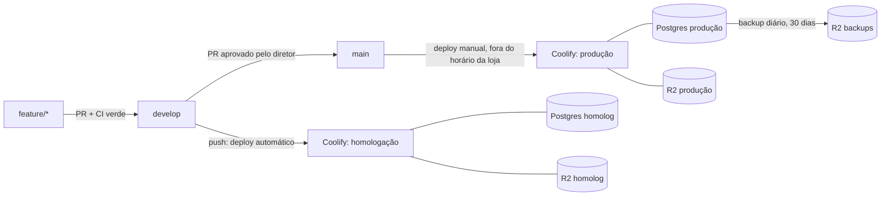

# Deploy, ambientes e backup: SUMMER

> **Status:** rascunho da Entrega 0 (fatias 0.2 e 0.13). Ainda não há repositório no GitHub nem acesso ao Coolify. Os passos de painel estão na seção 12 e as pendências na seção 13.
>
> Documentação do Coolify e do Cloudflare R2 consultada em **03/11/2026**. As fontes estão no fim do documento. Antes de configurar o painel, confira os nomes dos campos na versão instalada do Coolify.

## Sumário

1. [Visão geral](#1-visão-geral)
2. [Ambientes](#2-ambientes)
3. [Imagens e alvos do Dockerfile](#3-imagens-e-alvos-do-dockerfile)
4. [Variáveis de ambiente](#4-variáveis-de-ambiente)
5. [Migrações no deploy](#5-migrações-no-deploy)
6. [Healthcheck](#6-healthcheck)
7. [Como publicar](#7-como-publicar)
8. [Backup](#8-backup)
9. [Restauração](#9-restauração)
10. [Usuários do banco](#10-usuários-do-banco)
11. [Nada preso a provedor](#11-nada-preso-a-provedor)
12. [Passo a passo nos painéis](#12-passo-a-passo-nos-painéis)
13. [Pendências](#13-pendências)
14. [Fontes](#14-fontes)

---

## 1. Visão geral



- Uma VPS da Hostinger com o Coolify.
- Cada ambiente tem **um app** (Next.js) e **um worker** (pg-boss): dois recursos do Coolify, construídos do **mesmo Dockerfile**, com alvos diferentes (`app` e `worker`).
- Cada ambiente tem o próprio Postgres 17 (recurso de banco do Coolify) e o próprio bucket no R2.

## 2. Ambientes

| | Local | Homologação | Produção |
|---|---|---|---|
| Branch | qualquer | `develop` | `main` |
| Deploy | `pnpm dev` | automático a cada push | manual, depois da aprovação do diretor e fora do horário da loja |
| Banco | Postgres do `docker-compose.yml` | Postgres 17 próprio no Coolify | Postgres 17 próprio no Coolify |
| Arquivos | MinIO local (`summer-local`) | bucket R2 próprio | bucket R2 próprio |
| Focus NFe | — | ambiente de **homologação** do Focus | ambiente de **produção** do Focus |
| Mercado Livre | — | credenciais próprias | credenciais próprias |
| Seed de demonstração | sim | sim | **nunca** (`scripts/criar-tenant.ts`) |
| Módulos novos (`empresas.modulos`) | ligados à vontade | ligados para teste | **nascem desligados**; ligar só depois da aprovação |

**Os ambientes não compartilham nada:** nem banco, nem bucket, nem `BETTER_AUTH_SECRET`, nem `CHAVES_CIFRAGEM`, nem credenciais do Focus ou do Mercado Livre. Um token do Focus de produção nunca entra em homologação. Como esses tokens ficam cifrados no banco, a separação de bancos e de chaves de cifragem já garante isso.

## 3. Imagens e alvos do Dockerfile

`Dockerfile` multi-stage na raiz, com Node `22.23.4` (`bookworm-slim`) e pnpm via corepack (a versão vem do `packageManager` do `package.json`):

| Alvo | Para quê | Estado |
|---|---|---|
| `app` | servidor Next.js a partir do `output: "standalone"` (`node server.js`, porta 3000), usuário `node` (uid 1000) e `HEALTHCHECK` em `/api/health` | **ativo** |
| `worker` | consumidor da fila pg-boss (`src/worker/index.ts`) | comentado; habilitar na fatia 0.11 |
| `migrate` | aplica as migrações e sai (D010); usado à mão e em testes de restauração | comentado; habilitar na fatia 0.3 |

- **Nenhum segredo entra na imagem.** Todas as variáveis chegam em runtime. No Coolify, deixe todas como **"Not available during build"** (seção 4).
- O `.dockerignore` tira do contexto `.git`, `node_modules`, `.next`, `.env*`, certificados (`*.pfx`, `*.p12`, `*.pem`), `docs/` e os arquivos de infraestrutura local.
- O cache do pnpm e o `.next/cache` ficam em caches do BuildKit, fora das camadas.
- No Coolify, o alvo é escolhido no campo **"Docker build stage target"** (General → Build, só aparece com o build pack Dockerfile). Quando os alvos `worker` e `migrate` forem habilitados, o último estágio do arquivo deixa de ser o `app`; por isso **o campo precisa estar preenchido nos dois recursos**.

## 4. Variáveis de ambiente

A referência completa, comentada, está no [`.env.example`](../.env.example). **Toda variável nova entra lá e nesta tabela.**

| Variável | App | Worker | Segredo | Homologação × produção |
|---|:-:|:-:|:-:|---|
| `SUMMER_AMBIENTE` | ✓ | ✓ | | `homologacao` / `producao` |
| `PORT` | ✓ | | | `3000` (padrão da imagem) |
| `DATABASE_URL` | ✓ | ✓ | ✓ | usuário `summer_app` do banco do ambiente (seção 10) |
| `DATABASE_URL_MIGRACAO` | ✓ | ✓ | ✓ | usuário `summer_owner` do banco do ambiente; só para migrar (seção 5) |
| `DATABASE_URL_TEST` | | | | só local e CI |
| `DATABASE_POOL_MAX` | ✓ | ✓ | | ex.: app 10, worker 5 |
| `BETTER_AUTH_SECRET` | ✓ | ✓ | ✓ | um por ambiente (`openssl rand -base64 32`) |
| `BETTER_AUTH_URL` | ✓ | ✓ | | domínio HTTPS do ambiente |
| `S3_ENDPOINT` | ✓ | ✓ | | `https://<ACCOUNT_ID>.r2.cloudflarestorage.com` |
| `S3_REGION` | ✓ | ✓ | | `auto` (R2) |
| `S3_BUCKET` | ✓ | ✓ | | bucket do ambiente |
| `S3_ACCESS_KEY_ID` / `S3_SECRET_ACCESS_KEY` | ✓ | ✓ | ✓ | token R2 "Object Read & Write" restrito ao bucket do ambiente |
| `S3_FORCE_PATH_STYLE` | ✓ | ✓ | | `false` no R2 |
| `CHAVES_CIFRAGEM` | ✓ | ✓ | ✓ | uma por ambiente; **guardar cópia num cofre de senhas** |
| `SEED_SENHA_*` | | | ✓ | só homologação (para o `pnpm db:seed`) |
| `PGBOSS_SCHEMA` | ✓ | ✓ | | `pgboss` |
| `WORKER_CONCORRENCIA` | | ✓ | | ex.: `5` |
| `MIGRAR_AO_INICIAR` | ✓ | ✓ | | `true` (se a proposta da seção 5 for aprovada) |
| `MIGRACOES_DIR` | ✓ | ✓ | | opcional: pasta das migrações para o `migrate.mjs` (padrão `src/server/db/migrations`, relativo ao diretório de trabalho) |
| `POSTGRES_*`, `MINIO_*` | | | | só o `docker-compose.yml` local |

No Coolify:

- Cadastre as variáveis em **cada** recurso (app e worker) de **cada** ambiente. Para não repetir, use as variáveis compartilhadas do ambiente (`{{environment.NOME}}`).
- Em todas, **Build time = "Not available during build"** e **Runtime = "Available in the container"**. Nada do SUMMER precisa existir no build.
- Valores com `$` (senhas geradas): **Interpolation = "Literal"**.
- Nunca use o prefixo `NEXT_PUBLIC_` em nada sensível.

## 5. Migrações no deploy

### O que a D010 pede

As migrações rodam **antes** de a nova versão do app e do worker atender, e o deploy para se a migração falhar. As migrações são só aditivas, então a versão anterior continua funcionando com o banco novo.

### O que a documentação atual do Coolify mostra (03/11/2026)

- **Pre-deployment command:** roda **no container atual (o antigo)**, antes de ele ser substituído, e **não roda no primeiro deploy**. Se falhar, o deploy para.
  - Ou seja: ele executaria o código e as migrações **da versão antiga**. A migração nova nunca seria aplicada por ele. **Não serve para o SUMMER.**
- **Post-deployment command:** roda no container novo, mas **depois** de o deploy ser marcado como concluído; a falha só vai para o log. Também não serve: a versão nova já estaria no ar com o banco velho.
- **Rolling update** (build pack Dockerfile): o Coolify sobe o container novo **sem parar o atual** e só remove o antigo quando o novo fica saudável. Se o novo ficar *unhealthy*, **o atual continua no ar**.
  - Exige um healthcheck (sem ele, "container iniciou" já conta como pronto).
  - É desligado se o recurso publicar porta no host ou tiver nome de container fixo.
- **Docker Compose** no Coolify **não tem rolling update**: ele roda `docker compose up` e o Compose recria os serviços.

### Proposta (aguarda aprovação; depois vira uma decisão em `docs/decisoes.md`)

**Opção A, recomendada: migrar na subida do container + rolling update.**

1. As imagens `app` e `worker` levam o script de migração empacotado (`migrate.mjs`, sem drizzle-kit) e um `docker/entrypoint.sh`:

   ```sh
   #!/bin/sh
   set -e
   if [ "${MIGRAR_AO_INICIAR:-false}" = "true" ]; then
     DATABASE_URL="${DATABASE_URL_MIGRACAO:-$DATABASE_URL}" node /app/migrate.mjs
   fi
   # o processo do app não herda a credencial de dono do banco
   unset DATABASE_URL_MIGRACAO
   exec "$@"
   ```

2. O advisory lock do `scripts/migrate.ts` (D010) garante que app e worker, subindo juntos, não migram ao mesmo tempo. Quem chega depois encontra tudo aplicado.
3. Se a migração falhar, o processo sai antes de o servidor subir. O `HEALTHCHECK` nunca fica *healthy*, então o Coolify **mantém a versão anterior no ar** e o deploy aparece como falho. É o "se falhar, o deploy para" da D010.
4. Enquanto a migração roda, a versão anterior continua atendendo, o que é seguro porque as migrações são aditivas.
5. O alvo `migrate` continua existindo para uso manual (`docker run --rm`), para o teste de restauração e para emergências.

Custos da opção A:

- O container do app conhece a credencial de dono do banco. **Mitigação:** o `unset` acima, para que o processo Node não a receba. Ela ainda aparece no `docker inspect`, que só o administrador da VPS acessa.
- Uma migração longa precisa caber no `start-period` do `HEALTHCHECK` (40 s hoje), ou esse valor precisa subir.

**Opção B: recurso Docker Compose no Coolify**, com os serviços `migrate` (one-shot, `exclude_from_hc: true`), `app` (`depends_on: migrate: condition: service_completed_successfully`) e `worker`.

- É o desenho literal da D010, e só o `migrate` conhece a credencial de dono.
- Mas não tem rolling update: há alguns segundos de indisponibilidade a cada deploy, inclusive em homologação.
- A documentação do Coolify não confirma como ele trata o `condition` do `depends_on`. Seria preciso testar no painel.

**Rejeitada: pre-deployment command**, pelos motivos acima.

## 6. Healthcheck

- A rota `GET /api/health` (**a criar na fatia 0.11**) faz `SELECT 1` com timeout curto e responde:
  - `200` com `{ "status": "ok" }` se o banco responder;
  - `503` se não responder.
- Não expõe versão de dependências, variáveis nem mensagens de erro do banco.
- Precisa ser dinâmica: com `cacheComponents` ligado, não pode ser pré-renderizada no build.
- O `HEALTHCHECK` do Dockerfile chama a rota com o `fetch` do próprio Node (a imagem slim não tem curl nem wget): `--interval=15s --timeout=5s --start-period=40s --retries=3`.
- **O Coolify usa o `HEALTHCHECK` do Dockerfile** no lugar do configurado no painel. Não configure outro no painel.
- **Atenção:** enquanto `/api/health` não existir, a imagem fica *unhealthy* (a rota responde 404). O primeiro deploy só deve acontecer depois da fatia 0.11.
- O CI já sobe a imagem e espera o `healthy` (job `imagem`), e esse passo passa a rodar sozinho quando a rota existir.

## 7. Como publicar

### Fluxo de branches

- `feature/*` → PR para `develop`: o CI precisa estar verde. O merge publica automaticamente em **homologação**.
- O diretor testa em homologação, seguindo o roteiro de `docs/homologacao/`.
- Com a aprovação, abre-se um PR `develop` → `main`. O merge **não** publica sozinho.
- O deploy de produção é **manual**, **fora do horário de funcionamento da loja**, e segue o checklist abaixo.

### Versão

- Versão semântica (`vMAJOR.MINOR.PATCH`) com tag no commit da `main` que foi para produção, por exemplo `git tag -a v0.1.0 -m "Entrega 0"` seguido de `git push origin v0.1.0`.
- O `CHANGELOG.md` (em português, o que a loja vê de novo) é atualizado no mesmo PR.

### Checklist do deploy de produção

1. Está fora do horário da loja (**horário a confirmar com o diretor**)?
2. O CI da `main` está verde.
3. O `CHANGELOG.md` e a versão estão atualizados.
4. **Backup antes:** no Coolify, banco de produção → Backups → **"Back up now"**. Espere terminar com sucesso e confira o arquivo no bucket de backups do R2.
5. Deploy do **worker** e do **app** de produção (botão Deploy de cada recurso).
6. Acompanhe o log: a migração precisa aparecer aplicada, e o container novo precisa ficar *healthy*.
7. Abra `https://<domínio>/api/health`, faça login e confira a tela principal da entrega.
8. Crie e envie a tag da versão.
9. Se algo der errado:
   - **app com erro:** Coolify → Rollback → imagem anterior. O banco continua compatível, porque as migrações são aditivas. O rollback não volta variáveis de ambiente nem o banco;
   - **dados corrompidos:** restaure o backup do passo 4 (seção 9).

## 8. Backup

### Diário, automático, para o R2 (produção)

Use o backup agendado do próprio Coolify no recurso Postgres de produção:

1. **R2:** crie o bucket `summer-backups-producao` e um token "Object Read & Write" **só para ele** (diferente do token do app).
2. **Coolify → S3 Storages → adicionar.**
   - Endpoint: `https://<ACCOUNT_ID>.r2.cloudflarestorage.com` (o formulário separa protocolo, host, porta e caminho).
   - Região: `auto`.
   - Bucket: `summer-backups-producao`.
   - Chaves do token.
   - Valide. O Coolify faz um `ListObjectsV2`, e o bucket precisa existir antes.
3. **Banco de produção → Backups → "+ Add".**
   - Frequência diária às 3h no horário de Brasília: `0 3 * * *` se o fuso do servidor for `America/Sao_Paulo`, ou `0 6 * * *` se for UTC. O campo Timezone é só leitura e segue o servidor.
   - Selecione só o banco `summer`, que gera o formato *custom* do `pg_dump`.
   - S3: habilite o destino R2, com retenção de **30 dias** ("Days to keep" do destino).
   - Local: retenção de 7 dias, ou "Delete after S3 upload".
4. **Defesa em profundidade:** no R2, crie uma regra de ciclo de vida (Settings → Object Lifecycle Rules) que apague os objetos do bucket de backups depois de **35 dias**. Se a limpeza do Coolify falhar, o bucket não cresce para sempre. Os 5 dias de folga evitam que a regra apague antes dos 30 prometidos.
5. Use "Back up now" uma vez e confira o arquivo no R2.

Homologação: o mesmo procedimento, com o bucket `summer-backups-homologacao` e retenção de 7 dias. É opcional, mas ajuda a testar a restauração sem tocar em produção.

### Antes de cada deploy em produção

O "Back up now" do passo 4 do checklist da seção 7.

### Alternativa sem o recurso do Coolify

Se o banco não for um recurso gerenciado pelo Coolify, ou se o Coolify for trocado:

- uma tarefa agendada roda `pg_dump --format=custom` num container `postgres:17.11-bookworm`;
- envia o arquivo com qualquer cliente S3 (`rclone`, `aws s3 cp`);
- a retenção fica pela regra de ciclo de vida do R2.

Nada no formato depende do Coolify.

### Arquivos no R2 (fotos, XMLs, PDFs)

O backup do banco **não** inclui os arquivos do storage. Os XMLs fiscais precisam ser guardados por 5 anos (regra 4.16). Ver a pendência sobre retenção e cópia do bucket na seção 13.

## 9. Restauração

**Nunca restaure por cima do banco de produção em uso sem antes parar o app e o worker e fazer um backup do estado atual.**

### Opção 1: pelo Coolify

1. Pare o app e o worker do ambiente.
2. Faça "Back up now" do estado atual (mesmo que esteja ruim).
3. Banco → **Import Backup** → origem **S3 storage** → caminho do arquivo no bucket → **Check file**.
4. Revise as opções:
   - "Replace objects that already exist" (desligado por padrão);
   - "Keep owners and privileges" (desligado por padrão).

   A restauração do PostgreSQL roda numa única transação.
5. Acompanhe o "Database Restore Output" até o fim.
6. Ligue o worker e o app, abra `/api/health` e confira os dados.

### Opção 2: manual, com `pg_restore` (funciona fora do Coolify)

```sh
# 1. baixar o dump do R2 (exemplo com rclone já configurado para o R2)
rclone copy r2:summer-backups-producao/<caminho>/<arquivo>.dmp ./restauracao/

# 2. criar um banco descartável e restaurar
createdb -h <host> -U summer_owner summer_restaurado
pg_restore -h <host> -U summer_owner -d summer_restaurado \
  --no-owner --role=summer_owner --exit-on-error --single-transaction \
  ./restauracao/<arquivo>.dmp

# 3. conferir
psql -h <host> -U summer_owner -d summer_restaurado -c \
  "SELECT count(*) FROM drizzle.__drizzle_migrations"
```

Depois:

- compare a lista de migrações aplicadas com `src/server/db/migrations/`;
- conte as linhas das tabelas principais (empresas, produtos, vendas, `movimentacoes_estoque`);
- regrave os `GRANT`s da seção 10, porque o `--no-owner` não traz privilégios.

### Teste de restauração (obrigatório uma vez, seção 6 da especificação)

Restaure o backup mais recente de produção num banco **descartável**, suba uma cópia do app apontando para ele e confira login, uma empresa e uma consulta. Um backup só vale depois de restaurado uma vez.

| Data | Ambiente de origem | Arquivo | Opção usada | Responsável | Resultado |
|---|---|---|---|---|---|
| _pendente_ | | | | | |

## 10. Usuários do banco

O Coolify cria o Postgres com um superusuário. **Nem o app nem o worker usam esse usuário.** Uma vez por ambiente, conectado como superusuário (Terminal do recurso no Coolify, `psql`):

```sql
-- senhas geradas com: openssl rand -base64 24
CREATE ROLE summer_owner LOGIN PASSWORD '<senha-dono>';
CREATE ROLE summer_app   LOGIN PASSWORD '<senha-app>';

ALTER DATABASE summer OWNER TO summer_owner;
\c summer
ALTER SCHEMA public OWNER TO summer_owner;
REVOKE ALL ON DATABASE summer FROM PUBLIC;
GRANT CONNECT ON DATABASE summer TO summer_app;
GRANT USAGE ON SCHEMA public TO summer_app;

-- tudo o que o summer_owner criar (via migração) nasce com DML para o app,
-- SEM TRUNCATE e sem DDL
ALTER DEFAULT PRIVILEGES FOR ROLE summer_owner IN SCHEMA public
  GRANT SELECT, INSERT, UPDATE, DELETE ON TABLES TO summer_app;
ALTER DEFAULT PRIVILEGES FOR ROLE summer_owner IN SCHEMA public
  GRANT USAGE, SELECT ON SEQUENCES TO summer_app;
```

- **Migrações** (`DATABASE_URL_MIGRACAO`) usam `summer_owner`. **App e worker** (`DATABASE_URL`) usam `summer_app`.
- **Append-only (modelo 1.6, D008):** o gatilho bloqueia `UPDATE` e `DELETE` em `movimentacoes_estoque`, `auditoria` e `os_historico_status` (e `comissao_ajustes`, que só aceita o UPDATE que preenche o acerto), mas **gatilho não impede `TRUNCATE`**. Por isso o `summer_app` nunca recebe `TRUNCATE`.
  - Como reforço, depois da primeira migração:

    ```sql
    REVOKE TRUNCATE, UPDATE, DELETE
      ON movimentacoes_estoque, auditoria, os_historico_status
      FROM summer_app;
    -- comissao_ajustes precisa do UPDATE que grava o acerto
    REVOKE TRUNCATE, DELETE ON comissao_ajustes FROM summer_app;
    ```

  - Verificação (precisa devolver `f`):

    ```sql
    SELECT has_table_privilege('summer_app', 'movimentacoes_estoque', 'TRUNCATE'),
           has_table_privilege('summer_app', 'auditoria', 'TRUNCATE');
    ```
- **pg-boss** cria o próprio schema (`PGBOSS_SCHEMA`) ao iniciar. A fatia 0.11 decide entre duas opções: o `summer_owner` cria o schema durante a migração e dá os privilégios ao `summer_app`, ou o worker recebe `CREATE` só nesse schema.
- O Postgres **não** fica exposto na internet ("Make it publicly available" desligado). App e worker usam a URL interna que o Coolify mostra no recurso.

## 11. Nada preso a provedor

- **Imagens:** Docker puro. O mesmo `Dockerfile` roda em qualquer host com Docker.
- **Banco:** Postgres 17 oficial. Os backups são `pg_dump` em formato padrão.
- **Arquivos:** qualquer storage compatível com S3, configurado por `S3_*`. Trocar R2 por MinIO, AWS ou outro é trocar variáveis e copiar o bucket.
- **Configuração:** só por variável de ambiente.
- **O Coolify só orquestra.** Sair dele exige recriar os recursos (dois containers + Postgres + agendamento do backup) em outro orquestrador ou num `compose` de produção.
- **Ressalva local:** o MinIO oficial deixou de publicar imagens Docker em 2025. O `docker-compose.yml` usa o fork comunitário `pgsty/minio` (D014). Ele só é usado em desenvolvimento, e qualquer storage S3 serve no lugar.

## 12. Passo a passo nos painéis

### GitHub

1. Crie o repositório **privado** e envie `main` e `develop`:

   ```sh
   git remote add origin git@github.com:<org>/summer-motos.git
   git push -u origin main
   git push -u origin develop
   ```

2. Em Settings → Branches, crie regras de proteção para `main` e `develop`:
   - exigir PR;
   - exigir os checks do CI: `Lint`, `Typecheck`, `Testes de domínio`, `Migrações e testes de integração`, `Build do Next` e `Imagem Docker e docker-compose`;
   - bloquear push direto;
   - na `main`, exigir 1 aprovação.
3. Em Settings → Actions → General:
   - "Workflow permissions" = **Read repository contents**;
   - "Allow GitHub Actions to create and approve pull requests" desligado.
4. **Nenhum secret de produção** no GitHub. O CI não precisa de nenhum.

### Cloudflare R2

1. Crie 4 buckets:
   - `summer-arquivos-homologacao`;
   - `summer-arquivos-producao`;
   - `summer-backups-homologacao`;
   - `summer-backups-producao`.
2. Crie um token "Object Read & Write" **por bucket**, cada um restrito ao seu bucket.
3. Crie a regra de ciclo de vida de 35 dias nos buckets de backup (seção 8). **Não** crie regra de expiração nos buckets de arquivos, onde ficam os XMLs fiscais.
4. Anote o Account ID, que vai no endpoint.

### Coolify (repita para homologação e produção)

1. **Projeto** "SUMMER" com dois ambientes: `homologacao` e `producao`.
2. **Fonte:** conecte o GitHub pelo GitHub App do Coolify, com acesso só a este repositório.
3. **Banco:**
   - New Resource → Database → PostgreSQL;
   - imagem `postgres:17.11-bookworm`;
   - sem acesso público.
   - Depois de criado, rode o SQL da seção 10.
4. **App:**
   - New Resource → Application → repositório;
   - branch `develop` (homologação) ou `main` (produção);
   - build pack **Dockerfile**: Base Directory `/`, Dockerfile Location `/Dockerfile`, **"Docker build stage target" = `app`**;
   - Ports Exposes `3000`;
   - domínio HTTPS do ambiente;
   - **sem** port mapping para o host e **sem** nome de container fixo, porque os dois desligam o rolling update;
   - Healthcheck: deixe o do Dockerfile (não configure no painel);
   - variáveis da seção 4, todas "Not available during build";
   - Auto deploy: **ligado em homologação, desligado em produção**.
5. **Worker:** igual ao app, com **"Docker build stage target" = `worker`** e **sem domínio**. Habilite só depois da fatia 0.11.
6. **Backups:** seção 8.
7. **Rollback:** em Advanced, mantenha "Images to keep" ≥ 3, para ter versões anteriores disponíveis.
8. **Prova de vida:**
   - deploy;
   - `/api/health` com 200;
   - login;
   - em homologação, `pnpm db:seed` pelo terminal do container (quando o seed existir).

## 13. Pendências

- [ ] **Repositório no GitHub** (privado), proteção de branches e primeiro push (seção 12).
- [ ] **Acesso ao Coolify:** versão instalada e conferência dos nomes dos campos citados aqui.
- [ ] **Conta Cloudflare / R2:** buckets, tokens e Account ID.
- [ ] **Domínios e DNS** de homologação e produção.
- [ ] **Horário de funcionamento da loja**, para definir a janela de deploy de produção.
- [ ] **Aprovar a forma de migrar no deploy** (seção 5, opção A ou B) e registrar em `docs/decisoes.md` (complementa a D010).
- [x] Fatia 0.3: `scripts/migrate.ts` lendo `DATABASE_URL_MIGRACAO` (com fallback para `DATABASE_URL`), com advisory lock (D023). Empacota em JS puro com esbuild (`--bundle --platform=node --format=esm --packages=external`), conferido.
- [ ] Alvo `migrate` do Dockerfile, `docker/entrypoint.sh` e o passo de build que gera `dist/migrate.mjs`.
- [ ] Fatia 0.11: `/api/health`, alvo `worker` (com tratamento de `SIGTERM` e arquivo de batimento para o healthcheck) e schema do pg-boss com o usuário restrito (seção 10).
- [ ] **Teste de restauração** feito uma vez, com a data registrada na seção 9.
- [ ] **Cofre de senhas** para `CHAVES_CIFRAGEM`, `BETTER_AUTH_SECRET` e senhas do banco de produção. Perder a `CHAVES_CIFRAGEM` = perder os tokens do Focus e do Mercado Livre.
- [ ] **XMLs fiscais por 5 anos (regra 4.16):** avaliar retenção/bloqueio de objetos no bucket de arquivos de produção (o R2 tem bucket locks; conferir) e uma cópia periódica para outro destino.
- [ ] **Capacidade da VPS:** cada push faz 2 builds (app e worker) na própria VPS, e os 2 ambientes dividem a máquina. Se faltar memória no `next build`, alternativas: build server do Coolify, ou imagens construídas no GitHub Actions e publicadas num registry.
- [ ] Inconsistência a resolver: a D007 cita `APP_ENCRYPTION_KEY`, mas o modelo de dados 1.7 (e este documento) usa `CHAVES_CIFRAGEM`.

## 14. Fontes

Consultadas em 03/11/2026:

- Coolify, build pack Dockerfile: Base Directory, Dockerfile Location, healthcheck e pre/post-deployment. https://coolify.io/docs/applications/builds/dockerfile
- Coolify, rolling updates: condições e comportamento com container *unhealthy*; Compose sem rolling update. https://coolify.io/docs/knowledge-base/rolling-updates
- Coolify, health checks: o `HEALTHCHECK` do Dockerfile tem precedência sobre o do painel. https://coolify.io/docs/knowledge-base/health-checks
- Coolify, campo "Docker build stage target" (`dockerfileTargetBuild`), no código-fonte da tela General (a documentação não lista o campo). https://github.com/coollabsio/coolify/blob/v4.x/resources/views/livewire/project/application/general.blade.php
- Coolify, Docker Compose (`exclude_from_hc`, variáveis `SERVICE_*`). https://coolify.io/docs/knowledge-base/docker/compose
- Coolify, variáveis de ambiente (Build time / Runtime / Interpolation). https://coolify.io/docs/knowledge-base/environment-variables
- Coolify, backups de banco: agendamento, S3, retenção e formato custom do `pg_dump`. https://coolify.io/docs/databases/backups
- Coolify, restauração (Import Backup). https://coolify.io/docs/databases/restore
- Coolify, S3 storage. https://coolify.io/docs/core/s3-storage/overview
- Coolify, rollbacks. https://coolify.io/docs/applications/deployments/rollbacks
- Cloudflare R2, API S3 (endpoint e região `auto`). https://developers.cloudflare.com/r2/api/s3/api/
- Cloudflare R2, ciclo de vida de objetos. https://developers.cloudflare.com/r2/buckets/object-lifecycles/
- Next.js 16.4, `output: "standalone"`: `node_modules/next/dist/docs/01-app/03-api-reference/05-config/01-next-config-js/output.md`
