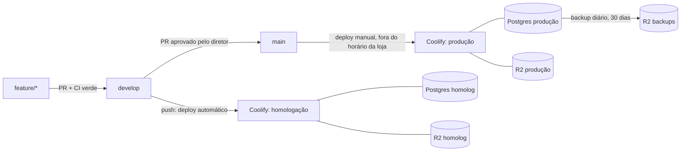

# Deploy, ambientes e backup: SUMMER

> **Status:** Entrega 0 (fatias 0.2, 0.11 e 0.13). Imagens `app`, `worker` e `migrate`, healthcheck e migração na subida (D020) prontos e testados com Docker local em 03/11/2026 (seção 5). Ainda não há repositório no GitHub nem acesso ao Coolify. Os passos de painel estão na seção 12 e as pendências na seção 13.
>
> Documentação do Coolify, do pg-boss e do Cloudflare R2 consultada em **03/11/2026**. As fontes estão no fim do documento. Antes de configurar o painel, confira os nomes dos campos na versão instalada do Coolify.

## Sumário

1. [Visão geral](#1-visão-geral)
2. [Ambientes](#2-ambientes)
3. [Imagens e alvos do Dockerfile](#3-imagens-e-alvos-do-dockerfile)
4. [Variáveis de ambiente](#4-variáveis-de-ambiente)
5. [Migrações no deploy](#5-migrações-no-deploy)
6. [Healthcheck](#6-healthcheck)
7. [Como publicar](#7-como-publicar)
8. [Backup](#8-backup)
9. [Restauração](#9-restauração)
10. [Usuários do banco](#10-usuários-do-banco)
11. [Nada preso a provedor](#11-nada-preso-a-provedor)
12. [Passo a passo nos painéis](#12-passo-a-passo-nos-painéis)
13. [Pendências](#13-pendências)
14. [Fontes](#14-fontes)

---

## 1. Visão geral



- Uma VPS da Hostinger com o Coolify.
- Cada ambiente tem **um app** (Next.js) e **um worker** (pg-boss): dois recursos do Coolify, construídos do **mesmo Dockerfile**, com alvos diferentes (`app` e `worker`).
- Cada ambiente tem o próprio Postgres 17 (recurso de banco do Coolify) e o próprio bucket no R2.

## 2. Ambientes

| | Local | Homologação | Produção |
|---|---|---|---|
| Branch | qualquer | `develop` | `main` |
| Deploy | `pnpm dev` | automático a cada push | manual, depois da aprovação do diretor e fora do horário da loja |
| Banco | Postgres do `docker-compose.yml` | Postgres 17 próprio no Coolify | Postgres 17 próprio no Coolify |
| Arquivos | MinIO local (`summer-local`) | bucket R2 próprio | bucket R2 próprio |
| Focus NFe | — | ambiente de **homologação** do Focus | ambiente de **produção** do Focus |
| Mercado Livre | — | credenciais próprias | credenciais próprias |
| Seed de demonstração | sim | sim | **nunca** (`scripts/criar-tenant.ts`) |
| Módulos novos (`empresas.modulos`) | ligados à vontade | ligados para teste | **nascem desligados**; ligar só depois da aprovação |

**Os ambientes não compartilham nada:** nem banco, nem bucket, nem `BETTER_AUTH_SECRET`, nem `CHAVES_CIFRAGEM`, nem credenciais do Focus ou do Mercado Livre. Um token do Focus de produção nunca entra em homologação. Como esses tokens ficam cifrados no banco, a separação de bancos e de chaves de cifragem já garante isso.

## 3. Imagens e alvos do Dockerfile

`Dockerfile` multi-stage na raiz, com Node `22.23.4` (`bookworm-slim`) e pnpm via corepack (a versão vem do `packageManager` do `package.json`):

| Alvo | Para quê | Processo | HEALTHCHECK |
|---|---|---|---|
| `app` | servidor Next.js a partir do `output: "standalone"`, porta 3000 | `node server.js` | `GET /api/health` (seção 6) |
| `worker` | consumidor da fila pg-boss (`src/worker/index.ts`) | `node dist/worker.mjs` | idade do arquivo de batimento (< 60 s) |
| `migrate` | aplica as migrações e sai (D010); uso manual: restauração, emergência, CI | `node dist/migrate.mjs` | — |

- **Todas rodam como o usuário `node` (uid 1000).** O código fica com dono root, só leitura para o `node`; só o `.next` do app pertence ao `node`, porque o Next grava cache em runtime.
- **O `app` é o último estágio:** `docker build .` sem `--target` gera o app.
- **`dist/migrate.mjs` e `dist/worker.mjs`** são gerados no estágio `build` por `pnpm build:scripts` (`scripts/build-scripts.mjs`, esbuild). Cada um é **autossuficiente** (pg, pg-boss e drizzle-orm embutidos, cerca de 1,3 MB e 1,7 MB), então:
  - o `worker` e o `migrate` não levam `node_modules` (imagens de cerca de 330 MB, quase tudo a base do Node);
  - o `migrate.mjs` roda dentro da imagem standalone do app, cujo `node_modules` só tem o que o Next rastreou.
  - O `server-only` é proibido nesses bundles: o build falha se algum import o puxar.
- **`app` e `worker` usam o `docker/entrypoint.sh`:** com `MIGRAR_AO_INICIAR=true`, migram antes de subir (seção 5). As duas imagens levam o `migrate.mjs` e as migrações SQL.
- **Versão:** `--build-arg SUMMER_VERSAO=v0.1.0` (opcional). Sem ela, vale o `version` do `package.json`. Aparece no `/api/health` e no log do worker.
- **Nenhum segredo entra na imagem.** Todas as variáveis chegam em runtime. No Coolify, deixe todas como **"Not available during build"** (seção 4).
- O `.dockerignore` tira do contexto `.git`, `node_modules`, `.next`, `dist`, `.env*`, certificados (`*.pfx`, `*.p12`, `*.pem`), `docs/` e os arquivos de infraestrutura local.
- O cache do pnpm e o `.next/cache` ficam em caches do BuildKit, fora das camadas.
- No Coolify, o alvo é escolhido no campo **"Docker build stage target"** (General → Build, só aparece com o build pack Dockerfile). **Preencha nos dois recursos** (`app` e `worker`).

Build local:

```sh
docker buildx build --target app     -t summer-app     --load .
docker buildx build --target worker  -t summer-worker  --load .
docker buildx build --target migrate -t summer-migrate --load .
```

## 4. Variáveis de ambiente

A referência completa, comentada, está no [`.env.example`](../.env.example). **Toda variável nova entra lá e nesta tabela.**

| Variável | App | Worker | Segredo | Homologação × produção |
|---|:-:|:-:|:-:|---|
| `SUMMER_AMBIENTE` | ✓ | ✓ | | `homologacao` / `producao` |
| `SUMMER_VERSAO` | ✓ | ✓ | | **build arg** opcional da imagem (ex.: a tag `v0.1.0`); sem ela, o `version` do `package.json`. Não precisa cadastrar no Coolify |
| `PORT` | ✓ | | | `3000` (padrão da imagem) |
| `DATABASE_URL` | ✓ | ✓ | ✓ | usuário `summer_app` do banco do ambiente (seção 10) |
| `DATABASE_URL_MIGRACAO` | ✓ | ✓ | ✓ | usuário `summer_owner` do banco do ambiente; só para migrar. O entrypoint a remove do ambiente antes de iniciar o Node (seção 5) |
| `DATABASE_URL_TEST` | | | | só local e CI |
| `DATABASE_POOL_MAX` | ✓ | ✓ | | ex.: app 10, worker 5 |
| `BETTER_AUTH_SECRET` | ✓ | ✓ | ✓ | um por ambiente (`openssl rand -base64 32`) |
| `BETTER_AUTH_URL` | ✓ | ✓ | | domínio HTTPS do ambiente. Em produção (`NODE_ENV=production`), se não for `https://`, a autenticação recusa a configuração: login e telas dão erro já na primeira requisição, com a causa no log |
| `BETTER_AUTH_TRUSTED_PROXIES` | ✓ | | | **obrigatória em produção** (vazia, a autenticação recusa a configuração, como faz com o `BETTER_AUTH_SECRET`): IPs/CIDRs dos proxies à frente do app, para o limite de tentativas do login achar o IP real no `x-forwarded-for`. No Coolify, a sub-rede da rede Docker do proxy (Traefik): `docker network inspect coolify --format '{{(index .IPAM.Config 0).Subnet}}'` (ex.: `10.0.1.0/24`). Com Cloudflare em modo proxy na frente, acrescente as faixas da Cloudflare. Nunca uma faixa de onde vêm clientes |
| `BETTER_AUTH_TRUSTED_ORIGINS` | ✓ | | | opcional: outras origens aceitas no login, além da do `BETTER_AUTH_URL` (lista separada por vírgula). Normalmente vazia |
| `S3_ENDPOINT` | ✓ | ✓ | | `https://<ACCOUNT_ID>.r2.cloudflarestorage.com` |
| `S3_REGION` | ✓ | ✓ | | `auto` (R2) |
| `S3_BUCKET` | ✓ | ✓ | | bucket do ambiente |
| `S3_ACCESS_KEY_ID` / `S3_SECRET_ACCESS_KEY` | ✓ | ✓ | ✓ | token R2 "Object Read & Write" restrito ao bucket do ambiente |
| `S3_FORCE_PATH_STYLE` | ✓ | ✓ | | `false` no R2 |
| `CHAVES_CIFRAGEM` | ✓ | ✓ | ✓ | uma por ambiente; **guardar cópia num cofre de senhas** |
| `SEED_SENHA_*` | | | ✓ | só homologação (para o `pnpm db:seed`) |
| `PGBOSS_SCHEMA` | ✓ | ✓ | | `pgboss` (só minúsculas, dígitos e `_`); o `migrate` cria o schema |
| `WORKER_CONCORRENCIA` | | ✓ | | ex.: `5` (de 1 a 50) |
| `MIGRAR_AO_INICIAR` | ✓ | ✓ | | `true` nos dois (D020) |
| `MIGRACOES_DIR` | ✓ | ✓ | | opcional: pasta das migrações para o `migrate.mjs` (padrão `src/server/db/migrations`, relativo ao diretório de trabalho) |
| `POSTGRES_*`, `MINIO_*` | | | | só o `docker-compose.yml` local |

No Coolify:

- Cadastre as variáveis em **cada** recurso (app e worker) de **cada** ambiente. Para não repetir, use as variáveis compartilhadas do ambiente (`{{environment.NOME}}`).
- Em todas, **Build time = "Not available during build"** e **Runtime = "Available in the container"**. Nada do SUMMER precisa existir no build.
- Valores com `$` (senhas geradas): **Interpolation = "Literal"**.
- Nunca use o prefixo `NEXT_PUBLIC_` em nada sensível.

## 5. Migrações no deploy

### Decisão (D020, opção A): migrar na subida do container, com rolling update

A D010 pede que as migrações rodem **antes** de a nova versão atender e que o deploy pare se a migração falhar. As migrações são só aditivas, então a versão anterior continua funcionando com o banco novo.

Por que não os comandos do Coolify (documentação de 03/11/2026):

- **Pre-deployment command:** roda **no container atual (o antigo)** e **não roda no primeiro deploy**. Executaria as migrações da versão antiga.
- **Post-deployment command:** roda no container novo, mas **depois** de o deploy ser marcado como concluído; a falha só vai para o log.
- **Rolling update** (build pack Dockerfile): o Coolify sobe o container novo **sem parar o atual** e só remove o antigo quando o novo fica *healthy*. Se o novo não ficar, **o atual continua no ar**. Exige healthcheck e é desligado se o recurso publicar porta no host ou tiver nome de container fixo.
- **Docker Compose** no Coolify **não tem rolling update** (opção B, descartada: alguns segundos fora do ar a cada deploy).

### Como funciona

`docker/entrypoint.sh` (app e worker):

1. Se `MIGRAR_AO_INICIAR=true`:
   - exige `DATABASE_URL_MIGRACAO` (sem ela, sai com erro);
   - roda `node /app/dist/migrate.mjs`, que, com o advisory lock da D023:
     1. aplica as migrações pendentes do Drizzle (todas numa transação);
     2. cria ou migra o schema do pg-boss (`PGBOSS_SCHEMA`);
     3. se o usuário de `DATABASE_URL` for outro (o `summer_app`), concede a ele só o uso da fila (seção 10).
   - se falhar, **sai com código 1**: o processo não sobe, o container nunca fica *healthy* e a versão anterior continua no ar.
2. `unset DATABASE_URL_MIGRACAO`: o processo Node não herda a credencial de dono.
3. `exec` do processo (`node server.js` ou `node dist/worker.mjs`), que vira o PID 1 e recebe o SIGTERM.

- App e worker sobem juntos e os dois tentam migrar: o advisory lock serializa. Quem chega depois encontra tudo aplicado.
- Enquanto a migração roda, a versão anterior continua atendendo.
- O `start-period` dos dois HEALTHCHECKs é de **60 s**. Uma migração mais longa que isso precisa de uma janela própria (rode o alvo `migrate` à mão antes do deploy) ou de um `start-period` maior.
- A credencial de dono ainda aparece no `docker inspect`, que só o administrador da VPS acessa.

### Uso manual do alvo `migrate`

```sh
docker run --rm \
  -e DATABASE_URL_MIGRACAO='postgres://summer_owner:<senha>@<host>:5432/summer' \
  -e DATABASE_URL='postgres://summer_app:<senha>@<host>:5432/summer' \
  summer-migrate
```

`DATABASE_URL` é opcional aqui: serve só para saber a quem conceder o uso da fila. Sai com 0 (inclusive sem pendência) ou 1.

### O schema do pg-boss

O `summer_app` não tem `CREATE` no banco. A documentação do pg-boss 12 (página *Install*) recomenda, para um usuário sem `CREATE`, criar e migrar o schema fora da aplicação (pela CLI ou pelas funções estáticas) e iniciar o pg-boss com `migrate: false`. O `migrate` do SUMMER faz isso com a credencial de dono, pelo mesmo procedimento do `pg-boss migrate` da CLI (`src/server/fila/instalar.ts`):

- schema ausente: `getConstructionPlans()`;
- versão antiga: a migração do pg-boss numa transação e, depois, os `CREATE INDEX CONCURRENTLY`, sem depender do BAM (que só roda numa instância com `migrate: true`);
- a cada atualização do pacote `pg-boss`, revise esse arquivo. O teste de integração `tests/integration/fila.test.ts` cobre a instalação e a migração a partir da versão anterior.

O worker sobe com `migrate: false`, `createSchema: false`, `reindex: false` e filas não particionadas: nenhuma DDL em runtime. Se o schema da fila estiver desatualizado, o `start()` do pg-boss falha e o worker sai com erro.

### Testado em 03/11/2026 (Docker local, banco descartável `summer_docker_teste`, papéis restritos criados só para o teste)

| Cenário | Resultado |
|---|---|
| App e worker sobem juntos num banco vazio com `MIGRAR_AO_INICIAR=true` | o app obteve o lock e aplicou as 19 migrações e o pg-boss; o worker esperou e achou tudo aplicado; os dois *healthy* em ~9 s |
| `/api/health` | 200 `{"status":"ok","banco":"ok","versao":"0.1.0-teste"}`, `Cache-Control: no-store` |
| `DATABASE_URL_MIGRACAO` no processo Node (`/proc/1/environ`) | ausente nos dois |
| Alvo `migrate` de novo | "nenhuma migração pendente", saída 0 |
| Senha de dono errada | o migrate falha, o entrypoint sai com 1, o servidor não sobe |
| `MIGRAR_AO_INICIAR=true` sem `DATABASE_URL_MIGRACAO` | sai com 1, com mensagem clara |
| App apontando para porta sem Postgres | `/api/health` 503 `{"status":"erro","banco":"indisponivel",...}`; container `unhealthy` depois do `start-period` |
| Container saudável perde a rede do banco e depois recupera | 503 sem rede, 200 de novo ao reconectar; o worker suspende o batimento e retoma |
| Worker como `summer_app` (sem DDL) | processa `sistema.ping`, sem erro de privilégio do pg-boss em vários minutos |
| `docker stop` do worker | parada graciosa em ~1 s, saída 0, batimento apagado |
| Usuário das três imagens | `node` |

## 6. Healthcheck

### App: `GET /api/health` (`src/app/api/health/route.ts`)

- Faz `select 1` no Pool do app, com prazo de **2 s** (`src/server/saude.ts`), e responde:
  - `200` com `{ "status": "ok", "banco": "ok", "versao": "..." }`;
  - `503` com `{ "status": "erro", "banco": "indisponivel", "versao": "..." }` se o banco recusar, demorar ou der erro.
- Não expõe mensagem de erro, URL, variáveis nem versões de dependências. `Cache-Control: no-store`.
- Dinâmica: com `cacheComponents`, chama `connection()` antes do banco, e o `next build` a lista como `ƒ`.
- Pública: o `proxy.ts` não intercepta `/api/*`.
- O `HEALTHCHECK` do Dockerfile chama a rota com o `fetch` do próprio Node (a imagem slim não tem curl nem wget): `--interval=15s --timeout=5s --start-period=60s --retries=3`.

### Worker: arquivo de batimento

- A cada 15 s, se o `select 1` do worker responde, ele regrava `/tmp/summer-worker-batimento` com a hora.
- O `HEALTHCHECK` exige um batimento com menos de 60 s. Banco fora por mais de ~1 minuto: o worker fica *unhealthy* (o pg-boss tenta de novo sozinho quando o banco volta).
- No SIGTERM, o worker apaga o arquivo, para de buscar jobs, espera os em andamento por até **8 s** (cabe nos 10 s padrão do `docker stop`) e sai com 0.

### No Coolify

- **O Coolify usa o `HEALTHCHECK` do Dockerfile** no lugar do configurado no painel. Não configure outro no painel.
- O rolling update depende dele (seção 5).

## 7. Como publicar

### Fluxo de branches

- `feature/*` → PR para `develop`: o CI precisa estar verde. O merge publica automaticamente em **homologação**.
- O diretor testa em homologação, seguindo o roteiro de `docs/homologacao/`.
- Com a aprovação, abre-se um PR `develop` → `main`. O merge **não** publica sozinho.
- O deploy de produção é **manual**, **fora do horário de funcionamento da loja**, e segue o checklist abaixo.

### Versão

- Versão semântica (`vMAJOR.MINOR.PATCH`) com tag no commit da `main` que foi para produção, por exemplo `git tag -a v0.1.0 -m "Entrega 0"` seguido de `git push origin v0.1.0`.
- O `CHANGELOG.md` (em português, o que a loja vê de novo) é atualizado no mesmo PR.

### Checklist do deploy de produção

1. Está fora do horário da loja (**horário a confirmar com o diretor**)?
2. O CI da `main` está verde.
3. O `CHANGELOG.md` e a versão estão atualizados.
4. **Backup antes:** no Coolify, banco de produção → Backups → **"Back up now"**. Espere terminar com sucesso e confira o arquivo no bucket de backups do R2.
5. Deploy do **worker** e do **app** de produção (botão Deploy de cada recurso).
6. Acompanhe o log: a migração precisa aparecer aplicada, e o container novo precisa ficar *healthy*.
7. Abra `https://<domínio>/api/health`, faça login e confira a tela principal da entrega.
8. Crie e envie a tag da versão.
9. Se algo der errado:
   - **app com erro:** Coolify → Rollback → imagem anterior. O banco continua compatível, porque as migrações são aditivas. O rollback não volta variáveis de ambiente nem o banco;
   - **dados corrompidos:** restaure o backup do passo 4 (seção 9).

## 8. Backup

### Diário, automático, para o R2 (produção)

Use o backup agendado do próprio Coolify no recurso Postgres de produção:

1. **R2:** crie o bucket `summer-backups-producao` e um token "Object Read & Write" **só para ele** (diferente do token do app).
2. **Coolify → S3 Storages → adicionar.**
   - Endpoint: `https://<ACCOUNT_ID>.r2.cloudflarestorage.com` (o formulário separa protocolo, host, porta e caminho).
   - Região: `auto`.
   - Bucket: `summer-backups-producao`.
   - Chaves do token.
   - Valide. O Coolify faz um `ListObjectsV2`, e o bucket precisa existir antes.
3. **Banco de produção → Backups → "+ Add".**
   - Frequência diária às 3h no horário de Brasília: `0 3 * * *` se o fuso do servidor for `America/Sao_Paulo`, ou `0 6 * * *` se for UTC. O campo Timezone é só leitura e segue o servidor.
   - Selecione só o banco `summer`, que gera o formato *custom* do `pg_dump`.
   - S3: habilite o destino R2, com retenção de **30 dias** ("Days to keep" do destino).
   - Local: retenção de 7 dias, ou "Delete after S3 upload".
4. **Defesa em profundidade:** no R2, crie uma regra de ciclo de vida (Settings → Object Lifecycle Rules) que apague os objetos do bucket de backups depois de **35 dias**. Se a limpeza do Coolify falhar, o bucket não cresce para sempre. Os 5 dias de folga evitam que a regra apague antes dos 30 prometidos.
5. Use "Back up now" uma vez e confira o arquivo no R2.

Homologação: o mesmo procedimento, com o bucket `summer-backups-homologacao` e retenção de 7 dias. É opcional, mas ajuda a testar a restauração sem tocar em produção.

### Antes de cada deploy em produção

O "Back up now" do passo 4 do checklist da seção 7.

### Alternativa sem o recurso do Coolify

Se o banco não for um recurso gerenciado pelo Coolify, ou se o Coolify for trocado:

- uma tarefa agendada roda `pg_dump --format=custom` num container `postgres:17.11-bookworm`;
- envia o arquivo com qualquer cliente S3 (`rclone`, `aws s3 cp`);
- a retenção fica pela regra de ciclo de vida do R2.

Nada no formato depende do Coolify.

### Arquivos no R2 (fotos, XMLs, PDFs)

O backup do banco **não** inclui os arquivos do storage. Os XMLs fiscais precisam ser guardados por 5 anos (regra 4.16). Ver a pendência sobre retenção e cópia do bucket na seção 13.

## 9. Restauração

**Nunca restaure por cima do banco de produção em uso sem antes parar o app e o worker e fazer um backup do estado atual.**

### Opção 1: pelo Coolify

1. Pare o app e o worker do ambiente.
2. Faça "Back up now" do estado atual (mesmo que esteja ruim).
3. Banco → **Import Backup** → origem **S3 storage** → caminho do arquivo no bucket → **Check file**.
4. Revise as opções:
   - "Replace objects that already exist" (desligado por padrão);
   - "Keep owners and privileges" (desligado por padrão).

   A restauração do PostgreSQL roda numa única transação.
5. Acompanhe o "Database Restore Output" até o fim.
6. Ligue o worker e o app, abra `/api/health` e confira os dados.

### Opção 2: manual, com `pg_restore` (funciona fora do Coolify)

```sh
# 1. baixar o dump do R2 (exemplo com rclone já configurado para o R2)
rclone copy r2:summer-backups-producao/<caminho>/<arquivo>.dmp ./restauracao/

# 2. criar um banco descartável e restaurar
createdb -h <host> -U summer_owner summer_restaurado
pg_restore -h <host> -U summer_owner -d summer_restaurado \
  --no-owner --role=summer_owner --exit-on-error --single-transaction \
  ./restauracao/<arquivo>.dmp

# 3. conferir
psql -h <host> -U summer_owner -d summer_restaurado -c \
  "SELECT count(*) FROM drizzle.__drizzle_migrations"
```

Depois:

- compare a lista de migrações aplicadas com `src/server/db/migrations/`;
- conte as linhas das tabelas principais (empresas, produtos, vendas, `movimentacoes_estoque`);
- regrave os `GRANT`s da seção 10, porque o `--no-owner` não traz privilégios.
- rode o alvo `migrate` (seção 5) com `DATABASE_URL` do `summer_app`: ele refaz os privilégios do schema do pg-boss.

### Teste de restauração (obrigatório uma vez, seção 6 da especificação)

Restaure o backup mais recente de produção num banco **descartável**, suba uma cópia do app apontando para ele e confira login, uma empresa e uma consulta. Um backup só vale depois de restaurado uma vez.

| Data | Ambiente de origem | Arquivo | Opção usada | Responsável | Resultado |
|---|---|---|---|---|---|
| _pendente_ | | | | | |

## 10. Usuários do banco

O Coolify cria o Postgres com um superusuário. **Nem o app nem o worker usam esse usuário.** Uma vez por ambiente, conectado como superusuário (Terminal do recurso no Coolify, `psql`):

```sql
-- senhas geradas com: openssl rand -base64 24
CREATE ROLE summer_owner LOGIN PASSWORD '<senha-dono>';
CREATE ROLE summer_app   LOGIN PASSWORD '<senha-app>';

ALTER DATABASE summer OWNER TO summer_owner;
\c summer
ALTER SCHEMA public OWNER TO summer_owner;
REVOKE ALL ON DATABASE summer FROM PUBLIC;
GRANT CONNECT ON DATABASE summer TO summer_app;
GRANT USAGE ON SCHEMA public TO summer_app;

-- tudo o que o summer_owner criar (via migração) nasce com DML para o app,
-- SEM TRUNCATE e sem DDL
ALTER DEFAULT PRIVILEGES FOR ROLE summer_owner IN SCHEMA public
  GRANT SELECT, INSERT, UPDATE, DELETE ON TABLES TO summer_app;
ALTER DEFAULT PRIVILEGES FOR ROLE summer_owner IN SCHEMA public
  GRANT USAGE, SELECT ON SEQUENCES TO summer_app;
```

- **Migrações** (`DATABASE_URL_MIGRACAO`) usam `summer_owner`. **App e worker** (`DATABASE_URL`) usam `summer_app`.
- **Append-only (modelo 1.6, D008):** o gatilho bloqueia `UPDATE` e `DELETE` em `movimentacoes_estoque`, `auditoria` e `os_historico_status` (e `comissao_ajustes`, que só aceita o UPDATE que preenche o acerto), mas **gatilho não impede `TRUNCATE`**. Por isso o `summer_app` nunca recebe `TRUNCATE`.
  - Como reforço, depois da primeira migração:

    ```sql
    REVOKE TRUNCATE, UPDATE, DELETE
      ON movimentacoes_estoque, auditoria, os_historico_status
      FROM summer_app;
    -- comissao_ajustes precisa do UPDATE que grava o acerto
    REVOKE TRUNCATE, DELETE ON comissao_ajustes FROM summer_app;
    ```

  - Verificação (precisa devolver `f`):

    ```sql
    SELECT has_table_privilege('summer_app', 'movimentacoes_estoque', 'TRUNCATE'),
           has_table_privilege('summer_app', 'auditoria', 'TRUNCATE');
    ```
- A lista acima confere com os gatilhos de append-only do schema atual (conferido em 03/11/2026, consultando `pg_trigger` num banco migrado): `movimentacoes_estoque`, `auditoria`, `os_historico_status` e `comissao_ajustes`. Os dois `REVOKE` rodaram sem erro e o resultado foi o esperado (`comissao_ajustes` mantém só o `UPDATE`).
- **pg-boss:** o `summer_owner` cria e migra o schema `PGBOSS_SCHEMA` durante o `migrate` (seção 5) e concede ao `summer_app`, automaticamente, só o uso da fila: `USAGE` no schema, `SELECT/INSERT/UPDATE/DELETE` nas tabelas, sequências e `EXECUTE` nas funções, também para o que for criado depois nesse schema. Sem `CREATE` e sem `TRUNCATE`. Não há SQL manual para isso.
  - Verificação (precisa devolver `f`, `f` e `t`):

    ```sql
    SELECT has_schema_privilege('summer_app', 'pgboss', 'CREATE'),
           has_table_privilege('summer_app', 'pgboss.job', 'TRUNCATE'),
           has_table_privilege('summer_app', 'pgboss.job', 'INSERT,UPDATE,DELETE');
    ```

  - O pg-boss reconstrói índices inchados com `REINDEX` na manutenção, o que exige ser dono. Por isso o worker roda com `reindex: false`: o inchaço só gera aviso no log (`index_bloat`). Ver a pendência na seção 13.
- O Postgres **não** fica exposto na internet ("Make it publicly available" desligado). App e worker usam a URL interna que o Coolify mostra no recurso.

## 11. Nada preso a provedor

- **Imagens:** Docker puro. O mesmo `Dockerfile` roda em qualquer host com Docker.
- **Banco:** Postgres 17 oficial. Os backups são `pg_dump` em formato padrão.
- **Arquivos:** qualquer storage compatível com S3, configurado por `S3_*`. Trocar R2 por MinIO, AWS ou outro é trocar variáveis e copiar o bucket.
- **Configuração:** só por variável de ambiente.
- **O Coolify só orquestra.** Sair dele exige recriar os recursos (dois containers + Postgres + agendamento do backup) em outro orquestrador ou num `compose` de produção.
- **Ressalva local:** o MinIO oficial deixou de publicar imagens Docker em 2025. O `docker-compose.yml` usa o fork comunitário `pgsty/minio` (D014). Ele só é usado em desenvolvimento, e qualquer storage S3 serve no lugar.

## 12. Passo a passo nos painéis

### GitHub

1. Crie o repositório **privado** e envie `main` e `develop`:

   ```sh
   git remote add origin git@github.com:<org>/summer-motos.git
   git push -u origin main
   git push -u origin develop
   ```

2. Em Settings → Branches, crie regras de proteção para `main` e `develop`:
   - exigir PR;
   - exigir os checks do CI: `Lint`, `Typecheck`, `Testes de domínio`, `Migrações e testes de integração`, `Build do Next` e `Imagem Docker e docker-compose`;
   - bloquear push direto;
   - na `main`, exigir 1 aprovação.
3. Em Settings → Actions → General:
   - "Workflow permissions" = **Read repository contents**;
   - "Allow GitHub Actions to create and approve pull requests" desligado.
4. **Nenhum secret de produção** no GitHub. O CI não precisa de nenhum.

### Cloudflare R2

1. Crie 4 buckets:
   - `summer-arquivos-homologacao`;
   - `summer-arquivos-producao`;
   - `summer-backups-homologacao`;
   - `summer-backups-producao`.
2. Crie um token "Object Read & Write" **por bucket**, cada um restrito ao seu bucket.
3. Crie a regra de ciclo de vida de 35 dias nos buckets de backup (seção 8). **Não** crie regra de expiração nos buckets de arquivos, onde ficam os XMLs fiscais.
4. Anote o Account ID, que vai no endpoint.

### Coolify (repita para homologação e produção)

1. **Projeto** "SUMMER" com dois ambientes: `homologacao` e `producao`.
2. **Fonte:** conecte o GitHub pelo GitHub App do Coolify, com acesso só a este repositório.
3. **Banco:**
   - New Resource → Database → PostgreSQL;
   - imagem `postgres:17.11-bookworm`;
   - sem acesso público.
   - Depois de criado, rode o SQL da seção 10.
4. **App** (New Resource → Application → este repositório):
   - branch `develop` (homologação) ou `main` (produção);
   - build pack **Dockerfile**: Base Directory `/`, Dockerfile Location `/Dockerfile`, **"Docker build stage target" = `app`**;
   - Ports Exposes `3000`;
   - domínio HTTPS do ambiente;
   - **sem** port mapping para o host e **sem** nome de container fixo, porque os dois desligam o rolling update;
   - Healthcheck: deixe o do Dockerfile (não configure no painel);
   - variáveis da seção 4, todas "Not available during build", **inclusive** `DATABASE_URL_MIGRACAO` e `MIGRAR_AO_INICIAR=true`;
   - Auto deploy: **ligado em homologação, desligado em produção**.
5. **Worker** (outro recurso Application, **mesmo repositório e mesma branch**):
   - build pack **Dockerfile**, **"Docker build stage target" = `worker`**;
   - **sem domínio** e sem port mapping. O worker não escuta nenhuma porta: deixe o "Ports Exposes" com o valor que o Coolify sugerir; o proxy nunca terá para onde rotear. *Conferir no painel se o campo aceita ficar vazio.*
   - Healthcheck: o do Dockerfile (arquivo de batimento);
   - variáveis: as mesmas do app (use as variáveis compartilhadas do ambiente), mais `WORKER_CONCORRENCIA`; `MIGRAR_AO_INICIAR=true` e `DATABASE_URL_MIGRACAO` também, porque o worker pode subir antes do app;
   - Auto deploy: igual ao app (ligado em homologação, desligado em produção).
   - **Parada:** o Coolify não aplica `--stop-timeout` nas "Custom Docker Options" (a lista permitida não inclui essa opção). O worker já para em até 8 s, dentro dos 10 s padrão do Docker.
6. **Backups:** seção 8.
7. **Rollback:** em Advanced, mantenha "Images to keep" ≥ 3, para ter versões anteriores disponíveis.
8. **Prova de vida:**
   - deploy do worker e do app;
   - no log de cada um: `[migrate] ...` e depois `[worker] pronto` ou `Ready`;
   - `/api/health` com 200;
   - login;
   - em homologação, `pnpm db:seed` pelo terminal do container (quando o seed existir).

## 13. Pendências

- [ ] **Repositório no GitHub** (privado), proteção de branches e primeiro push (seção 12).
- [ ] **Acesso ao Coolify:** versão instalada e conferência dos nomes dos campos citados aqui.
- [ ] **Conta Cloudflare / R2:** buckets, tokens e Account ID.
- [ ] **Domínios e DNS** de homologação e produção.
- [ ] **Horário de funcionamento da loja**, para definir a janela de deploy de produção.
- [x] Forma de migrar no deploy: opção A (D020), seção 5.
- [x] Fatia 0.3: `scripts/migrate.ts` lendo `DATABASE_URL_MIGRACAO` (com fallback para `DATABASE_URL`), com advisory lock (D023).
- [x] Alvos `worker` e `migrate` do Dockerfile, `docker/entrypoint.sh` e `pnpm build:scripts` (`dist/migrate.mjs` e `dist/worker.mjs`, autossuficientes).
- [x] Fatia 0.11: `/api/health`, worker com SIGTERM e arquivo de batimento, schema do pg-boss criado pelo `migrate` com o dono e uso concedido ao `summer_app` (seções 5, 6 e 10). Testado com Docker local (seção 5).
- [ ] **Primeiro deploy no Coolify:** conferir os nomes dos campos, o "Ports Exposes" do worker e se o rolling update mantém a versão anterior quando a migração falha (simular com uma migração quebrada em homologação).
- [ ] **REINDEX da fila:** o worker roda com `reindex: false`. Quando o log mostrar o aviso `index_bloat`, rodar como `summer_owner` os comandos de `getReindexCommands()` (ou `pg-boss reindex` pela CLI). Avaliar automatizar isso no `migrate`.
- [ ] **Versão na imagem:** decidir se o Coolify passa `SUMMER_VERSAO` como build arg (ex.: a tag) ou se fica o `version` do `package.json`.
- [ ] **Teste de restauração** feito uma vez, com a data registrada na seção 9.
- [ ] **Cofre de senhas** para `CHAVES_CIFRAGEM`, `BETTER_AUTH_SECRET` e senhas do banco de produção. Perder a `CHAVES_CIFRAGEM` = perder os tokens do Focus e do Mercado Livre.
- [ ] **XMLs fiscais por 5 anos (regra 4.16):** avaliar retenção/bloqueio de objetos no bucket de arquivos de produção (o R2 tem bucket locks; conferir) e uma cópia periódica para outro destino.
- [ ] **Capacidade da VPS:** cada push faz 2 builds (app e worker) na própria VPS, e os 2 ambientes dividem a máquina. Se faltar memória no `next build`, alternativas: build server do Coolify, ou imagens construídas no GitHub Actions e publicadas num registry.
- [ ] Inconsistência a resolver: a D007 cita `APP_ENCRYPTION_KEY`, mas o modelo de dados 1.7 (e este documento) usa `CHAVES_CIFRAGEM`.

## 14. Fontes

Consultadas em 03/11/2026:

- Coolify, build pack Dockerfile: Base Directory, Dockerfile Location, healthcheck e pre/post-deployment. https://coolify.io/docs/applications/builds/dockerfile
- Coolify, rolling updates: condições e comportamento com container *unhealthy*; Compose sem rolling update. https://coolify.io/docs/knowledge-base/rolling-updates
- Coolify, health checks: o `HEALTHCHECK` do Dockerfile tem precedência sobre o do painel. https://coolify.io/docs/knowledge-base/health-checks
- Coolify, campo "Docker build stage target" (`dockerfileTargetBuild`), no código-fonte da tela General (a documentação não lista o campo). https://github.com/coollabsio/coolify/blob/v4.x/resources/views/livewire/project/application/general.blade.php
- Coolify, Docker Compose (`exclude_from_hc`, variáveis `SERVICE_*`). https://coolify.io/docs/knowledge-base/docker/compose
- Coolify, variáveis de ambiente (Build time / Runtime / Interpolation). https://coolify.io/docs/knowledge-base/environment-variables
- Coolify, backups de banco: agendamento, S3, retenção e formato custom do `pg_dump`. https://coolify.io/docs/databases/backups
- Coolify, restauração (Import Backup). https://coolify.io/docs/databases/restore
- Coolify, S3 storage. https://coolify.io/docs/core/s3-storage/overview
- Coolify, rollbacks. https://coolify.io/docs/applications/deployments/rollbacks
- Cloudflare R2, API S3 (endpoint e região `auto`). https://developers.cloudflare.com/r2/api/s3/api/
- Cloudflare R2, ciclo de vida de objetos. https://developers.cloudflare.com/r2/buckets/object-lifecycles/
- Coolify, Custom Docker Options (lista de opções permitidas; `--stop-timeout` não está nela). https://coolify.io/docs/applications/builds/custom-docker-options
- pg-boss 12, instalação com usuário sem `CREATE` (CLI ou funções estáticas). https://pgboss.io/install
- pg-boss 12, CLI (`migrate`, `plans`, variáveis `PGBOSS_*`). https://pgboss.io/cli
- pg-boss 12, construtor (`migrate`, `createSchema`, `schema`, `db`). https://pgboss.io/api/constructor
- pg-boss 12, `start()`/`stop()` (`graceful`, `timeout` padrão de 30 s) e o BAM só em instâncias com `migrate: true`. https://pgboss.io/api/ops
- Next.js 16.4, route handlers com Cache Components (`connection()`): `node_modules/next/dist/docs/01-app/01-getting-started/15-route-handlers.md`
- Next.js 16.4, `output: "standalone"`: `node_modules/next/dist/docs/01-app/03-api-reference/05-config/01-next-config-js/output.md`
