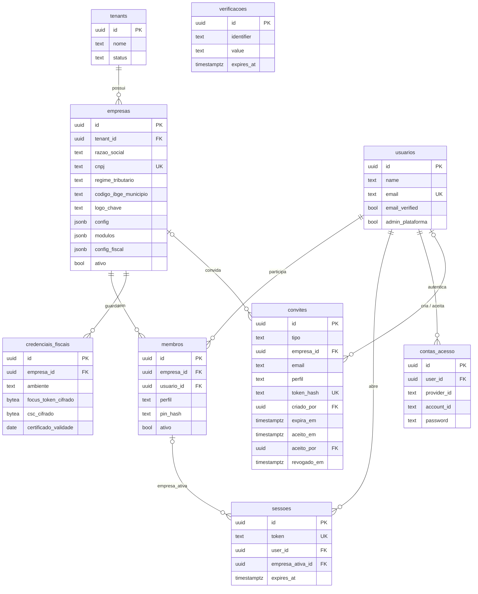
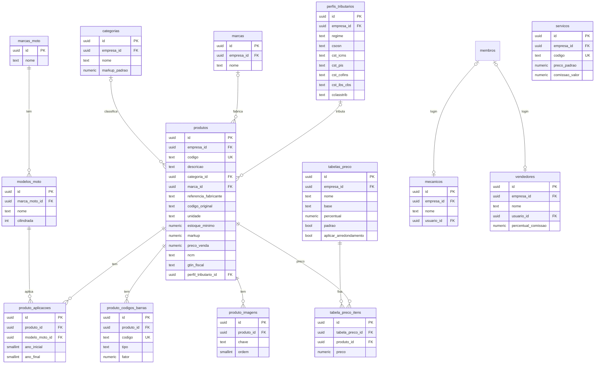
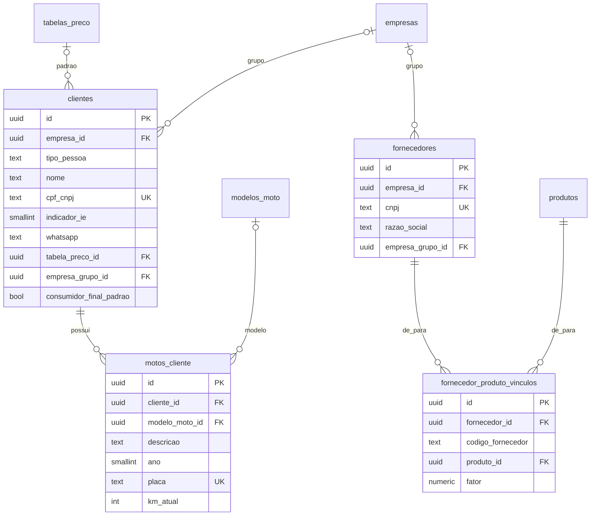
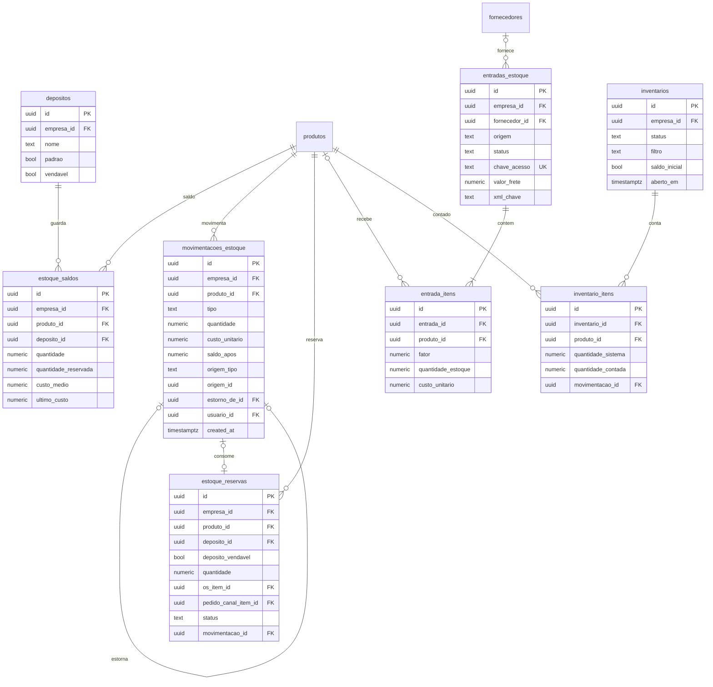
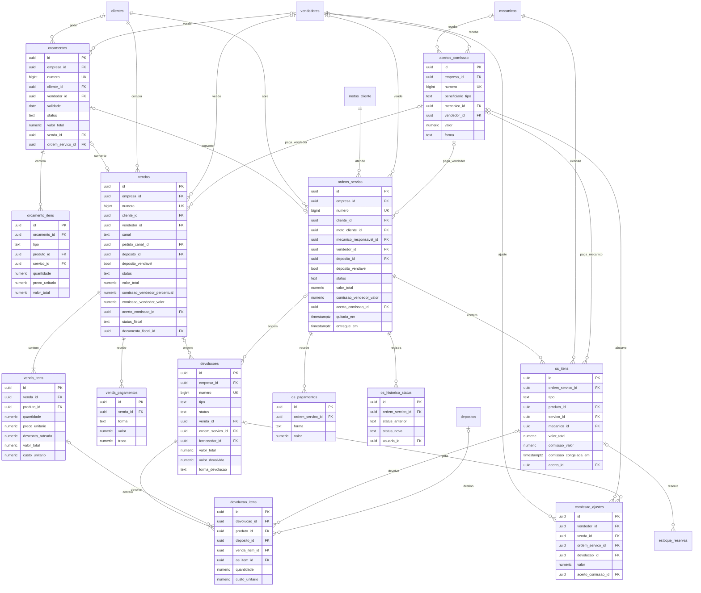
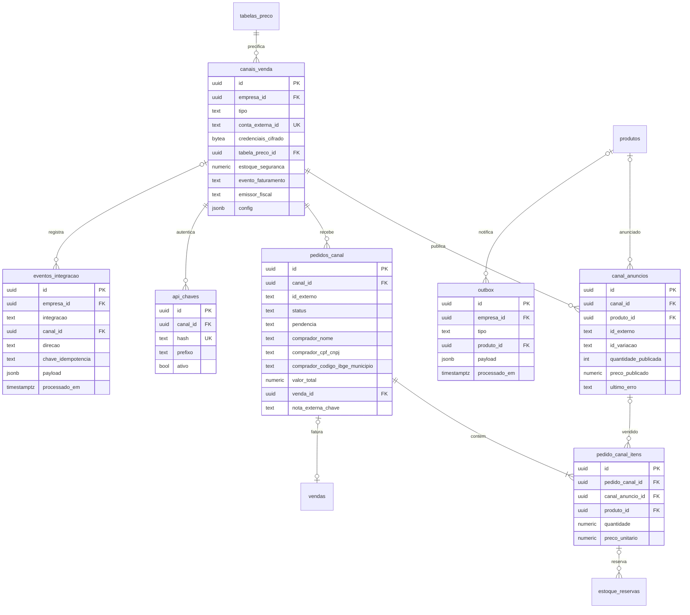
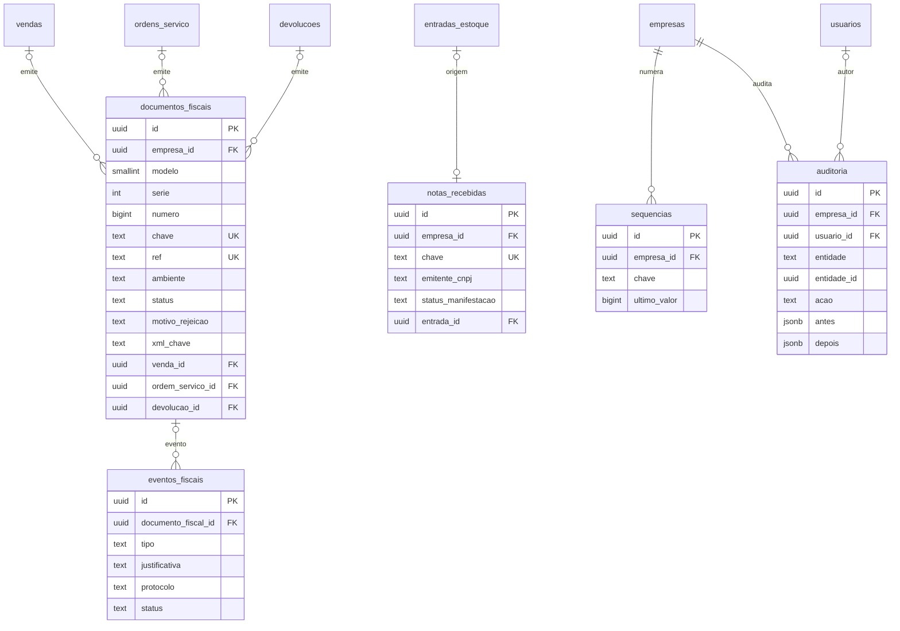
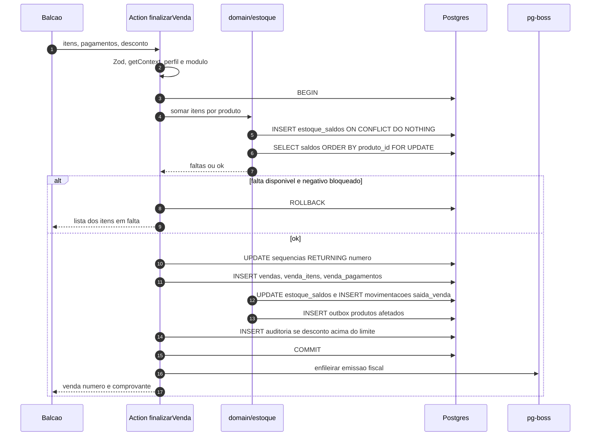
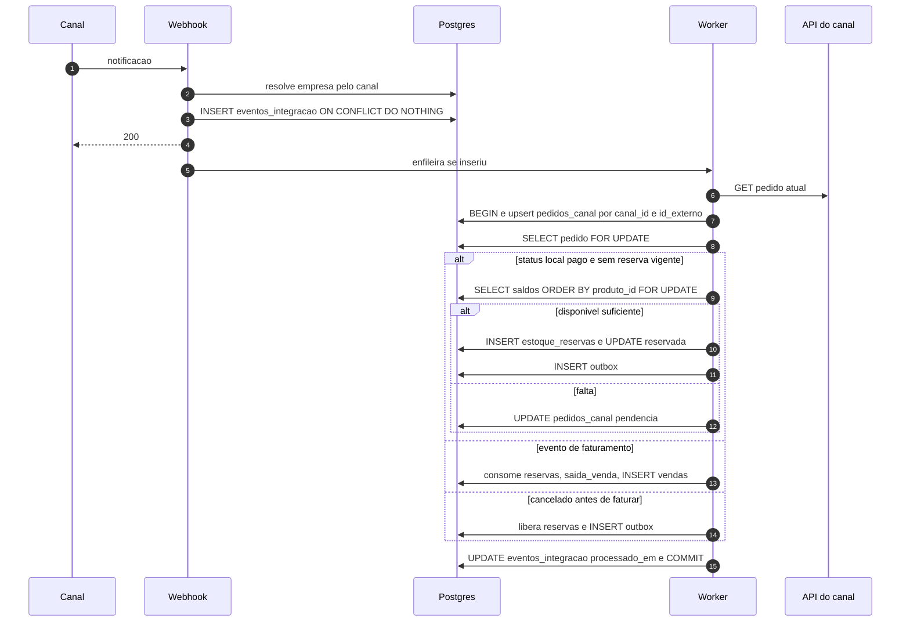

# SUMMER — Modelo de dados

> **Status:** proposta para aprovação (Fase A, Entrega 0). Nenhuma migração existe ainda.
> **Data:** 2026-11-03
> **Fonte:** `docs/especificacao.md`, seções 2, 4 e 5.
> **Modelo aprovado pelo usuário em 2026-11-03.** Itens marcados **[APROVADA — pergunta Px]** eram propostas confirmadas pelo diretor (seção 14). Itens marcados **[ADIÇÃO]** não estão na seção 5, mas são exigidos por alguma regra da seção 4 ou da seção 7.

## Sumário

1. Convenções
2. Plataforma e acesso
3. Referência global
4. Catálogo
5. Pessoas
6. Estoque
7. Documentos comerciais
8. Canais de venda
9. Fiscal
10. Controle
11. Formato dos JSONs
12. Diagramas ER
13. Fluxos de estoque
14. Perguntas de negócio
15. Migrações previstas

---

## 1. Convenções

### 1.1 Colunas comuns

Para não repetir em toda tabela, as colunas abaixo valem para todas, salvo indicação. As tabelas de cada módulo listam só as colunas próprias.

| coluna | tipo | nulo | padrão | observação |
|---|---|---|---|---|
| `id` | `uuid` | não | `gen_random_uuid()` | PK. O tipo `uuid` aceita UUIDv7 gerado pela aplicação no futuro sem migração. |
| `empresa_id` | `uuid` | não | — | FK → `empresas(id)` ON DELETE RESTRICT. Só nas tabelas de negócio (marcadas **[N]**). |
| `created_at` | `timestamptz` | não | `now()` | Momento do registro. Nas tabelas append-only é a data do evento. |
| `updated_at` | `timestamptz` | não | `now()` | Mantido pelo gatilho `set_updated_at()` (BEFORE UPDATE). |

Marcadores usados nos títulos das tabelas:

- **[N]**: tabela de negócio. Tem `empresa_id` e a constraint `unique (empresa_id, id)`, alvo das FKs compostas.
- **[G]**: tabela global, sem `empresa_id` (`marcas_moto`, `modelos_moto` e as tabelas de plataforma e auth).
- **[A]**: append-only. O gatilho `bloquear_alteracao()` rejeita `UPDATE` e `DELETE`.

### 1.2 Tipos

| uso | tipo | nunca |
|---|---|---|
| dinheiro (preço, total, desconto, comissão) | `numeric(14,2)` | `real`, `double precision`, `money` |
| quantidade (saldo, item, fator) | `numeric(14,4)` | idem |
| custo unitário e custo médio | `numeric(16,6)` | idem |
| alíquota, percentual, markup, MVA | `numeric(7,4)` | idem |
| status e tipos | `text` + `CHECK` | `pgEnum` |
| datas e horas | `timestamptz` | `timestamp` sem fuso |
| datas sem hora (validade, período) | `date` | — |
| numeração de documento e sequência | `bigint` | — |
| CNPJ | `text` com 14 caracteres, sem máscara, `CHECK (cnpj ~ '^[0-9A-Z]{12}[0-9]{2}$')` | — |
| CPF | `text` com 11 dígitos, `CHECK (~ '^[0-9]{11}$')` | — |
| chave de acesso NF-e | `text`, `CHECK (~ '^[0-9]{44}$')` | — |
| chave de arquivo no storage | `text` (ex.: `empresas/<uuid>/xml/<chave>.xml`) | conteúdo do arquivo no banco |
| segredo | `bytea` em coluna `*_cifrado` | texto puro |

O dígito verificador (CPF, CNPJ, GTIN, EAN) é validado no domínio (`server/domain/documentos`, `server/domain/ean`). O banco valida só o formato, como última barreira.

No Drizzle, `numeric` volta como `string`. A aplicação converte para `Decimal` (`decimal.js`, `ROUND_HALF_UP`). Valores decimais dentro de JSON também são strings (`"5.0000"`), nunca números.

### 1.3 Status e tipos: `text` + `CHECK`

Cada `CHECK` tem nome fixo (`<tabela>_<coluna>_check`). Para acrescentar um valor sem quebrar a versão anterior do app (seção 6), a migração alarga a constraint:

```sql
ALTER TABLE vendas DROP CONSTRAINT vendas_canal_check,
  ADD CONSTRAINT vendas_canal_check CHECK (canal IN (..., 'novo_valor')) NOT VALID;
ALTER TABLE vendas VALIDATE CONSTRAINT vendas_canal_check;
```

Alargar é sempre compatível. Remover um valor exige duas entregas: primeiro o app para de gravá-lo; depois a constraint é estreitada.

### 1.4 `ON DELETE`

- **Padrão: `ON DELETE RESTRICT` em todas as FKs.** Documentos e movimentos nunca são apagados, e cadastros são desativados (`ativo = false`).
- Linhas filhas de cadastro **podem ser apagadas** pela aplicação: código de barras, imagem, aplicação em moto, item de tabela de preço, vínculo de fornecedor e itens de orçamento aberto. Apaga-se o filho, nunca o pai, então a FK do filho para o pai continua `RESTRICT`. Não há `CASCADE` no domínio.
- **Exceções com `CASCADE`** (todas técnicas, nenhuma apaga documento):
  - `sessoes.user_id` e `contas_acesso.user_id` → `usuarios`: comportamento esperado pelo Better Auth. Usuários nunca são apagados, porque `auditoria` e os documentos os referenciam com `RESTRICT`;
  - `sessoes (empresa_ativa_id, user_id)` → `membros`: se um vínculo fosse apagado, as sessões dele morreriam junto. Na prática, membros são desativados, não apagados.
- `ON UPDATE`: padrão (`NO ACTION`). Ninguém altera `id` nem `empresa_id`.

### 1.5 Isolamento: FKs compostas

Toda referência entre duas tabelas **[N]** usa FK composta, para o banco impedir que um documento da empresa A aponte para um cadastro da empresa B:

```sql
-- na tabela referenciada
ALTER TABLE produtos ADD CONSTRAINT produtos_empresa_id_id_key UNIQUE (empresa_id, id);

-- na tabela que referencia
ALTER TABLE venda_itens ADD CONSTRAINT venda_itens_produto_fk
  FOREIGN KEY (empresa_id, produto_id) REFERENCES produtos (empresa_id, id) ON DELETE RESTRICT;
```

- Nas tabelas, **"→ x (C)"** indica FK composta `(empresa_id, coluna) → x(empresa_id, id)`. **"→ x"** indica FK simples para `x(id)`.
- Com FK opcional (coluna nula), o `MATCH SIMPLE` padrão do Postgres não verifica a linha. É o comportamento desejado.
- Referências a tabelas globais (`usuarios`, `modelos_moto`, `empresas`) são FKs simples.
- `empresa_grupo_id` (clientes, fornecedores e vendas) aponta para outra empresa do **mesmo tenant**. Isso não cabe numa FK, porque as tabelas de negócio não têm `tenant_id`. O gatilho `validar_empresa_grupo()` confere o tenant das duas empresas (1.6), com teste de integração.
- Quem autoriza desconto (`desconto_autorizado_por`, `auditoria.autorizado_por`) é um membro da empresa: FK composta `(empresa_id, x) → membros (empresa_id, usuario_id)`.
- Índices únicos sobre o id de outra tabela começam por `empresa_id` (ex.: `unique (empresa_id, pedido_canal_id)` em `vendas`).
- Um teste de integração lê o `pg_constraint` e garante que toda FK entre duas tabelas com `empresa_id` começa por `empresa_id` e que toda tabela com `empresa_id` tem `unique (empresa_id, id)`.
- O custo é um índice único `(empresa_id, id)` a mais por tabela referenciada. Para o volume de uma loja, é desprezível.

### 1.6 Gatilhos e funções (migração custom 1)

| função | tipo | uso |
|---|---|---|
| `f_unaccent(text)` | `sql IMMUTABLE PARALLEL SAFE STRICT`, wrapper de `public.unaccent('public.unaccent', $1)` | índices de busca |
| `set_updated_at()` | gatilho `BEFORE UPDATE FOR EACH ROW` | todas as tabelas com `updated_at`, exceto as **[A]** |
| `bloquear_alteracao()` | gatilho `BEFORE UPDATE OR DELETE FOR EACH ROW`, `RAISE EXCEPTION` | tabelas **[A]**: `movimentacoes_estoque`, `auditoria` e `os_historico_status`. A proposta `comissao_ajustes` tem um gatilho próprio, que só permite preencher `acerto_comissao_id` uma vez (7.11). |
| `bloquear_saida_status_final(coluna, finais…)` | gatilho `BEFORE UPDATE OF status` | status final não volta: OS `entregue`/`cancelada`, venda `cancelada`, reserva `consumida`/`liberada`. As outras colunas da linha continuam podendo mudar. |
| `validar_empresa_grupo()` | gatilho `BEFORE INSERT OR UPDATE OF empresa_id, empresa_grupo_id` | `clientes`, `fornecedores` e `vendas`: a empresa do grupo é do mesmo tenant (1.5). |
| `movimentacoes_estoque_validar_estorno()` | gatilho `BEFORE INSERT ... WHEN (tipo = 'estorno')` | o estorno espelha o original (6.3). |
| `os_itens_proteger_comissao()`, `proteger_comissao_vendedor()` | gatilho `BEFORE UPDATE` | comissão congelada não muda; o acerto é preenchido uma vez (7.3, 7.6, 7.7). |

Os gatilhos recusam com SQLSTATE `23001` (`restrict_violation`) o que não pode mudar e com `23514` (`check_violation`) o que é inconsistente.

O gatilho append-only não impede `TRUNCATE`. O usuário do banco usado pelo app não deve ter `TRUNCATE` nessas tabelas (registrar em `docs/deploy.md`).

### 1.7 Segredos

- Colunas `*_cifrado bytea`, cifradas com AES-256-GCM na aplicação (`server/crypto`).
- Formato do conteúdo: `[1 byte: versão da chave][12 bytes: IV][texto cifrado][16 bytes: tag]`.
- As chaves vêm de variável de ambiente (`CHAVES_CIFRAGEM=v1:<base64>,v2:<base64>`). A versão no primeiro byte permite trocar a chave e recifrar aos poucos.
- AAD = `"<tabela>:<coluna>:<id da linha>"`, para um valor cifrado não poder ser copiado para outra linha.
- Chave de API: só o hash SHA-256 (a chave tem 256 bits de entropia, então não precisa de hash lento).
- PIN: hash lento (scrypt ou argon2, o mesmo algoritmo do Better Auth).

### 1.8 Numeração

- `sequencias (empresa_id, chave)` é única, com `ultimo_valor bigint`.
- O próximo número sai de `UPDATE sequencias SET ultimo_valor = ultimo_valor + 1 WHERE empresa_id = $1 AND chave = $2 RETURNING ultimo_valor`, **na mesma transação do documento**. Se o documento falhar, o número volta e não sobra buraco.
- Os documentos têm `numero bigint not null` e `unique (empresa_id, numero)`, exibido como `#000123`.

### 1.9 Nomes do Better Auth

**Decisão:** as tabelas do Better Auth ganham nomes em português (`usuarios`, `sessoes`, `contas_acesso`, `verificacoes`). As colunas ficam com os nomes do Better Auth em `snake_case` (`email_verified`, `expires_at`, `user_id`…).

- `user` é palavra reservada no Postgres e exigiria aspas em todo SQL manual, como relatórios e testes.
- `usuarios` é referenciada por quase todo o domínio (`usuario_id` em documentos, movimentos e auditoria). O nome em português deixa os joins coerentes.
- As colunas internas são termos técnicos do protocolo (token, provider, access_token). Traduzi-las só aumentaria o mapeamento e o risco de erro.
- O mapeamento é feito no adapter do Drizzle: `drizzleAdapter(db, { provider: 'pg', schema: { user: usuarios, session: sessoes, account: contasAcesso, verification: verificacoes } })`, com `modelName` em `user`, `session`, `account` e `verification`. As chaves das propriedades no schema Drizzle ficam com o nome do Better Auth (`emailVerified`); só o nome da coluna é `snake_case` (`boolean('email_verified')`).
- IDs: `advanced.database.generateId: 'uuid'`, com `uuid default gen_random_uuid()` no banco.
- **Confira na versão instalada** do `better-auth` antes da migração: a forma de mapear `modelName` e campos e a opção de `generateId` mudaram entre versões.
- Campos adicionais declarados em `additionalFields` com `input: false`: `usuarios.admin_plataforma` e `sessoes.empresa_ativa_id`.
- A tabela `rateLimit` do Better Auth não é criada: o limite de tentativas de login fica em memória no processo do app. Se houver mais de uma réplica do app, ela vira uma migração aditiva.

### 1.10 Decisões de modelagem desta proposta

> **Regra 4.4 substituída (kits).** Por decisão do usuário em 2026-11-03, a regra 4.4 da especificação não vale mais: *"o kit é um produto já com peças inclusas. Não são montados com peças avulsas."* Todo kit vem fechado do fornecedor e é um produto como outro qualquer, com saldo, custo médio, código de barras, NCM e perfil tributário próprios. Não existe composição de kit nem kit sem saldo. Por isso o modelo não tem `kit_componentes`, `produtos.tipo` nem `kit_produto_id`, e os fluxos não explodem kits. O kit relação da seção 8 (seed) é cadastrado como um produto comum, com unidade `KIT`.

> **Respostas do diretor (2026-11-03) que mudam a especificação** (detalhes na seção 14.1):
>
> - **Regra 4.3 / seção 7 (OS):** a OS entregue **não pode ser reaberta**. Isso substitui o "Reabrir uma OS entregue (só o dono) gera estorno" da tabela 4.3 e a "reabertura de OS" da lista de auditoria da regra 4.11. Correção depois do fechamento é feita por devolução.
> - **Regra 4.13 (comissão do mecânico):** a comissão congela quando a OS é **entregue**, independente do pagamento. Substitui o "entregue e paga".
> - **Comissão do vendedor (regra nova):** percentual por vendedor sobre o valor das peças, na venda de balcão e na OS (D22). Os acertos de mecânico e de vendedor ficam numa tabela só, `acertos_comissao`, em vez da `acertos_mecanico` da seção 5 (D23).
> - **Devolução de cliente:** não existe crédito na loja. A loja devolve o pagamento e a peça volta ao estoque; a devolução registra o valor e a forma.
> - **Comprador do site:** não entra em `clientes`; os dados de destinatário ficam no pedido (D24).
> - **Regra 4.6 (unidades):** acrescentada a unidade `PCT` (pacote).

As decisões 1 a 9 do pedido (membros próprios, FKs compostas, `text` + `CHECK`, `set_updated_at`, `gen_random_uuid`, `*_cifrado`, append-only, `sequencias`, migrações) estão aplicadas. Abaixo estão as decisões **adicionais** desta proposta, a registrar em `docs/decisoes.md` depois da aprovação.

| # | Decisão | Por quê |
|---|---|---|
| D1 | Tabelas do Better Auth com nome em português e colunas com os nomes do Better Auth (1.9). | `user` é palavra reservada; menos mapeamento nas colunas. |
| D2 | ~~`unique (empresa_id, id, tipo)` em `produtos` e uma coluna constante `produto_tipo` / `kit_tipo` nas FKs.~~ **Removida em 2026-11-03.** | A regra 4.4 foi substituída: não existe mais kit sem saldo nem composição, então não há o que garantir. |
| D3 | Exceções de `CASCADE` só nas tabelas técnicas do Better Auth (1.4). | Nada do domínio é apagado por cascata. |
| D4 | Segredos fiscais em `credenciais_fiscais`, separados de `empresas` (2.3). | Um `select *` em `empresas` nunca traz segredo. |
| D5 | Valores decimais em JSON sempre como string (11). | Evita `float` no JavaScript. |
| D6 | Um código de barras igual ao `codigo` de outro produto é recusado na action (4.5). | O leitor (4.8) precisa de um resultado único. A trava fica na aplicação, porque o banco não tem unicidade entre duas tabelas. |
| D7 | A reserva aponta para o item (`estoque_reservas.os_item_id` / `pedido_canal_item_id`), e não o item para a reserva (6.4). Revista em 2026-11-03. | Cada item tem no máximo **uma reserva ativa** (garantido por índice único parcial), mas pode ter várias **ao longo do tempo**: mudar a quantidade da peça numa OS aberta libera a reserva antiga e cria outra, e um pedido de canal cancelado e reativado faz o mesmo. As anteriores ficam no histórico. Apontar do item para a reserva perderia esse histórico e criaria uma FK circular (item → reserva → item). |
| D8 | Placa única por empresa; trocar de dono muda o `cliente_id` da moto (5.2). | O histórico por placa continua inteiro, porque a OS guarda cliente e moto. |
| D9 | Origem com FKs tipadas em `estoque_reservas`, `documentos_fiscais`, `devolucoes` e `comissao_ajustes`. Origem polimórfica (`origem_tipo` + `origem_id`, sem FK) só em `movimentacoes_estoque` e `auditoria`. | Integridade no banco onde há poucas origens; nas tabelas append-only, a flexibilidade compensa. |
| D10 | `ref` do Focus = `documentos_fiscais.id`, gravado **antes** do envio (9.1). | Uma retentativa depois de queda reusa a mesma ref, e o Focus não duplica. Uma nova nota para a mesma venda (depois de cancelar) ganha outra ref; o índice parcial impede duas notas vigentes. |
| D11 | ~~Entrada de compra só aceita produto simples; kit é recusado.~~ **Removida em 2026-11-03.** | Com a regra 4.4 substituída, o kit tem saldo próprio e dá entrada como qualquer produto. |
| D12 | Snapshot de `empresa_grupo_id` em `vendas` (7.3). | O relatório consolidado não muda se o cadastro do cliente mudar depois. |
| D13 | Log e limite de requisições da API v1 ficam para a Entrega 7, numa migração aditiva. | Não estão na seção 5, e o formato depende do plano do e-commerce. |
| D14 | `tabelas_preco.padrao`: uma tabela padrão por empresa (4.11). | O balcão precisa de uma tabela quando o cliente não tem a dele. |
| D15 | Item de OS removido é exclusão lógica (`removido_em`). | Reservas e auditoria apontam para ele. |
| D16 | `entradas_estoque.status` (`rascunho`, `confirmada`, `cancelada`). | A conferência do XML acontece antes de mexer no estoque. |
| D17 | Append-only também em `os_historico_status` (e, com uma exceção, na proposta `comissao_ajustes`). | São registros históricos, como o kardex. |
| D18 | Retenção: `outbox` processada há mais de 30 dias e `payload` de `eventos_integracao` processado há mais de 180 dias podem ser expurgados. | São filas e logs, não documentos. Os XMLs ficam no storage e nunca são apagados. |
| D19 | PIN de aprovação: um por membro dono (`membros.pin_hash`, hash lento). A auditoria grava qual dono autorizou (`autorizado_por`). Cinco erros seguidos bloqueiam o PIN daquele dono por 15 minutos (`pin_falhas`, `pin_bloqueado_ate`). | A seção 3 já fala em "PIN de um usuário dono", então é um por pessoa. O bloqueio impede descobrir o PIN no balcão por tentativa e erro. Saiu das perguntas: é técnica. |
| D20 | A virada é marcada pela chave `estoque` em `empresas.modulos` (11.2). Ligá-la é um passo do checklist da virada, junto com o inventário de saldo inicial. | A Entrega 1 precisa mostrar "Estoque controlado no TeraSoft até a virada", e as telas de estoque, balcão e OS só funcionam depois dela. Saiu das perguntas: é técnica. |
| D21 | A OS entregue **não gera venda**. Ela é um documento completo: dá baixa com `saida_os`, recebe em `os_pagamentos` e é origem da nota fiscal e da devolução (`documentos_fiscais.ordem_servico_id`, `devolucoes.ordem_servico_id`). Os relatórios somam vendas e OS entregues. O valor `os` continua no CHECK de `vendas.canal` (seção 5), sem uso. | A seção 5 dá à OS pagamentos próprios, e a seção 7 emite nota "a partir de venda ou OS". Gerar uma venda na entrega duplicaria os pagamentos. Para a loja, o resultado é o mesmo: a peça da OS pode ser devolvida e sai na nota. Se o diretor quiser ver a OS como venda, basta mudar o relatório. |
| D22 | Cadastro `vendedores` (4.10), separado de `mecanicos`, com `percentual_comissao` e `usuario_id` opcional. `vendedor_id` em `orcamentos`, `vendas` e `ordens_servico`. Percentual, base e valor da comissão do vendedor são **congelados no documento** no fechamento (venda `finalizada`, OS `entregue`). | Regra nova do diretor (R2). Gravar o valor no documento torna o passado imutável quando o percentual do vendedor mudar, como já acontece com a comissão do mecânico. Mecânico e vendedor são papéis diferentes; quem faz os dois tem um cadastro em cada, ligados ao mesmo login. |
| D23 | Uma tabela de acertos, `acertos_comissao`, com `beneficiario_tipo` (`mecanico` ou `vendedor`) e FKs tipadas `mecanico_id` / `vendedor_id`, em vez de `acertos_mecanico` mais uma tabela paralela para vendedores. | A numeração `acerto` é uma só por empresa (regra 4.11). Com duas tabelas, os números se intercalariam entre elas, e a unicidade valeria só dentro de cada uma. Forma de pagamento, auditoria e histórico são iguais. Ainda não há migração, então o nome novo não quebra nada. |
| D24 | O comprador do e-commerce **não** entra em `clientes` (R8). A venda gerada usa o cliente "Consumidor final" e chega ao destinatário por `vendas.pedido_canal_id`. Os dados completos de destinatário ficam em `pedidos_canal` (8.3) e **congelam quando o pedido é faturado** (a sincronização não os sobrescreve depois). | Evita copiar 14 colunas para a venda. Toda venda de canal tem pedido (CHECK em `vendas`), e o registro legal da nota é o XML autorizado, guardado no storage. No Mercado Livre continua o mínimo. |
| D25 | Custo desconhecido = **nulo**. `estoque_saldos.custo_medio` e `ultimo_custo`, `movimentacoes_estoque.custo_unitario` e `custo_medio_apos`, e `custo_unitario` em `venda_itens`, `os_itens` e `devolucao_itens` aceitam nulo. O `saldo_inicial` importado sem custo do TeraSoft grava nulo. A primeira entrada com custo trata o médio nulo como "saldo ≤ 0": `novo_medio = custo_entrada`. Itens com custo nulo ficam fora da margem, e o relatório mostra quantos ficaram de fora. | É a forma mais simples: nenhuma coluna nova. Gravar 0 daria margem de 100% e passaria despercebido; com nulo, o tipo `Decimal \| null` obriga o código a tratar o caso. Entradas de compra e manuais continuam exigindo custo (CHECK em 6.3). |
| D26 | O arredondamento do preço vem só de `empresas.config.arredondamento_preco` e vale também para o preço calculado por tabela. A tabela tem apenas `aplicar_arredondamento boolean default true` (4.11). | Uma regra por empresa. O liga/desliga por tabela serve para "Repasse entre empresas" (custo + %), onde terminar em ,90 não faz sentido. Preço fixo por produto (`tabela_preco_itens`) nunca é arredondado. |
| D27 | Paginação por cursor keyset, com índices `(empresa_id, coluna, id)` (1.11). | Sem `OFFSET`; listas grandes (kardex, vendas) ficam rápidas em qualquer página. |
| D28 | `depositos.vendavel` (6.1). A empresa nasce com "Loja" (padrão, vendável) e "Garantia" (oculto, não vendável). Peça com defeito devolvida pelo cliente entra em "Garantia" e sai de lá na devolução ao fornecedor. | Proposta aceita pelo diretor (R7). O disponível do balcão e dos canais só considera depósitos vendáveis, então a peça com defeito nunca é vendida nem publicada. |

### 1.11 Paginação keyset (D27)

As listas paginam por cursor keyset, sem `OFFSET`: `WHERE empresa_id = $1 [AND filtro] AND (coluna, id) < ($cursor_coluna, $cursor_id) ORDER BY coluna DESC, id DESC LIMIT n`.

- Cada ordem oferecida na tela tem um índice `(empresa_id, [filtro de igualdade,] coluna, id)`. A tabela abaixo resume esses índices; os demais estão em cada tabela.
- O `id` desempata. Isso é obrigatório: `created_at = now()` é o horário da **transação**, então todas as linhas gravadas numa mesma transação (os movimentos de uma venda, por exemplo) têm o mesmo `created_at`. O UUID não é cronológico, mas o desempate só precisa ser estável.
- Ordenação por texto (`descricao`, `nome`) usa a collation do banco. O banco é criado com collation ICU `pt-BR` (`CREATE DATABASE ... LOCALE_PROVIDER icu ICU_LOCALE 'pt-BR'`), para "Á" ordenar junto de "A". Registrar em `docs/deploy.md`.
- Coluna única (`codigo`, `numero`) dispensa o `id`: o índice único `(empresa_id, codigo)` ou `(empresa_id, numero)` já serve.

| tabela | ordens da lista | índices |
|---|---|---|
| `produtos` | descrição; código | `(empresa_id, descricao, id)`; `unique (empresa_id, codigo)` |
| `clientes` | nome | `(empresa_id, nome, id)` |
| `fornecedores` | razão social | `(empresa_id, razao_social, id)` |
| `orcamentos` | mais recentes; por status; número | `(empresa_id, created_at desc, id desc)`; `(empresa_id, status, created_at desc, id desc)`; `unique (empresa_id, numero)` |
| `vendas` | mais recentes; por canal; número | `(empresa_id, finalizada_em desc, id desc)`; `(empresa_id, canal, finalizada_em desc, id desc)`; `unique (empresa_id, numero)` |
| `ordens_servico` | mais recentes; por status (kanban); número | `(empresa_id, created_at desc, id desc)`; `(empresa_id, status, created_at desc, id desc)`; `unique (empresa_id, numero)` |
| `movimentacoes_estoque` (kardex) | por produto; geral; por tipo; por usuário | `(empresa_id, produto_id, created_at desc, id desc)`; `(empresa_id, created_at desc, id desc)`; `(empresa_id, tipo, created_at desc, id desc)`; `(empresa_id, usuario_id, created_at desc, id desc)` |
| `entradas_estoque`, `devolucoes`, `acertos_comissao`, `pedidos_canal`, `auditoria` | mais recentes | `(empresa_id, <data>, id)` em cada tabela |

---

## 2. Plataforma e acesso

### 2.1 `tenants` [G]

| coluna | tipo | nulo | padrão | FK/CHECK | observação |
|---|---|---|---|---|---|
| nome | text | não | — | — | |
| status | text | não | `'ativo'` | CHECK `in ('ativo','suspenso')` | Suspenso bloqueia o login de todos os membros. |

Índices: nenhum além da PK.

### 2.2 `empresas` [G] (raiz do isolamento)

| coluna | tipo | nulo | padrão | FK/CHECK | observação |
|---|---|---|---|---|---|
| tenant_id | uuid | não | — | → tenants | |
| razao_social | text | não | — | | |
| nome_fantasia | text | sim | — | | |
| cnpj | text | não | — | CHECK formato CNPJ alfanumérico | Sem máscara. |
| ie | text | sim | — | | Inscrição estadual (ou `ISENTO`). |
| im | text | sim | — | | Inscrição municipal. |
| regime_tributario | text | não | — | CHECK `in ('simples_nacional','lucro_presumido','lucro_real')` | Define o CRT na nota. |
| cep | text | sim | — | CHECK `~ '^[0-9]{8}$'` | |
| logradouro | text | sim | — | | |
| numero | text | sim | — | | "S/N" é válido. |
| complemento | text | sim | — | | |
| bairro | text | sim | — | | |
| municipio | text | sim | — | | |
| codigo_ibge_municipio | text | sim | — | CHECK `~ '^[0-9]{7}$'` | Obrigatório para ligar o módulo fiscal (validado na action). |
| uf | text | sim | — | CHECK `~ '^[A-Z]{2}$'` | |
| telefone | text | sim | — | | |
| logo_chave | text | sim | — | | Chave no storage. |
| config | jsonb | não | ver 11.1 | | |
| modulos | jsonb | não | ver 11.2 | | |
| config_fiscal | jsonb | não | ver 11.3 | | |
| ativo | boolean | não | `true` | | |

Índices e unicidade:

- `unique (cnpj)`: um CNPJ existe uma vez na plataforma;
- `index (tenant_id)`.

### 2.3 `credenciais_fiscais` [N] [ADIÇÃO]

A Entrega 3 exige um token do Focus por empresa e por ambiente, cifrado. Os segredos ficam numa tabela separada para nunca aparecerem num `select * from empresas`.

| coluna | tipo | nulo | padrão | FK/CHECK | observação |
|---|---|---|---|---|---|
| ambiente | text | não | — | CHECK `in ('homologacao','producao')` | |
| focus_token_cifrado | bytea | sim | — | | |
| csc_id | text | sim | — | | Identificador do CSC da NFC-e (não é segredo). |
| csc_cifrado | bytea | sim | — | | CSC da NFC-e. |
| certificado_validade | date | sim | — | | Para o alerta de vencimento. A senha do A1 nunca é gravada. |
| certificado_enviado_em | timestamptz | sim | — | | |

Unicidade: `unique (empresa_id, ambiente)`.

### 2.4 `usuarios` (Better Auth `user`) [G]

| coluna | tipo | nulo | padrão | FK/CHECK | observação |
|---|---|---|---|---|---|
| name | text | não | — | | |
| email | text | não | — | UNIQUE | O Better Auth normaliza para minúsculas. |
| email_verified | boolean | não | `false` | | |
| image | text | sim | — | | |
| admin_plataforma | boolean | não | `false` | | `additionalFields`, `input: false`. Dá acesso só a `/admin`. |

Usuários nunca são apagados: a função de exclusão de conta do Better Auth fica desligada.

### 2.5 `sessoes` (Better Auth `session`) [G]

| coluna | tipo | nulo | padrão | FK/CHECK | observação |
|---|---|---|---|---|---|
| token | text | não | — | UNIQUE | |
| expires_at | timestamptz | não | — | | |
| ip_address | text | sim | — | | |
| user_agent | text | sim | — | | |
| user_id | uuid | não | — | → usuarios **ON DELETE CASCADE** | |
| empresa_ativa_id | uuid | sim | — | FK `(empresa_ativa_id, user_id)` → `membros (empresa_id, usuario_id)` **ON DELETE CASCADE** | `additionalFields`, `input: false`. Só muda pela action de trocar de empresa, que confere se o membro está ativo. |

Índice: `index (user_id)`.

### 2.6 `contas_acesso` (Better Auth `account`) [G]

| coluna | tipo | nulo | padrão | FK/CHECK | observação |
|---|---|---|---|---|---|
| account_id | text | não | — | | Para e-mail e senha, é o próprio `user_id`. |
| provider_id | text | não | — | | `credential`. |
| user_id | uuid | não | — | → usuarios **ON DELETE CASCADE** | |
| access_token | text | sim | — | | Não usado (sem OAuth de login). |
| refresh_token | text | sim | — | | idem |
| id_token | text | sim | — | | idem |
| access_token_expires_at | timestamptz | sim | — | | |
| refresh_token_expires_at | timestamptz | sim | — | | |
| scope | text | sim | — | | |
| password | text | sim | — | | Hash da senha, gerado pelo Better Auth. |

Índices: `index (user_id)`; `unique (provider_id, account_id)`.

### 2.7 `verificacoes` (Better Auth `verification`) [G]

| coluna | tipo | nulo | padrão | FK/CHECK | observação |
|---|---|---|---|---|---|
| identifier | text | não | — | | |
| value | text | não | — | | |
| expires_at | timestamptz | não | — | | |

Índice: `index (identifier)`.

O convite do dono (e o de admin da plataforma) usa a tabela própria `convites` (2.9, D033), não esta. Esta tabela fica para o fluxo de redefinição de senha do Better Auth, quando houver envio de e-mail.

### 2.8 `membros` [N]

| coluna | tipo | nulo | padrão | FK/CHECK | observação |
|---|---|---|---|---|---|
| usuario_id | uuid | não | — | → usuarios | |
| perfil | text | não | — | CHECK `in ('dono','balcao','estoque','mecanico')` | |
| pin_hash | text | sim | — | CHECK `pin_hash is null or perfil = 'dono'` | PIN de aprovação de desconto. |
| pin_falhas | smallint | não | `0` | CHECK `>= 0` | **[ADIÇÃO]** Contador de erros seguidos de PIN (D19). |
| pin_bloqueado_ate | timestamptz | sim | — | | **[ADIÇÃO]** Bloqueio temporário contra tentativa e erro no balcão (D19). |
| ativo | boolean | não | `true` | | |

Índices e unicidade: `unique (empresa_id, usuario_id)`, que também é alvo das FKs de `sessoes` e `mecanicos`; `index (usuario_id)`, para listar as empresas do usuário.

### 2.9 `convites` [ADIÇÃO, D033]

Convite por link de uso único: substitui a senha provisória do convite do dono (fatia 0.10). O token (256 bits, base64url) só aparece uma vez, no link `/convite/<token>`; a tabela guarda o SHA-256 dele. A auditoria nunca recebe o token nem o hash.

| coluna | tipo | nulo | padrão | FK/CHECK | observação |
|---|---|---|---|---|---|
| tipo | text | não | `'empresa'` | CHECK `in ('empresa','admin_plataforma')` | `admin_plataforma`: conta de admin criada pelo `scripts/criar-tenant.ts --admin-plataforma`. |
| empresa_id | uuid | sim | — | → empresas | Nulo só no tipo `admin_plataforma`. |
| email | text | não | — | CHECK `email = lower(btrim(email)) and email <> ''` | Normalizado. |
| perfil | text | sim | — | CHECK `in ('dono','balcao','estoque','mecanico')` | Nulo só no tipo `admin_plataforma`. |
| token_hash | text | não | — | UNIQUE; CHECK `~ '^[0-9a-f]{64}$'` | SHA-256 do token, em hexadecimal. |
| criado_por | uuid | sim | — | → usuarios | Nulo = sistema (script). |
| expira_em | timestamptz | não | `now() + interval '7 days'` | | |
| aceito_em | timestamptz | sim | — | | |
| aceito_por | uuid | sim | — | → usuarios | |
| revogado_em | timestamptz | sim | — | | |

CHECKs de tabela:

- `convites_alvo_check`: `(tipo = 'empresa' and empresa_id is not null and perfil is not null) or (tipo = 'admin_plataforma' and empresa_id is null and perfil is null)`;
- `convites_situacao_check`: não pode estar aceito e revogado ao mesmo tempo; `aceito_por` só com `aceito_em`.

Índices e unicidade:

- `unique (token_hash)`;
- `unique (empresa_id, email) where aceito_em is null and revogado_em is null`: um convite pendente por empresa e e-mail (convidar de novo revoga o anterior antes de inserir);
- `unique (email) where tipo = 'admin_plataforma' and aceito_em is null and revogado_em is null`;
- `unique (empresa_id, id)` (convenção 1.1);
- `index (email)`.

Regras (aplicação, `server/servicos/convites.ts`):

- **Pendente** = não aceito, não revogado e `expira_em > now()`.
- **Aceite atômico:** `UPDATE ... SET aceito_em = now() WHERE token_hash = $1 AND aceito_em IS NULL AND revogado_em IS NULL AND expira_em > now() RETURNING`. Dois cliques não criam dois membros.
- Criar o convite não consulta `usuarios`: a resposta é a mesma para e-mail novo e existente.
- O admin da plataforma só convida o primeiro dono: recusa se a empresa já tem dono ativo ou um convite de dono pendente para outro e-mail.
- Gatilho `set_updated_at`.

---

## 3. Referência global

### 3.1 `marcas_moto` [G]

| coluna | tipo | nulo | padrão | FK/CHECK | observação |
|---|---|---|---|---|---|
| nome | text | não | — | | Honda, Yamaha… |
| ativo | boolean | não | `true` | | |

Unicidade: `unique index (lower(nome))`.

### 3.2 `modelos_moto` [G]

| coluna | tipo | nulo | padrão | FK/CHECK | observação |
|---|---|---|---|---|---|
| marca_moto_id | uuid | não | — | → marcas_moto | |
| nome | text | não | — | | "CG 160 Titan". |
| cilindrada | integer | sim | — | CHECK `> 0` | Em cc. |
| ativo | boolean | não | `true` | | |

Unicidade: `unique index (marca_moto_id, lower(nome))`.

---

## 4. Catálogo

### 4.1 `categorias` [N]

| coluna | tipo | nulo | padrão | FK/CHECK | observação |
|---|---|---|---|---|---|
| nome | text | não | — | | |
| markup_padrao | numeric(7,4) | sim | — | CHECK `>= 0` | Herdado pelo produto sem markup próprio. |
| ativo | boolean | não | `true` | | |

Unicidade: `unique index (empresa_id, lower(nome))`.

### 4.2 `marcas` [N]

| coluna | tipo | nulo | padrão | FK/CHECK | observação |
|---|---|---|---|---|---|
| nome | text | não | — | | Cobreq, Vaz, NGK… |
| ativo | boolean | não | `true` | | |

Unicidade: `unique index (empresa_id, lower(nome))`.

### 4.3 `perfis_tributarios` [N]

| coluna | tipo | nulo | padrão | FK/CHECK | observação |
|---|---|---|---|---|---|
| nome | text | não | — | | |
| descricao | text | sim | — | | |
| regime | text | não | — | CHECK `in ('simples','normal')` | `simples` para empresas do Simples Nacional; `normal` para Presumido e Real (validado na action). |
| csosn | text | sim | — | CHECK `~ '^[0-9]{3}$'` | Simples. |
| cst_icms | text | sim | — | CHECK `~ '^[0-9]{2}$'` | Regime normal. |
| aliquota_icms | numeric(7,4) | sim | — | CHECK `>= 0` | |
| reducao_base_icms | numeric(7,4) | sim | — | CHECK `between 0 and 100` | Percentual. |
| st_retido_anteriormente | boolean | não | `false` | | |
| mva | numeric(7,4) | sim | — | CHECK `>= 0` | |
| aliquota_st | numeric(7,4) | sim | — | CHECK `>= 0` | |
| fcp_st | numeric(7,4) | sim | — | CHECK `>= 0` | |
| cst_pis | text | sim | — | CHECK `~ '^[0-9]{2}$'` | |
| aliq_pis | numeric(7,4) | sim | — | CHECK `>= 0` | |
| cst_cofins | text | sim | — | CHECK `~ '^[0-9]{2}$'` | |
| aliq_cofins | numeric(7,4) | sim | — | CHECK `>= 0` | |
| monofasico | boolean | não | `false` | | |
| cst_ipi | text | sim | — | CHECK `~ '^[0-9]{2}$'` | |
| aliq_ipi | numeric(7,4) | sim | — | CHECK `>= 0` | |
| cst_ibs_cbs | text | sim | — | CHECK `~ '^[0-9]{3}$'` | Reforma tributária. |
| cclasstrib | text | sim | — | CHECK `~ '^[0-9]{6}$'` | Classificação tributária. |
| aliq_cbs | numeric(7,4) | sim | — | CHECK `>= 0` | |
| aliq_ibs_uf | numeric(7,4) | sim | — | CHECK `>= 0` | |
| aliq_ibs_mun | numeric(7,4) | sim | — | CHECK `>= 0` | |
| ativo | boolean | não | `true` | | |

CHECK de tabela: `(regime = 'simples' and csosn is not null) or (regime = 'normal' and cst_icms is not null)`. Os demais obrigatórios dependem do CST e ficam na validação Zod do formulário.

Unicidade: `unique index (empresa_id, lower(nome))`.

O CFOP e a natureza da operação não estão no perfil (ver pergunta P5, para o contador).

### 4.4 `produtos` [N]

| coluna | tipo | nulo | padrão | FK/CHECK | observação |
|---|---|---|---|---|---|
| codigo | text | não | — | CHECK `codigo = btrim(codigo) and codigo <> ''` | SKU. Gerado em `sequencias.produto` se vier em branco. |
| descricao | text | não | — | | |
| descricao_curta | text | sim | — | | Etiqueta. |
| descricao_completa | text | sim | — | | Canais. |
| categoria_id | uuid | sim | — | → categorias (C) | |
| marca_id | uuid | sim | — | → marcas (C) | |
| referencia_fabricante | text | sim | — | | |
| codigo_original | text | sim | — | | Código da montadora. |
| unidade | text | não | `'UN'` | CHECK `in ('UN','PC','PAR','JG','KIT','CX','PCT','LT','ML','M')` | Unidade de estoque. `PCT` (pacote) acrescentada pelo diretor (R13). A compra em outra unidade é convertida pelo fator (`entrada_itens.fator`, `fornecedor_produto_vinculos.fator`), e o código de barras do pacote tem `fator` (ex.: PCT com 10 = 10). |
| corredor | text | sim | — | | |
| prateleira | text | sim | — | | |
| gaveta | text | sim | — | | |
| estoque_minimo | numeric(14,4) | não | `0` | CHECK `>= 0` | |
| markup | numeric(7,4) | sim | — | CHECK `>= 0` | Nulo: herda `categorias.markup_padrao`. |
| preco_venda | numeric(14,2) | não | `0` | CHECK `>= 0` | Preço de venda base. |
| ativo | boolean | não | `true` | | |
| observacoes | text | sim | — | | |
| peso_g | integer | sim | — | CHECK `> 0` | |
| altura_cm | numeric(8,2) | sim | — | CHECK `> 0` | |
| largura_cm | numeric(8,2) | sim | — | CHECK `> 0` | |
| comprimento_cm | numeric(8,2) | sim | — | CHECK `> 0` | |
| ncm | text | sim | — | CHECK `~ '^[0-9]{8}$'` | |
| cest | text | sim | — | CHECK `~ '^[0-9]{7}$'` | |
| origem | smallint | sim | — | CHECK `between 0 and 8` | |
| gtin_fiscal | text | sim | — | CHECK `~ '^([0-9]{8}\|[0-9]{12,14})$' and not (length(gtin_fiscal) = 13 and gtin_fiscal like '2%')` | Dígito verificador validado no domínio. Vazio = `SEM GTIN`. |
| unidade_tributavel | text | sim | — | | Nula: igual a `unidade`. |
| perfil_tributario_id | uuid | sim | — | → perfis_tributarios (C) | |

Índices e unicidade:

- `unique (empresa_id, codigo)`;
- `unique (empresa_id, id)` (seção 1.5);
- `index (empresa_id, descricao, id)`: lista ordenada por descrição, paginação keyset (1.11);
- `index (empresa_id, categoria_id)`, `index (empresa_id, marca_id)`;
- busca (migração custom 10): `gin (f_unaccent(lower(descricao)) gin_trgm_ops)`, e o mesmo para `codigo`, `referencia_fabricante` e `codigo_original`. A query usa exatamente a mesma expressão e filtra `empresa_id` (o planner combina o GIN com o filtro). Se o volume crescer, avaliar `btree_gin` para pôr `empresa_id` no mesmo índice.

Alterar `codigo`, `markup` ou `preco_venda` grava auditoria (regras 4.7 e 4.9).

### 4.5 `produto_codigos_barras` [N]

| coluna | tipo | nulo | padrão | FK/CHECK | observação |
|---|---|---|---|---|---|
| produto_id | uuid | não | — | → produtos (C) | |
| codigo | text | não | — | CHECK `codigo = btrim(codigo) and codigo <> ''` | Aceita EAN, GTIN e Code128. |
| tipo | text | não | — | CHECK `in ('fabricante','interno','embalagem')` | |
| fator | numeric(14,4) | não | `1` | CHECK `> 0` | Unidades de estoque que o código representa. |

Índices: `unique (empresa_id, codigo)`; `index (empresa_id, produto_id)`.

Colisão entre código de barras e `produtos.codigo` de outro produto: bloqueada na action (decisão D6).

### 4.6 `produto_imagens` [N]

| coluna | tipo | nulo | padrão | FK/CHECK | observação |
|---|---|---|---|---|---|
| produto_id | uuid | não | — | → produtos (C) | |
| chave | text | não | — | | Storage. |
| ordem | smallint | não | `0` | CHECK `>= 0` | |

Índice: `index (empresa_id, produto_id, ordem)`.

### 4.7 `produto_aplicacoes` [N]

| coluna | tipo | nulo | padrão | FK/CHECK | observação |
|---|---|---|---|---|---|
| produto_id | uuid | não | — | → produtos (C) | |
| modelo_moto_id | uuid | não | — | → modelos_moto | Global. |
| ano_inicial | smallint | sim | — | CHECK `between 1950 and 2100` | Nulo: sem limite inferior. |
| ano_final | smallint | sim | — | CHECK `between 1950 and 2100` | Nulo: até hoje. |
| observacao | text | sim | — | | "dianteira". |

CHECK de tabela: `ano_final is null or ano_inicial is null or ano_final >= ano_inicial`.

Índices: `index (empresa_id, modelo_moto_id)`, usado em "peças por moto"; `index (empresa_id, produto_id)`.

### 4.8 `servicos` [N]

| coluna | tipo | nulo | padrão | FK/CHECK | observação |
|---|---|---|---|---|---|
| codigo | text | não | — | CHECK `btrim(codigo) <> ''` | Digitado. |
| descricao | text | não | — | | |
| preco_padrao | numeric(14,2) | não | `0` | CHECK `>= 0` | |
| comissao_valor | numeric(14,2) | não | `0` | CHECK `>= 0` | Valor fixo pago ao mecânico (regra 4.13). |
| tempo_estimado_min | integer | sim | — | CHECK `> 0` | |
| ativo | boolean | não | `true` | | |
| item_lista_servico | text | sim | — | | NFS-e, oculto (backlog). |
| codigo_tributacao_municipio | text | sim | — | | NFS-e, oculto. |
| aliquota_iss | numeric(7,4) | sim | — | CHECK `>= 0` | NFS-e, oculto. |

Unicidade: `unique (empresa_id, codigo)`. Alterar `comissao_valor` grava auditoria.

### 4.9 `mecanicos` [N]

| coluna | tipo | nulo | padrão | FK/CHECK | observação |
|---|---|---|---|---|---|
| nome | text | não | — | | |
| usuario_id | uuid | sim | — | FK `(empresa_id, usuario_id)` → `membros (empresa_id, usuario_id)` | Garante que o login é membro desta empresa. |
| ativo | boolean | não | `true` | | |

Unicidade: `unique (empresa_id, usuario_id) where usuario_id is not null`.

### 4.10 `vendedores` [N] [ADIÇÃO, D22]

Quem recebe comissão sobre as peças vendidas, no balcão e na OS. É análogo a `mecanicos`; um mecânico que também vende tem um cadastro aqui, ligado ao mesmo login.

| coluna | tipo | nulo | padrão | FK/CHECK | observação |
|---|---|---|---|---|---|
| nome | text | não | — | | |
| usuario_id | uuid | sim | — | FK `(empresa_id, usuario_id)` → `membros (empresa_id, usuario_id)` | Opcional. Com login, o balcão já vem com ele preenchido (pergunta P3). |
| percentual_comissao | numeric(7,4) | não | `0` | CHECK `between 0 and 100` | Percentual sobre o valor das peças. Só o dono altera, com auditoria (`comissao_alterada`). |
| ativo | boolean | não | `true` | | |

Índices: `unique (empresa_id, usuario_id) where usuario_id is not null`; `unique index (empresa_id, lower(nome))`.

### 4.11 `tabelas_preco` [N]

| coluna | tipo | nulo | padrão | FK/CHECK | observação |
|---|---|---|---|---|---|
| nome | text | não | — | | |
| base | text | não | `'preco_base'` | CHECK `in ('preco_base','ultimo_custo','custo_medio')` | |
| percentual | numeric(7,4) | não | `0` | CHECK `> -100` | Preço = base × (1 + percentual/100). Negativo = desconto. |
| padrao | boolean | não | `false` | | **[ADIÇÃO]** Tabela usada quando o cliente não tem tabela padrão (balcão, orçamento e OS). |
| aplicar_arredondamento | boolean | não | `true` | | **[ADIÇÃO, D26]** Aplica `empresas.config.arredondamento_preco` ao preço calculado. Desligado, por exemplo, em "Repasse entre empresas". |
| ativo | boolean | não | `true` | | |

Índices: `unique index (empresa_id, lower(nome))`; `unique (empresa_id) where padrao`.

### 4.12 `tabela_preco_itens` [N]

| coluna | tipo | nulo | padrão | FK/CHECK | observação |
|---|---|---|---|---|---|
| tabela_preco_id | uuid | não | — | → tabelas_preco (C) | |
| produto_id | uuid | não | — | → produtos (C) | |
| preco | numeric(14,2) | não | — | CHECK `>= 0` | Preço fixo; a linha só existe se houver preço fixo. Nunca é arredondado (D26). |

Índices: `unique (tabela_preco_id, produto_id)`; `index (empresa_id, produto_id)`.

---

## 5. Pessoas

### 5.1 `clientes` [N]

| coluna | tipo | nulo | padrão | FK/CHECK | observação |
|---|---|---|---|---|---|
| tipo_pessoa | text | não | `'pf'` | CHECK `in ('pf','pj')` | |
| nome | text | não | — | | Razão social, se PJ. |
| cpf_cnpj | text | sim | — | ver CHECK de tabela | |
| ie | text | sim | — | | |
| indicador_ie | smallint | não | `9` | CHECK `in (1,2,9)` | **[ADIÇÃO]** `indIEDest` da NF-e: 1 contribuinte, 2 isento, 9 não contribuinte. |
| whatsapp | text | sim | — | CHECK `~ '^[0-9]{10,13}$'` | Só dígitos, com DDD. |
| email | text | sim | — | | |
| cep | text | sim | — | CHECK `~ '^[0-9]{8}$'` | |
| logradouro, numero, complemento, bairro, municipio | text | sim | — | | |
| codigo_ibge_municipio | text | sim | — | CHECK `~ '^[0-9]{7}$'` | |
| uf | text | sim | — | CHECK `~ '^[A-Z]{2}$'` | |
| tabela_preco_id | uuid | sim | — | → tabelas_preco (C) | |
| empresa_grupo_id | uuid | sim | — | → empresas; CHECK `empresa_grupo_id <> empresa_id` | Mesmo tenant: gatilho `validar_empresa_grupo()` (1.5). |
| consumidor_final_padrao | boolean | não | `false` | | O cliente "Consumidor final" da empresa. |
| observacoes | text | sim | — | | |
| ativo | boolean | não | `true` | | |

CHECK de tabela: `cpf_cnpj is null or (tipo_pessoa = 'pf' and cpf_cnpj ~ '^[0-9]{11}$') or (tipo_pessoa = 'pj' and cpf_cnpj ~ '^[0-9A-Z]{12}[0-9]{2}$')`.

Índices:

- `unique (empresa_id, cpf_cnpj) where cpf_cnpj is not null`: a importação do TeraSoft mostra os duplicados na prévia;
- `unique (empresa_id) where consumidor_final_padrao`;
- `gin (f_unaccent(lower(nome)) gin_trgm_ops)` (custom 10);
- `index (empresa_id, nome, id)`: paginação keyset (1.11);
- `index (empresa_id, whatsapp)`.

### 5.2 `motos_cliente` [N]

| coluna | tipo | nulo | padrão | FK/CHECK | observação |
|---|---|---|---|---|---|
| cliente_id | uuid | não | — | → clientes (C) | |
| modelo_moto_id | uuid | sim | — | → modelos_moto | |
| descricao | text | sim | — | | Texto livre quando o modelo não está no cadastro. |
| ano | smallint | sim | — | CHECK `between 1950 and 2100` | |
| placa | text | sim | — | CHECK `~ '^[A-Z]{3}[0-9][A-Z0-9][0-9]{2}$'` | Maiúsculas, sem hífen. |
| cor | text | sim | — | | |
| km_atual | integer | sim | — | CHECK `>= 0` | |
| chassi | text | sim | — | | |
| ativo | boolean | não | `true` | | |

CHECK: `modelo_moto_id is not null or descricao is not null`.

Índices: `unique (empresa_id, placa) where placa is not null` (decisão D8: a moto é uma só; se trocar de dono, muda o `cliente_id`); `index (empresa_id, cliente_id)`.

### 5.3 `fornecedores` [N]

| coluna | tipo | nulo | padrão | FK/CHECK | observação |
|---|---|---|---|---|---|
| cnpj | text | sim | — | CHECK formato CNPJ | Nulo para fornecedor importado sem CNPJ. |
| razao_social | text | não | — | | |
| nome_fantasia | text | sim | — | | |
| ie | text | sim | — | | Vem do XML. |
| contato | text | sim | — | | Nome do contato. |
| telefone | text | sim | — | | |
| email | text | sim | — | | |
| cep, logradouro, numero, complemento, bairro, municipio | text | sim | — | | **[ADIÇÃO]** Exigidos na NF-e de devolução ao fornecedor; preenchidos pelo XML. |
| codigo_ibge_municipio | text | sim | — | CHECK `~ '^[0-9]{7}$'` | **[ADIÇÃO]** idem |
| uf | text | sim | — | CHECK `~ '^[A-Z]{2}$'` | **[ADIÇÃO]** idem |
| empresa_grupo_id | uuid | sim | — | → empresas; CHECK `<> empresa_id` | Mesmo tenant: gatilho `validar_empresa_grupo()` (1.5). |
| observacoes | text | sim | — | | |
| ativo | boolean | não | `true` | | |

Índices: `unique (empresa_id, cnpj) where cnpj is not null`; `gin (f_unaccent(lower(razao_social)) gin_trgm_ops)` (custom 10); `index (empresa_id, razao_social, id)` (keyset).

### 5.4 `fornecedor_produto_vinculos` [N]

| coluna | tipo | nulo | padrão | FK/CHECK | observação |
|---|---|---|---|---|---|
| fornecedor_id | uuid | não | — | → fornecedores (C) | |
| codigo_fornecedor | text | não | — | | `cProd` do XML. |
| produto_id | uuid | não | — | → produtos (C) | |
| unidade_compra | text | sim | — | | `uCom` do XML. |
| fator | numeric(14,4) | não | `1` | CHECK `> 0` | Unidades de estoque por unidade de compra. |

Índices: `unique (empresa_id, fornecedor_id, codigo_fornecedor)`; `index (empresa_id, produto_id)`.

---

## 6. Estoque

### 6.1 `depositos` [N]

| coluna | tipo | nulo | padrão | FK/CHECK | observação |
|---|---|---|---|---|---|
| nome | text | não | — | | "Loja". |
| padrao | boolean | não | `false` | | Criado com a empresa e escondido na interface. |
| vendavel | boolean | não | `false` | | **[ADIÇÃO, D28]** O disponível do balcão, da OS e dos canais só soma depósitos vendáveis. A empresa nasce com "Loja" (`padrao`, criado com `vendavel = true` explícito) e "Garantia" (oculto, `vendavel = false`). Um depósito novo só vira vendável por decisão. |
| ativo | boolean | não | `true` | | |

Índices: `unique (empresa_id, nome)`; `unique (empresa_id) where padrao`; `unique (empresa_id, id, vendavel)`, alvo da FK que obriga venda, OS e reserva a usar depósito vendável.

**Depósito vendável obrigatório:** `vendas`, `ordens_servico` e `estoque_reservas` têm a coluna constante `deposito_vendavel boolean not null default true check (deposito_vendavel)` e a FK `(empresa_id, deposito_id, deposito_vendavel) → depositos (empresa_id, id, vendavel)`. O banco recusa vender, abrir OS ou reservar no "Garantia". `devolucao_itens` continua podendo apontar para o "Garantia" (FK comum).

CHECK: `not padrao or vendavel` (o depósito padrão é sempre vendável).

### 6.2 `estoque_saldos` [N]

| coluna | tipo | nulo | padrão | FK/CHECK | observação |
|---|---|---|---|---|---|
| produto_id | uuid | não | — | → produtos (C) | Inclusive kit, que tem saldo próprio. |
| deposito_id | uuid | não | — | → depositos (C) | |
| quantidade | numeric(14,4) | não | `0` | | Pode ficar negativa se `permite_estoque_negativo`. |
| quantidade_reservada | numeric(14,4) | não | `0` | CHECK `>= 0` | |
| custo_medio | numeric(16,6) | sim | — | CHECK `>= 0` | Nulo = custo desconhecido (D25), ex.: saldo inicial importado sem custo. |
| ultimo_custo | numeric(16,6) | sim | — | CHECK `>= 0` | Nulo = sem entrada com custo ainda. Sem último custo, não há preço sugerido. |

Unicidade: `unique (produto_id, deposito_id)` (o `produto_id` já é único no sistema, e a FK composta garante a empresa). Índice: `index (empresa_id, deposito_id)`.

- Disponível = `quantidade − quantidade_reservada`. É calculado, não gravado.
- A linha é criada na primeira movimentação (`INSERT ... ON CONFLICT DO NOTHING`) e então travada com `SELECT ... FOR UPDATE` (seção 13).
- Só `server/domain/estoque` dentro de `withTransaction` altera esta tabela.

### 6.3 `movimentacoes_estoque` [N] [A]

| coluna | tipo | nulo | padrão | FK/CHECK | observação |
|---|---|---|---|---|---|
| produto_id | uuid | não | — | → produtos (C) | |
| deposito_id | uuid | não | — | → depositos (C) | |
| tipo | text | não | — | CHECK `in ('saldo_inicial','entrada_compra','entrada_manual','saida_venda','saida_os','ajuste_manual','ajuste_inventario','devolucao_cliente','devolucao_fornecedor','estorno')` | |
| quantidade | numeric(14,4) | não | — | CHECK `<> 0`; sinal por tipo (abaixo) | Com sinal. |
| custo_unitario | numeric(16,6) | sim | — | CHECK `>= 0` | Entrada: custo da entrada. Saída: custo médio do momento (CMV). Nulo = custo desconhecido (D25). |
| saldo_apos | numeric(14,4) | não | — | | `estoque_saldos.quantidade` depois do movimento. |
| custo_medio_apos | numeric(16,6) | sim | — | | **[ADIÇÃO]** Permite reconstituir o custo médio pelo kardex. Nulo enquanto o custo for desconhecido. |
| origem_tipo | text | sim | — | CHECK `in ('venda','ordem_servico','pedido_canal','entrada','inventario','devolucao')` | Nulo em `ajuste_manual`. |
| origem_id | uuid | sim | — | | Id do documento (polimórfico, sem FK). |
| origem_item_id | uuid | sim | — | | Id do item do documento (ex.: `venda_itens.id`). |
| estorno_de_id | uuid | sim | — | → movimentacoes_estoque (C) | Obrigatório em `estorno`. |
| motivo | text | sim | — | | Obrigatório em ajuste e estorno. |
| usuario_id | uuid | sim | — | → usuarios | Nulo = sistema (worker, webhook). |

CHECKs de tabela:

- sinal: `(tipo in ('saldo_inicial','entrada_compra','entrada_manual','devolucao_cliente') and quantidade > 0) or (tipo in ('saida_venda','saida_os','devolucao_fornecedor') and quantidade < 0) or tipo in ('ajuste_manual','ajuste_inventario','estorno')`;
- `tipo <> 'estorno' or estorno_de_id is not null`;
- `tipo not in ('ajuste_manual','estorno') or motivo is not null`;
- `(origem_tipo is null) = (origem_id is null)`;
- `tipo not in ('entrada_compra','entrada_manual') or custo_unitario is not null`: entrada sempre tem custo (D25).

Índices:

- `index (empresa_id, produto_id, created_at desc, id desc)`: kardex por produto e "movimentado depois da abertura do inventário";
- `index (empresa_id, created_at desc, id desc)`, `index (empresa_id, tipo, created_at desc, id desc)`, `index (empresa_id, usuario_id, created_at desc, id desc)`: filtros do kardex. Todos terminam em `id` para a paginação keyset (1.11), porque os movimentos de uma mesma transação têm o mesmo `created_at`;
- `index (empresa_id, origem_tipo, origem_id)`: estorno e devolução encontram os movimentos do documento;
- `unique (estorno_de_id) where estorno_de_id is not null`: um movimento só é estornado uma vez.

**Estorno sempre total** (gatilho `movimentacoes_estoque_validar_estorno()`): mesmo `produto_id`, mesmo `deposito_id`, `quantidade = −original.quantidade` e o mesmo `custo_unitario` do original. Correção parcial é `ajuste_manual` com motivo.

**`saldo_inicial`** é sempre positivo e aceita custo nulo (peça sem custo conhecido, D25). No inventário da virada, uma diferença negativa vira `ajuste_inventario` (13.7).

**Kardex por depósito (avaliado):** o índice por produto não leva `deposito_id`. O aviso "movimentado depois da abertura" (13.7) filtra `deposito_id` sobre a faixa `(empresa_id, produto_id, created_at > aberto_em)`, que é pequena; pôr `deposito_id` no meio do índice atrapalharia o kardex do produto em todos os depósitos. Revisar se a loja passar a ter vários depósitos vendáveis.

### 6.4 `estoque_reservas` [N]

| coluna | tipo | nulo | padrão | FK/CHECK | observação |
|---|---|---|---|---|---|
| produto_id | uuid | não | — | → produtos (C) | Igual ao produto do item de origem. |
| deposito_id | uuid | não | — | FK `(empresa_id, deposito_id, deposito_vendavel)` → depositos | Só depósito vendável (6.1). |
| deposito_vendavel | boolean | não | `true` | CHECK `deposito_vendavel` | Coluna constante da FK acima. |
| quantidade | numeric(14,4) | não | — | CHECK `> 0` | |
| os_item_id | uuid | sim | — | FK `(empresa_id, os_item_id, produto_id)` → `os_itens (empresa_id, id, produto_id)` | O produto da reserva é o do item. FK criada na migração do passo 7. |
| pedido_canal_item_id | uuid | sim | — | FK `(empresa_id, pedido_canal_item_id, produto_id)` → `pedido_canal_itens (empresa_id, id, produto_id)` | idem; passo 8. |
| status | text | não | `'ativa'` | CHECK `in ('ativa','consumida','liberada')` | |
| consumida_em | timestamptz | sim | — | | |
| liberada_em | timestamptz | sim | — | | |
| movimentacao_id | uuid | sim | — | → movimentacoes_estoque (C) | Saída que consumiu a reserva. |
| usuario_id | uuid | sim | — | → usuarios | |

CHECKs:

- `num_nonnulls(os_item_id, pedido_canal_item_id) = 1`: a origem é um item de OS ou um item de pedido de canal;
- `status <> 'consumida' or (consumida_em is not null and movimentacao_id is not null)`;
- `status <> 'liberada' or liberada_em is not null`;
- `status <> 'ativa' or (consumida_em is null and liberada_em is null and movimentacao_id is null)`.

Status final não volta: `consumida` e `liberada` não mudam de status (gatilho `bloquear_saida_status_final`).

A origem usa duas FKs tipadas em vez de `origem_tipo` + `origem_id`, para o banco garantir que o item existe. A seção 5 põe "referência à reserva" no item da OS. Aqui a referência fica do lado da reserva (D7):

- cada item tem **no máximo uma reserva ativa** (índices abaixo);
- ao longo do tempo, o mesmo item pode ter várias reservas: mudar a quantidade da peça numa OS aberta libera a reserva antiga e cria outra, e as anteriores ficam como histórico (`consumida` ou `liberada`);
- isso evita uma FK circular (item → reserva → item).

O item da OS acha a reserva ativa por `estoque_reservas.os_item_id` com `status = 'ativa'`. As tabelas de origem têm `unique (empresa_id, id, produto_id)`, alvo das FKs acima.

Índices:

- `index (produto_id, status)` (seção 5);
- `unique (empresa_id, os_item_id) where status <> 'liberada'`: no máximo uma reserva **vigente** (ativa ou consumida) por item de OS. O item cuja reserva já foi consumida nunca ganha outra; só uma reserva liberada abre espaço para uma nova;
- `unique (empresa_id, pedido_canal_item_id) where status <> 'liberada'`: idem por item de pedido. Esses dois índices também garantem idempotência: um pedido pago processado duas vezes, ou de novo depois de faturado, não reserva em dobro.

### 6.5 `entradas_estoque` [N]

| coluna | tipo | nulo | padrão | FK/CHECK | observação |
|---|---|---|---|---|---|
| fornecedor_id | uuid | sim | — | → fornecedores (C) | Opcional na entrada manual. |
| deposito_id | uuid | não | — | → depositos (C) | |
| origem | text | não | — | CHECK `in ('manual','xml')` | |
| status | text | não | `'rascunho'` | CHECK `in ('rascunho','confirmada','cancelada')` | **[ADIÇÃO]** A conferência do XML precisa de rascunho. `cancelada` = rascunho descartado; depois de confirmada, a correção é por estorno ou devolução. |
| numero_nota | bigint | sim | — | CHECK `> 0` | |
| serie_nota | integer | sim | — | CHECK `>= 0` | |
| chave_acesso | text | sim | — | CHECK `~ '^[0-9]{44}$'` | |
| data_emissao | timestamptz | sim | — | | |
| data_entrada | timestamptz | não | `now()` | | |
| valor_produtos | numeric(14,2) | não | `0` | | |
| valor_frete | numeric(14,2) | não | `0` | CHECK `>= 0` | Na entrada manual, é rateado pelo valor dos itens. |
| valor_seguro | numeric(14,2) | não | `0` | CHECK `>= 0` | |
| valor_outras_despesas | numeric(14,2) | não | `0` | CHECK `>= 0` | |
| valor_desconto | numeric(14,2) | não | `0` | CHECK `>= 0` | |
| valor_ipi | numeric(14,2) | não | `0` | CHECK `>= 0` | |
| valor_st | numeric(14,2) | não | `0` | CHECK `>= 0` | |
| valor_total | numeric(14,2) | não | `0` | | |
| xml_chave | text | sim | — | | Storage. Nunca é apagado (4.16). |
| observacoes | text | sim | — | | |
| usuario_id | uuid | não | — | → usuarios | Quem criou. |
| confirmada_em | timestamptz | sim | — | | |
| confirmada_por | uuid | sim | — | → usuarios | |

CHECKs: `origem <> 'xml' or (chave_acesso is not null and xml_chave is not null)`; `status <> 'confirmada' or confirmada_em is not null`; `status <> 'cancelada' or confirmada_em is null` (a entrada confirmada não vira cancelada: a correção é por estorno ou devolução).

Índices:

- `unique (empresa_id, chave_acesso) where chave_acesso is not null and status <> 'cancelada'`: bloqueia o XML importado duas vezes; um rascunho descartado não impede reimportar;
- `index (empresa_id, data_entrada desc, id desc)` (keyset); `index (empresa_id, fornecedor_id)`.

### 6.6 `entrada_itens` [N]

| coluna | tipo | nulo | padrão | FK/CHECK | observação |
|---|---|---|---|---|---|
| entrada_id | uuid | não | — | → entradas_estoque (C) | |
| numero_item | smallint | não | — | CHECK `> 0` | `nItem` do XML ou ordem na tela. |
| produto_id | uuid | sim | — | → produtos (C) | Nulo durante a conferência; obrigatório para confirmar (na action). |
| codigo_fornecedor | text | sim | — | | `cProd`. |
| descricao_fornecedor | text | sim | — | | `xProd`. |
| ean_fornecedor | text | sim | — | | `cEAN`, usado na sugestão do de-para. |
| ncm | text | sim | — | CHECK `~ '^[0-9]{8}$'` | |
| cfop | text | sim | — | CHECK `~ '^[0-9]{4}$'` | |
| unidade_compra | text | não | — | | |
| fator | numeric(14,4) | não | `1` | CHECK `> 0` | |
| quantidade_compra | numeric(14,4) | não | — | CHECK `> 0` | |
| quantidade_estoque | numeric(14,4) | não | — | CHECK `> 0` | `quantidade_compra × fator`. |
| valor_produto | numeric(14,2) | não | — | CHECK `>= 0` | `vProd`. |
| valor_desconto | numeric(14,2) | não | `0` | CHECK `>= 0` | Rateado. |
| valor_frete | numeric(14,2) | não | `0` | CHECK `>= 0` | Rateado. |
| valor_seguro | numeric(14,2) | não | `0` | CHECK `>= 0` | Rateado. |
| valor_outras_despesas | numeric(14,2) | não | `0` | CHECK `>= 0` | Rateado. |
| valor_ipi | numeric(14,2) | não | `0` | CHECK `>= 0` | |
| valor_st | numeric(14,2) | não | `0` | CHECK `>= 0` | |
| custo_unitario | numeric(16,6) | não | — | CHECK `>= 0` | Por unidade de estoque (regra 4.5). |

CHECK: `quantidade_estoque = round(quantidade_compra * fator, 4)`.

Índices: `unique (entrada_id, numero_item)`; `index (empresa_id, produto_id)`.

### 6.7 `inventarios` [N]

| coluna | tipo | nulo | padrão | FK/CHECK | observação |
|---|---|---|---|---|---|
| deposito_id | uuid | não | — | → depositos (C) | |
| status | text | não | `'aberto'` | CHECK `in ('aberto','aplicado','cancelado')` | |
| filtro | text | não | `'todos'` | CHECK `in ('todos','categoria','localizacao')` | |
| filtro_categoria_id | uuid | sim | — | → categorias (C) | |
| filtro_corredor | text | sim | — | | |
| filtro_prateleira | text | sim | — | | |
| saldo_inicial | boolean | não | `false` | | **[ADIÇÃO]** Inventário da virada: ao aplicar, gera `saldo_inicial` em vez de `ajuste_inventario`. |
| aberto_em | timestamptz | não | `now()` | | Base para avisar sobre movimento depois da abertura. |
| aberto_por | uuid | não | — | → usuarios | |
| aplicado_em | timestamptz | sim | — | | |
| aplicado_por | uuid | sim | — | → usuarios | |
| cancelado_em | timestamptz | sim | — | | |
| observacoes | text | sim | — | | |

CHECKs: `filtro <> 'categoria' or filtro_categoria_id is not null`; `filtro <> 'localizacao' or filtro_corredor is not null`.

Índices: `unique (empresa_id, deposito_id) where status = 'aberto'` (R6: proposta mantida pelo diretor); `index (empresa_id, aberto_em desc)`.

### 6.8 `inventario_itens` [N]

| coluna | tipo | nulo | padrão | FK/CHECK | observação |
|---|---|---|---|---|---|
| inventario_id | uuid | não | — | → inventarios (C) | |
| produto_id | uuid | não | — | → produtos (C) | |
| quantidade_sistema | numeric(14,4) | não | — | | Saldo na abertura. |
| quantidade_contada | numeric(14,4) | sim | — | CHECK `>= 0` | Nulo = não contado. Cada leitura soma atomicamente (`coalesce(q,0) + fator`). |
| contado_em | timestamptz | sim | — | | Última contagem. |
| contado_por | uuid | sim | — | → usuarios | |
| diferenca_aplicada | numeric(14,4) | sim | — | | Calculada sobre o saldo **no momento da aplicação**. |
| movimentado_apos_abertura | boolean | sim | — | | Gravado na revisão e na aplicação. |
| movimentacao_id | uuid | sim | — | → movimentacoes_estoque (C) | |

Índice: `unique (inventario_id, produto_id)`.

---

## 7. Documentos comerciais

Padrão dos itens de documento (orçamento, venda, OS):

- `valor_bruto = round_half_up(quantidade × preco_unitario, 2)`;
- `valor_total = valor_bruto − desconto_item − desconto_rateado`;
- o desconto do cabeçalho é rateado pela função pura `server/domain/rateio` (regra 4.10);
- as duas contas são CHECKs nos itens de orçamento, venda e OS: `valor_bruto = round(quantidade * preco_unitario, 2)` e `valor_total = valor_bruto - desconto_item - desconto_rateado`. O `round` do Postgres é half-up para valores ≥ 0.

Comissões (D22, D23):

- **Mecânico:** valor fixo por item de serviço (`os_itens.comissao_valor`), congelado quando a OS é **entregue**, independente do pagamento (resposta R2).
- **Vendedor:** percentual do vendedor sobre o valor das peças do documento, congelado no fechamento (venda `finalizada` ou OS `entregue`). O percentual, a base e o valor ficam gravados no próprio documento.
- Os dois são pagos por `acertos_comissao` (7.10), com numeração `sequencias.acerto`.

### 7.1 `orcamentos` [N]

| coluna | tipo | nulo | padrão | FK/CHECK | observação |
|---|---|---|---|---|---|
| numero | bigint | não | — | | `sequencias.orcamento`. |
| cliente_id | uuid | sim | — | → clientes (C) | |
| cliente_nome | text | sim | — | | Nome livre. |
| moto_cliente_id | uuid | sim | — | → motos_cliente (C) | |
| moto_descricao | text | sim | — | | Moto em texto livre. |
| vendedor_id | uuid | sim | — | → vendedores (C) | **[ADIÇÃO, D22]** Vai para a venda ou a OS na conversão. |
| tabela_preco_id | uuid | não | — | → tabelas_preco (C) | |
| validade | date | não | — | | "Vencido" é calculado (`validade < hoje` em `America/Sao_Paulo`), não gravado. |
| status | text | não | `'aberto'` | CHECK `in ('aberto','aprovado','recusado','convertido')` | |
| valor_produtos | numeric(14,2) | não | `0` | | |
| valor_servicos | numeric(14,2) | não | `0` | | |
| valor_desconto | numeric(14,2) | não | `0` | CHECK `>= 0` | Desconto do cabeçalho. |
| valor_total | numeric(14,2) | não | `0` | CHECK `>= 0` | |
| desconto_autorizado_por | uuid | sim | — | FK `(empresa_id, desconto_autorizado_por)` → `membros (empresa_id, usuario_id)` | Dono que digitou o PIN, membro desta empresa. |
| observacoes | text | sim | — | | |
| usuario_id | uuid | não | — | → usuarios | Quem fez. |
| venda_id | uuid | sim | — | → vendas (C) | Documento gerado na conversão. |
| ordem_servico_id | uuid | sim | — | → ordens_servico (C) | idem |
| convertido_em | timestamptz | sim | — | | |

CHECKs:

- `cliente_id is not null or cliente_nome is not null`;
- `(status = 'convertido') = (num_nonnulls(venda_id, ordem_servico_id) = 1)`.

Um orçamento com mão de obra só converte em OS. Se a loja converter em venda, o sistema avisa e leva só as peças (R10, na action).

Índices:

- `unique (empresa_id, numero)`: também serve à paginação por número;
- `index (empresa_id, created_at desc, id desc)` e `index (empresa_id, status, created_at desc, id desc)`: paginação keyset (1.11);
- `index (empresa_id, cliente_id)`; `index (empresa_id, validade)`.

### 7.2 `orcamento_itens` [N]

| coluna | tipo | nulo | padrão | FK/CHECK | observação |
|---|---|---|---|---|---|
| orcamento_id | uuid | não | — | → orcamentos (C) | |
| ordem | smallint | não | — | | |
| tipo | text | não | — | CHECK `in ('produto','servico')` | |
| produto_id | uuid | sim | — | → produtos (C) | |
| servico_id | uuid | sim | — | → servicos (C) | Nulo = serviço em texto livre. |
| codigo | text | sim | — | | Snapshot. |
| descricao | text | não | — | | Snapshot. |
| unidade | text | sim | — | | Snapshot. |
| quantidade | numeric(14,4) | não | — | CHECK `> 0` | |
| preco_unitario | numeric(14,2) | não | — | CHECK `>= 0` | |
| valor_bruto | numeric(14,2) | não | — | | |
| desconto_item | numeric(14,2) | não | `0` | CHECK `>= 0` | |
| desconto_rateado | numeric(14,2) | não | `0` | CHECK `>= 0` | |
| valor_total | numeric(14,2) | não | — | CHECK `>= 0` | |
| mecanico_id | uuid | sim | — | → mecanicos (C) | Só em serviço. |

CHECK: `(tipo = 'produto' and produto_id is not null and servico_id is null and mecanico_id is null) or (tipo = 'servico' and produto_id is null)`.

Índice: `index (empresa_id, orcamento_id, ordem)`.

### 7.3 `vendas` [N]

| coluna | tipo | nulo | padrão | FK/CHECK | observação |
|---|---|---|---|---|---|
| numero | bigint | não | — | | `sequencias.venda`. |
| cliente_id | uuid | não | — | → clientes (C) | Consumidor final, se não informado. Nas vendas de canal, é sempre o Consumidor final; os dados do comprador ficam no pedido (D24). |
| empresa_grupo_id | uuid | sim | — | → empresas; CHECK `<> empresa_id`; gatilho de mesmo tenant | **[ADIÇÃO]** Snapshot de `clientes.empresa_grupo_id` no momento da venda. Os relatórios consolidados excluem por aqui (4.15), sem depender de o cadastro mudar depois. |
| canal | text | não | `'balcao'` | CHECK `in ('balcao','orcamento','os','mercado_livre','ecommerce')` | `os` fica sem uso (D21). |
| pedido_canal_id | uuid | sim | — | → pedidos_canal (C) | FK criada na migração 8. Por ele a nota do e-commerce chega aos dados do destinatário (D24). |
| orcamento_id | uuid | sim | — | → orcamentos (C) | |
| deposito_id | uuid | não | — | FK `(empresa_id, deposito_id, deposito_vendavel)` → depositos | Só depósito vendável (6.1). |
| deposito_vendavel | boolean | não | `true` | CHECK `deposito_vendavel` | Coluna constante da FK acima. |
| tabela_preco_id | uuid | não | — | → tabelas_preco (C) | |
| vendedor_id | uuid | sim | — | → vendedores (C) | **[ADIÇÃO, D22]** Escolhido no balcão (pergunta P3). Nulo nas vendas de canal. |
| comissao_vendedor_percentual | numeric(7,4) | sim | — | CHECK `between 0 and 100` | Cópia de `vendedores.percentual_comissao` na finalização. |
| comissao_vendedor_base | numeric(14,2) | sim | — | CHECK `>= 0` | Valor líquido das peças: soma de `venda_itens.valor_total`, sem frete ([APROVADA — pergunta P1]). |
| comissao_vendedor_valor | numeric(14,2) | sim | — | CHECK `>= 0` | `round_half_up(base × percentual ÷ 100, 2)`. |
| acerto_comissao_id | uuid | sim | — | → acertos_comissao (C) | Acerto que pagou a comissão do vendedor. |
| status | text | não | `'finalizada'` | CHECK `in ('finalizada','cancelada')` | |
| valor_produtos | numeric(14,2) | não | — | | |
| valor_desconto | numeric(14,2) | não | `0` | CHECK `>= 0` | |
| valor_frete | numeric(14,2) | não | `0` | CHECK `>= 0` | Pedidos de canal. |
| valor_total | numeric(14,2) | não | — | CHECK `>= 0` | |
| desconto_autorizado_por | uuid | sim | — | FK `(empresa_id, desconto_autorizado_por)` → `membros (empresa_id, usuario_id)` | Membro desta empresa. |
| status_fiscal | text | não | `'nao_emitido'` | CHECK `in ('nao_emitido','processando','autorizado','erro','cancelado','denegado','externo')` | `externo` = nota do emissor externo registrada. |
| emissor_fiscal | text | sim | — | CHECK `in ('focus','externo','nao_fiscal')` | `nao_fiscal` = comprovante não fiscal. |
| documento_fiscal_id | uuid | sim | — | → documentos_fiscais (C) | FK criada na migração 9. Aponta para a nota vigente. |
| finalizada_em | timestamptz | não | `now()` | | |
| usuario_id | uuid | sim | — | → usuarios | Operador logado (pode ser diferente do vendedor); nulo em pedido de canal processado pelo worker. |
| cancelada_em | timestamptz | sim | — | | |
| cancelada_por | uuid | sim | — | → usuarios | Só o dono. |
| motivo_cancelamento | text | sim | — | | |
| observacoes | text | sim | — | | |

CHECKs:

- `status <> 'cancelada' or (cancelada_em is not null and cancelada_por is not null and motivo_cancelamento is not null)`;
- `(canal in ('mercado_livre','ecommerce')) = (pedido_canal_id is not null)`;
- `num_nonnulls(comissao_vendedor_percentual, comissao_vendedor_base, comissao_vendedor_valor) in (0, 3)`;
- `(vendedor_id is null) = (comissao_vendedor_valor is null)`: a venda nasce finalizada, então a comissão é gravada na inserção;
- `acerto_comissao_id is null or vendedor_id is not null`;
- `comissao_vendedor_valor = round(comissao_vendedor_base * comissao_vendedor_percentual / 100, 2)`.

Gatilhos: a venda `cancelada` não volta a `finalizada`; como a venda nasce fechada, `vendedor_id` e `comissao_vendedor_*` nunca mudam depois da inserção, e `acerto_comissao_id` é preenchido uma vez só. Correção de comissão é por `comissao_ajustes` (7.11).

A venda cancelada **antes** do acerto sai da comissão pelo status. A venda cancelada **depois** do acerto gera um ajuste negativo ([APROVADA — pergunta P2], 7.11).

Índices:

- `unique (empresa_id, numero)`;
- `unique (empresa_id, pedido_canal_id) where pedido_canal_id is not null`: o faturamento do pedido é idempotente;
- `unique (empresa_id, orcamento_id) where orcamento_id is not null`;
- `index (empresa_id, finalizada_em desc, id desc)` e `index (empresa_id, canal, finalizada_em desc, id desc)`: paginação keyset (1.11);
- `index (empresa_id, cliente_id)`;
- `index (empresa_id, vendedor_id, finalizada_em) where vendedor_id is not null and acerto_comissao_id is null`: comissões a pagar;
- `index (empresa_id, status_fiscal) where status_fiscal in ('processando','erro')`: tela de rejeições.

### 7.4 `venda_itens` [N]

| coluna | tipo | nulo | padrão | FK/CHECK | observação |
|---|---|---|---|---|---|
| venda_id | uuid | não | — | → vendas (C) | |
| ordem | smallint | não | — | | |
| produto_id | uuid | não | — | → produtos (C) | |
| pedido_canal_item_id | uuid | sim | — | → pedido_canal_itens (C) | FK criada na migração 8. |
| codigo | text | não | — | | Snapshot. |
| descricao | text | não | — | | Snapshot. |
| ncm | text | sim | — | CHECK `~ '^[0-9]{8}$'` | Snapshot. |
| unidade | text | não | — | | Snapshot. |
| quantidade | numeric(14,4) | não | — | CHECK `> 0` | |
| preco_unitario | numeric(14,2) | não | — | CHECK `>= 0` | |
| valor_bruto | numeric(14,2) | não | — | | |
| desconto_item | numeric(14,2) | não | `0` | CHECK `>= 0` | |
| desconto_rateado | numeric(14,2) | não | `0` | CHECK `>= 0` | |
| valor_total | numeric(14,2) | não | — | CHECK `>= 0` | |
| custo_unitario | numeric(16,6) | sim | — | CHECK `>= 0` | CMV: custo médio do produto no momento da baixa. Nulo = produto sem custo conhecido; fica fora da margem (D25). |

Índices: `index (empresa_id, venda_id, ordem)`; `index (empresa_id, produto_id)`.

### 7.5 `venda_pagamentos` [N]

| coluna | tipo | nulo | padrão | FK/CHECK | observação |
|---|---|---|---|---|---|
| venda_id | uuid | não | — | → vendas (C) | |
| forma | text | não | — | CHECK `in ('dinheiro','pix','debito','credito','boleto','crediario','marketplace','outros')` | Não existe crédito de cliente (R1). |
| valor | numeric(14,2) | não | — | CHECK `> 0` | Valor que abate a venda (sem o troco). |
| parcelas | smallint | não | `1` | CHECK `between 1 and 48` | |
| troco | numeric(14,2) | não | `0` | CHECK `>= 0` | |

CHECK: `forma = 'dinheiro' or troco = 0`. Índice: `index (empresa_id, venda_id)`.

### 7.6 `ordens_servico` [N]

| coluna | tipo | nulo | padrão | FK/CHECK | observação |
|---|---|---|---|---|---|
| numero | bigint | não | — | | `sequencias.os`. |
| cliente_id | uuid | não | — | → clientes (C) | |
| moto_cliente_id | uuid | não | — | → motos_cliente (C) | Cadastro rápido na abertura. |
| km_entrada | integer | sim | — | CHECK `>= 0` | |
| defeito_relatado | text | não | — | | |
| diagnostico | text | sim | — | | |
| mecanico_responsavel_id | uuid | sim | — | → mecanicos (C) | |
| vendedor_id | uuid | sim | — | → vendedores (C) | **[ADIÇÃO, D22]** Escolhido na OS a partir da lista de vendedores; pode ser diferente de quem está logado. |
| comissao_vendedor_percentual | numeric(7,4) | sim | — | CHECK `between 0 and 100` | Congelado na entrega. |
| comissao_vendedor_base | numeric(14,2) | sim | — | CHECK `>= 0` | Valor líquido das peças: soma de `os_itens.valor_total` dos itens de peça não removidos ([APROVADA — pergunta P1]). |
| comissao_vendedor_valor | numeric(14,2) | sim | — | CHECK `>= 0` | |
| acerto_comissao_id | uuid | sim | — | → acertos_comissao (C) | Acerto que pagou a comissão do vendedor. |
| previsao_entrega | timestamptz | sim | — | | |
| status | text | não | `'aberta'` | CHECK `in ('aberta','aguardando_peca','em_execucao','pronta','entregue','cancelada')` | `entregue` e `cancelada` são finais: a OS fechada **não reabre** (R3); a correção é feita por devolução. |
| orcamento_id | uuid | sim | — | → orcamentos (C) | |
| deposito_id | uuid | não | — | FK `(empresa_id, deposito_id, deposito_vendavel)` → depositos | Só depósito vendável (6.1). |
| deposito_vendavel | boolean | não | `true` | CHECK `deposito_vendavel` | Coluna constante da FK acima. |
| tabela_preco_id | uuid | não | — | → tabelas_preco (C) | |
| valor_pecas | numeric(14,2) | não | `0` | | |
| valor_servicos | numeric(14,2) | não | `0` | | |
| valor_desconto | numeric(14,2) | não | `0` | CHECK `>= 0` | |
| valor_total | numeric(14,2) | não | `0` | CHECK `>= 0` | |
| desconto_autorizado_por | uuid | sim | — | FK `(empresa_id, desconto_autorizado_por)` → `membros (empresa_id, usuario_id)` | Membro desta empresa. |
| quitada_em | timestamptz | sim | — | | **[ADIÇÃO]** Quando os pagamentos somam o total. Só informativo: **não** condiciona nenhuma comissão (R2). |
| entregue_em | timestamptz | sim | — | | Fechamento da OS: congela as comissões do mecânico e do vendedor. |
| entregue_por | uuid | sim | — | → usuarios | |
| cancelada_em | timestamptz | sim | — | | |
| motivo_cancelamento | text | sim | — | | |
| status_fiscal | text | não | `'nao_emitido'` | mesmo CHECK de `vendas` | |
| emissor_fiscal | text | sim | — | CHECK `in ('focus','nao_fiscal')` | |
| documento_fiscal_id | uuid | sim | — | → documentos_fiscais (C) | FK na migração 9. |
| usuario_id | uuid | não | — | → usuarios | Quem abriu. |
| observacoes | text | sim | — | | |

CHECKs:

- `status <> 'entregue' or entregue_em is not null`;
- `status <> 'cancelada' or (cancelada_em is not null and motivo_cancelamento is not null)`;
- `num_nonnulls(comissao_vendedor_percentual, comissao_vendedor_base, comissao_vendedor_valor) in (0, 3)`;
- `comissao_vendedor_valor is null or (status = 'entregue' and vendedor_id is not null)`;
- `status <> 'entregue' or vendedor_id is null or comissao_vendedor_valor is not null`;
- `acerto_comissao_id is null or comissao_vendedor_valor is not null`;
- `comissao_vendedor_valor = round(comissao_vendedor_base * comissao_vendedor_percentual / 100, 2)`.

A regra "OS entregue ou cancelada não muda de status" (R3, D018) é garantida pelo gatilho `bloquear_saida_status_final`, além da action (a transição sai de `ordens_servico ... FOR UPDATE`). Com a OS fechada (`entregue` ou `cancelada`), `vendedor_id` e `comissao_vendedor_*` não mudam, e `acerto_comissao_id` é preenchido uma vez só (gatilho `proteger_comissao_vendedor`).

Índices:

- `unique (empresa_id, numero)`; `unique (empresa_id, orcamento_id) where orcamento_id is not null`;
- `index (empresa_id, created_at desc, id desc)` e `index (empresa_id, status, created_at desc, id desc)`: lista e kanban, com paginação keyset (1.11);
- `index (empresa_id, mecanico_responsavel_id, status)`;
- `index (empresa_id, vendedor_id, entregue_em) where vendedor_id is not null and acerto_comissao_id is null`: comissões a pagar;
- `index (empresa_id, moto_cliente_id)` (histórico por placa); `index (empresa_id, cliente_id)`.

"O mecânico vê só as OS dele" (R9): OS em que ele é o `mecanico_responsavel_id` **ou** tem algum `os_itens.mecanico_id`. A consulta usa os índices de `ordens_servico` e `os_itens`.

### 7.7 `os_itens` [N]

| coluna | tipo | nulo | padrão | FK/CHECK | observação |
|---|---|---|---|---|---|
| ordem_servico_id | uuid | não | — | → ordens_servico (C) | |
| ordem | smallint | não | — | | |
| tipo | text | não | — | CHECK `in ('produto','servico')` | |
| descricao | text | não | — | | Snapshot ou texto livre. |
| quantidade | numeric(14,4) | não | — | CHECK `> 0` | |
| preco_unitario | numeric(14,2) | não | — | CHECK `>= 0` | No serviço, é o valor da mão de obra (editável). |
| valor_bruto | numeric(14,2) | não | — | | |
| desconto_item | numeric(14,2) | não | `0` | CHECK `>= 0` | |
| desconto_rateado | numeric(14,2) | não | `0` | CHECK `>= 0` | |
| valor_total | numeric(14,2) | não | — | CHECK `>= 0` | |
| **peça:** produto_id | uuid | sim | — | → produtos (C) | A reserva ativa fica em `estoque_reservas.os_item_id` (D7). |
| codigo | text | sim | — | | Snapshot. |
| ncm | text | sim | — | CHECK `~ '^[0-9]{8}$'` | Snapshot. |
| unidade | text | sim | — | | Snapshot. |
| custo_unitario | numeric(16,6) | sim | — | CHECK `>= 0` | CMV gravado na baixa (entrega). Nulo também quando o produto não tem custo conhecido (D25). |
| **serviço:** servico_id | uuid | sim | — | → servicos (C) | Opcional (texto livre). |
| mecanico_id | uuid | sim | — | → mecanicos (C) | Quem executou. Exigido na entrega (action). |
| comissao_valor | numeric(14,2) | sim | — | CHECK `>= 0` | Vem do serviço; só o dono edita; obrigatório no serviço livre. |
| comissao_congelada_em | timestamptz | sim | — | | Preenchida na entrega da OS, sem depender do pagamento (R2). |
| acerto_id | uuid | sim | — | → acertos_comissao (C) | Acerto do mecânico que pagou este serviço. |
| removido_em | timestamptz | sim | — | | **[ADIÇÃO]** Remover item é exclusão lógica: a linha fica, porque reservas e auditoria apontam para ela. Só com a OS aberta. |
| removido_por | uuid | sim | — | → usuarios | |

CHECKs:

- `(tipo = 'produto' and produto_id is not null and servico_id is null and mecanico_id is null and comissao_valor is null) or (tipo = 'servico' and produto_id is null and comissao_valor is not null)`;
- `acerto_id is null or comissao_congelada_em is not null`.

A action confere que o `acerto_id` aponta para um acerto com `beneficiario_tipo = 'mecanico'` do mesmo mecânico; um teste de integração cobre isso.

Comissão congelada (gatilho `os_itens_proteger_comissao`): com `comissao_congelada_em` preenchida, `comissao_valor`, `mecanico_id` e a própria data não mudam; `acerto_id` é preenchido uma vez só. Correção de comissão do mecânico depois do fechamento não existe (R3).

`unique (empresa_id, id, produto_id)`: alvo da FK de `estoque_reservas` (6.4).

Índices: `index (empresa_id, ordem_servico_id, ordem)`; `index (empresa_id, mecanico_id, comissao_congelada_em)` (telas "Mão de obra" e "Meus ganhos", e a visão do mecânico em R9); `index (empresa_id, acerto_id)`; `index (empresa_id, produto_id)`.

### 7.8 `os_pagamentos` [N]

Mesmas colunas e CHECKs de `venda_pagamentos`, com `ordem_servico_id → ordens_servico (C)` no lugar de `venda_id`, mais:

| coluna | tipo | nulo | padrão | FK/CHECK | observação |
|---|---|---|---|---|---|
| recebido_em | timestamptz | não | `now()` | | Pode haver sinal antes da entrega e pagamento depois dela. |
| usuario_id | uuid | não | — | → usuarios | |

Índice: `index (empresa_id, ordem_servico_id)`.

### 7.9 `os_historico_status` [N] [A]

| coluna | tipo | nulo | padrão | FK/CHECK | observação |
|---|---|---|---|---|---|
| ordem_servico_id | uuid | não | — | → ordens_servico (C) | |
| status_anterior | text | sim | — | mesmo CHECK de `ordens_servico.status` | Nulo na abertura. |
| status_novo | text | não | — | idem | |
| motivo | text | sim | — | | Obrigatório no cancelamento (action). |
| usuario_id | uuid | sim | — | → usuarios | |

`created_at` é a data e hora da mudança. Índice: `index (empresa_id, ordem_servico_id, created_at)`.

### 7.10 `acertos_comissao` [N] (substitui `acertos_mecanico`, D23)

Um acerto paga **um** beneficiário: um mecânico (comissões de serviço) ou um vendedor (comissões sobre peças). Quem é mecânico e vendedor recebe dois acertos separados, nunca misturados.

| coluna | tipo | nulo | padrão | FK/CHECK | observação |
|---|---|---|---|---|---|
| numero | bigint | não | — | | `sequencias.acerto` (numeração única para os dois tipos). |
| beneficiario_tipo | text | não | — | CHECK `in ('mecanico','vendedor')` | |
| mecanico_id | uuid | sim | — | → mecanicos (C) | |
| vendedor_id | uuid | sim | — | → vendedores (C) | |
| periodo_inicio | date | não | — | | |
| periodo_fim | date | não | — | CHECK `>= periodo_inicio` | |
| valor | numeric(14,2) | não | — | CHECK `> 0` | Mecânico: soma de `os_itens.comissao_valor`. Vendedor: soma das comissões das vendas e OS, mais os ajustes (7.11). Se o saldo do vendedor ficar ≤ 0, não há acerto e os ajustes passam para o próximo. |
| forma | text | não | — | CHECK `in ('pix','dinheiro')` | |
| pago_por | uuid | não | — | → usuarios | |
| pago_em | timestamptz | não | `now()` | | |
| observacoes | text | sim | — | | |

CHECK: `(beneficiario_tipo = 'mecanico' and mecanico_id is not null and vendedor_id is null) or (beneficiario_tipo = 'vendedor' and vendedor_id is not null and mecanico_id is null)`.

Índices: `unique (empresa_id, numero)`; `index (empresa_id, mecanico_id, pago_em desc, id desc)`; `index (empresa_id, vendedor_id, pago_em desc, id desc)`; `index (empresa_id, pago_em desc, id desc)` (histórico de pagamentos, keyset).

O pagamento grava auditoria (`acerto_comissao`).

### 7.11 `comissao_ajustes` [N] [A] [APROVADA — pergunta P2]

Desconto na comissão do **vendedor** quando a venda é cancelada depois do acerto, ou quando uma peça de venda ou OS fechada é devolvida. O valor entra no próximo acerto do vendedor. A comissão do mecânico não tem ajuste: a OS não reabre (R3), e a devolução é só de peças.

| coluna | tipo | nulo | padrão | FK/CHECK | observação |
|---|---|---|---|---|---|
| vendedor_id | uuid | não | — | → vendedores (C) | |
| venda_id | uuid | sim | — | → vendas (C) | |
| ordem_servico_id | uuid | sim | — | → ordens_servico (C) | |
| devolucao_id | uuid | sim | — | → devolucoes (C) | Nulo no cancelamento de venda. |
| valor | numeric(14,2) | não | — | CHECK `<> 0` | Negativo = desconto. Devolução: `−round_half_up(valor das peças devolvidas × percentual congelado ÷ 100, 2)`. Cancelamento: `−comissao_vendedor_valor`. |
| motivo | text | não | — | | |
| acerto_comissao_id | uuid | sim | — | → acertos_comissao (C) | Acerto que absorveu o ajuste. **Exceção ao append-only:** só esta coluna pode ser preenchida, uma vez (gatilho próprio: permite `UPDATE` de `acerto_comissao_id` de nulo para um valor e nada mais). |
| usuario_id | uuid | não | — | → usuarios | |

CHECK: `num_nonnulls(venda_id, ordem_servico_id) = 1`.

Índice: `index (empresa_id, vendedor_id) where acerto_comissao_id is null`.

### 7.12 `devolucoes` [N]

| coluna | tipo | nulo | padrão | FK/CHECK | observação |
|---|---|---|---|---|---|
| numero | bigint | não | — | | `sequencias.devolucao`. |
| tipo | text | não | — | CHECK `in ('cliente','fornecedor')` | |
| status | text | sim | — | CHECK `status in ('enviado','aceito','recusado')` | Só no fornecedor. |
| venda_id | uuid | sim | — | → vendas (C) | Origem na devolução de cliente. |
| ordem_servico_id | uuid | sim | — | → ordens_servico (C) | Origem: peça de OS fechada (D21, R3). |
| entrada_id | uuid | sim | — | → entradas_estoque (C) | Origem opcional na devolução ao fornecedor. |
| cliente_id | uuid | sim | — | → clientes (C) | |
| fornecedor_id | uuid | sim | — | → fornecedores (C) | |
| garantia | boolean | não | `false` | | Peça com defeito: na devolução de cliente, entra no depósito "Garantia" (D28); na devolução ao fornecedor, é a remessa em garantia. |
| motivo | text | não | — | | |
| valor_total | numeric(14,2) | não | — | CHECK `>= 0` | Valor dos itens devolvidos. |
| valor_devolvido | numeric(14,2) | sim | — | CHECK `>= 0` | **[R1]** O que a loja devolveu ao cliente. Só no cliente. |
| forma_devolucao | text | sim | — | CHECK `in ('dinheiro','pix','estorno_cartao','marketplace','outros')` | **[R1]** Como a loja devolveu (não existe crédito na loja). `marketplace` = reembolso feito pelo Mercado Livre ou pelo site. Só no cliente. |
| documento_fiscal_id | uuid | sim | — | → documentos_fiscais (C) | NF-e de devolução. FK na migração 9. |
| status_fiscal | text | não | `'nao_emitido'` | mesmo CHECK de `vendas` | |
| usuario_id | uuid | não | — | → usuarios | |
| observacoes | text | sim | — | | |

CHECK de tabela:

```sql
CHECK (
  (tipo = 'cliente' and cliente_id is not null and num_nonnulls(venda_id, ordem_servico_id) = 1
     and fornecedor_id is null and status is null
     and valor_devolvido is not null and forma_devolucao is not null)
  or
  (tipo = 'fornecedor' and fornecedor_id is not null and status is not null
     and venda_id is null and ordem_servico_id is null
     and valor_devolvido is null and forma_devolucao is null)
)
```

Índices: `unique (empresa_id, numero)`; `index (empresa_id, venda_id)`; `index (empresa_id, ordem_servico_id)`; `index (empresa_id, created_at desc, id desc)` e `index (empresa_id, tipo, created_at desc, id desc)` (keyset).

### 7.13 `devolucao_itens` [N]

| coluna | tipo | nulo | padrão | FK/CHECK | observação |
|---|---|---|---|---|---|
| devolucao_id | uuid | não | — | → devolucoes (C) | |
| produto_id | uuid | sim | — | → produtos (C) | Nulo só na devolução de mão de obra ([APROVADA — pergunta P4]). |
| deposito_id | uuid | sim | — | → depositos (C) | **[ADIÇÃO, D28]** Para onde a peça volta (cliente) ou de onde sai (fornecedor): "Loja", ou "Garantia" se tiver defeito. Obrigatório quando há produto. |
| venda_item_id | uuid | sim | — | → venda_itens (C) | |
| os_item_id | uuid | sim | — | → os_itens (C) | |
| entrada_item_id | uuid | sim | — | → entrada_itens (C) | |
| quantidade | numeric(14,4) | não | — | CHECK `> 0` | Até o vendido menos o já devolvido (somado sob trava do item de origem). |
| valor_unitario | numeric(14,2) | não | — | CHECK `>= 0` | |
| valor_total | numeric(14,2) | não | — | CHECK `>= 0` | |
| custo_unitario | numeric(16,6) | sim | — | CHECK `>= 0` | Cliente: o custo da venda original (pode ser nulo, D25). Fornecedor: o custo médio do momento. Nulo na mão de obra. |

CHECKs:

- `num_nonnulls(venda_item_id, os_item_id, entrada_item_id) <= 1`;
- `(produto_id is null) = (deposito_id is null)`;
- `produto_id is not null or os_item_id is not null`: sem produto, só item de serviço de OS (P4).

Índices: `index (empresa_id, devolucao_id)`; `index (empresa_id, venda_item_id)`; `index (empresa_id, os_item_id)`.

---

## 8. Canais de venda

### 8.1 `canais_venda` [N]

| coluna | tipo | nulo | padrão | FK/CHECK | observação |
|---|---|---|---|---|---|
| tipo | text | não | — | CHECK `in ('mercado_livre','ecommerce')` | |
| nome | text | não | — | | |
| ativo | boolean | não | `false` | | Nasce desligado. |
| conta_externa_id | text | sim | — | | **[ADIÇÃO]** `user_id` do vendedor no Mercado Livre. Roteia a notificação para a empresa certa. |
| credenciais_cifrado | bytea | sim | — | | Tokens OAuth (ML). |
| token_expira_em | timestamptz | sim | — | | Para o worker renovar o token antes de vencer (não é segredo). |
| webhook_segredo_cifrado | bytea | sim | — | | Segredo HMAC do webhook de saída (e-commerce). |
| tabela_preco_id | uuid | não | — | → tabelas_preco (C) | |
| estoque_seguranca | numeric(14,4) | não | `0` | CHECK `>= 0` | |
| evento_faturamento | text | não | `'pago'` | CHECK `in ('pago','faturado','enviado','entregue')` | O que dispara a baixa. Lista final no plano da integração. |
| emissor_fiscal | text | não | — | CHECK `in ('focus','externo')` | ML = `externo`. |
| config | jsonb | não | ver 11.4 | | |

Índices: `unique (empresa_id, tipo, nome)`; `unique (tipo, conta_externa_id) where conta_externa_id is not null` (global, porque a notificação chega antes de se saber a empresa). Alterar a configuração grava auditoria.

### 8.2 `canal_anuncios` [N]

| coluna | tipo | nulo | padrão | FK/CHECK | observação |
|---|---|---|---|---|---|
| canal_id | uuid | não | — | → canais_venda (C) | |
| produto_id | uuid | sim | — | → produtos (C) | Nulo = anúncio sem vínculo (lista da Entrega 6). |
| id_externo | text | não | — | | `MLB123…`. |
| id_variacao | text | sim | — | | |
| sku | text | sim | — | | SKU lido do canal; deve bater com `produtos.codigo`. |
| titulo | text | sim | — | | |
| status_externo | text | sim | — | | Status do canal, sem CHECK (o valor é de fora). |
| sincronizar | boolean | não | `true` | | Pausa a sincronização deste anúncio. |
| quantidade_publicada | integer | sim | — | CHECK `>= 0` | Última enviada: `floor(max(0, disponível − segurança))`. |
| preco_publicado | numeric(14,2) | sim | — | | Último enviado. |
| sincronizado_em | timestamptz | sim | — | | |
| ultimo_erro | text | sim | — | | |
| ultimo_erro_em | timestamptz | sim | — | | |

Índices: `unique nulls not distinct (canal_id, id_externo, id_variacao)` (PG 15+; sem `NULLS NOT DISTINCT`, dois anúncios sem variação passariam); `index (empresa_id, produto_id)`; `index (canal_id) where ultimo_erro is not null` (painel de erros).

### 8.3 `pedidos_canal` [N]

| coluna | tipo | nulo | padrão | FK/CHECK | observação |
|---|---|---|---|---|---|
| canal_id | uuid | não | — | → canais_venda (C) | |
| id_externo | text | não | — | | |
| pack_id_externo | text | sim | — | | Carrinho do ML (vários pedidos, uma nota). Confirmar no plano da Entrega 6. |
| envio_id_externo | text | sim | — | | `shipment` do ML. |
| status_externo | text | sim | — | | |
| status | text | não | `'pendente'` | CHECK `in ('pendente','pago','faturado','cancelado','devolvido')` | |
| pendencia | text | sim | — | | **[ADIÇÃO]** Ex.: "sem estoque para reservar: X", "SKU sem vínculo". A tela lista os pedidos com pendência. |
| comprador_nome | text | sim | — | | Mercado Livre: só o mínimo (nome e apelido). E-commerce: nome do destinatário da NF-e. |
| comprador_tipo_pessoa | text | sim | — | CHECK `in ('pf','pj')` | **[R8, D24]** Destinatário da NF-e do e-commerce. |
| comprador_cpf_cnpj | text | sim | — | CHECK: mesmo formato de `clientes.cpf_cnpj` | idem. |
| comprador_ie | text | sim | — | | idem, se houver. |
| comprador_indicador_ie | smallint | sim | — | CHECK `in (1,2,9)` | idem (`indIEDest`). |
| comprador_email | text | sim | — | | idem. |
| comprador_telefone | text | sim | — | | idem. |
| comprador_cep | text | sim | — | CHECK `~ '^[0-9]{8}$'` | idem. |
| comprador_logradouro, comprador_numero, comprador_complemento, comprador_bairro, comprador_municipio | text | sim | — | | idem. |
| comprador_codigo_ibge_municipio | text | sim | — | CHECK `~ '^[0-9]{7}$'` | idem. |
| comprador_uf | text | sim | — | CHECK `~ '^[A-Z]{2}$'` | idem. |
| valor_produtos | numeric(14,2) | não | `0` | | |
| valor_frete | numeric(14,2) | não | `0` | | |
| valor_taxas | numeric(14,2) | não | `0` | | |
| valor_desconto | numeric(14,2) | não | `0` | | |
| valor_total | numeric(14,2) | não | `0` | | |
| pago_em | timestamptz | sim | — | | |
| faturado_em | timestamptz | sim | — | | |
| cancelado_em | timestamptz | sim | — | | |
| venda_id | uuid | sim | — | → vendas (C) | |
| nota_externa_chave | text | sim | — | CHECK `~ '^[0-9]{44}$'` | |
| nota_externa_numero | bigint | sim | — | | |
| nota_externa_serie | integer | sim | — | | |
| nota_externa_xml_chave | text | sim | — | | Storage, nunca apagado. |

CHECK: `status <> 'faturado' or venda_id is not null`.

Para o e-commerce (emissor Focus), a action de faturamento recusa o pedido sem nome, CPF/CNPJ, endereço completo e código IBGE. Depois de `faturado`, a sincronização não altera mais os campos `comprador_*` (D24). O comprador **não** é gravado em `clientes` (R8).

Índices: `unique (canal_id, id_externo)` (seção 5); `index (empresa_id, status, created_at desc, id desc)` e `index (empresa_id, created_at desc, id desc)` (keyset); `index (empresa_id) where pendencia is not null`; `unique (empresa_id, nota_externa_chave) where nota_externa_chave is not null`.

### 8.4 `pedido_canal_itens` [N]

| coluna | tipo | nulo | padrão | FK/CHECK | observação |
|---|---|---|---|---|---|
| pedido_canal_id | uuid | não | — | → pedidos_canal (C) | |
| canal_anuncio_id | uuid | sim | — | → canal_anuncios (C) | |
| produto_id | uuid | sim | — | → produtos (C) | Nulo = SKU sem vínculo (vira pendência). |
| id_externo_item | text | sim | — | | |
| sku | text | sim | — | | |
| titulo | text | sim | — | | |
| quantidade | numeric(14,4) | não | — | CHECK `> 0` | |
| preco_unitario | numeric(14,2) | não | — | CHECK `>= 0` | |
| valor_total | numeric(14,2) | não | — | | |
| taxa | numeric(14,2) | não | `0` | CHECK `>= 0` | Tarifa do canal. |

Índices: `index (empresa_id, pedido_canal_id)`; `index (empresa_id, produto_id)`; `unique (empresa_id, id, produto_id)`, alvo da FK de `estoque_reservas` (6.4).

### 8.5 `eventos_integracao` [N]

| coluna | tipo | nulo | padrão | FK/CHECK | observação |
|---|---|---|---|---|---|
| integracao | text | não | — | CHECK `in ('mercado_livre','ecommerce','focus','mde')` | **[ADIÇÃO]** Os webhooks do Focus não pertencem a um canal. |
| canal_id | uuid | sim | — | → canais_venda (C) | Obrigatório em `mercado_livre` e `ecommerce`. |
| direcao | text | não | — | CHECK `in ('entrada','saida')` | |
| tipo | text | não | — | | Tópico: `orders_v2`, `items`, `pedido.status`, `nfe.autorizada`, `disponibilidade`… |
| id_externo | text | sim | — | | Recurso afetado (pedido, anúncio, ref). |
| chave_idempotencia | text | não | — | | Ver abaixo. |
| payload | jsonb | não | — | | Corpo recebido ou enviado. |
| recebido_em | timestamptz | não | `now()` | | |
| processado_em | timestamptz | sim | — | | |
| tentativas | integer | não | `0` | CHECK `>= 0` | |
| erro | text | sim | — | | |

CHECK: `integracao not in ('mercado_livre','ecommerce') or canal_id is not null`.

**Idempotência:** `unique nulls not distinct (empresa_id, integracao, canal_id, direcao, chave_idempotencia)`. O webhook faz `INSERT ... ON CONFLICT DO NOTHING`; se não inseriu, responde 200 e não processa de novo. Composição da `chave_idempotencia`:

- Mercado Livre (entrada): `_id` da notificação; na falta dele, `topic:resource:sent`. A mesma ordem pode gerar várias notificações diferentes (uma por mudança). Cada uma é processada, buscando o estado atual na API, e o upsert em `pedidos_canal` é idempotente;
- e-commerce (entrada, API v1): cabeçalho `Idempotency-Key` ou `pedido:<id_externo>:<status>`;
- Focus (entrada): `<ref>:<status>`;
- saída (webhook ao e-commerce, envio ao ML): `outbox:<id da linha da outbox>`.

A empresa é resolvida **antes** de gravar: no ML, por `canais_venda.conta_externa_id`; no Focus, por `documentos_fiscais.ref`; no e-commerce, pela chave de API. Notificação de conta desconhecida vai para o log da aplicação e não é gravada.

Índices: `index (recebido_em) where processado_em is null`; `index (empresa_id, integracao, recebido_em desc)`.

Retenção: o `payload` de eventos processados com mais de 180 dias pode ser expurgado por uma tarefa (decisão a registrar). Não é documento fiscal: os XMLs ficam no storage.

### 8.6 `api_chaves` [N]

| coluna | tipo | nulo | padrão | FK/CHECK | observação |
|---|---|---|---|---|---|
| canal_id | uuid | não | — | → canais_venda (C) | |
| nome | text | não | — | | |
| hash | text | não | — | CHECK `~ '^[0-9a-f]{64}$'` | SHA-256 hex. |
| prefixo | text | não | — | | Visível, ex.: `sk_ab12cd`. |
| ativo | boolean | não | `true` | | |
| ultimo_uso_em | timestamptz | sim | — | | Atualizado no máximo uma vez por minuto, para não gerar escrita a cada requisição. |
| revogada_em | timestamptz | sim | — | | |
| criado_por | uuid | não | — | → usuarios | |

Índices: `unique (hash)` (global: a busca acontece antes de saber a empresa); `index (empresa_id, canal_id)`.

O log de requisições da API v1 e o limite por chave ficam para a Entrega 7, numa migração aditiva (decisão D13).

### 8.7 `outbox` [N]

| coluna | tipo | nulo | padrão | FK/CHECK | observação |
|---|---|---|---|---|---|
| tipo | text | não | — | CHECK `in ('produto.disponivel_alterado','produto.preco_alterado')` | |
| produto_id | uuid | sim | — | → produtos (C) | Chave de agrupamento: várias mudanças do mesmo produto viram um envio só. |
| payload | jsonb | não | `'{}'` | | |
| processado_em | timestamptz | sim | — | | |
| tentativas | integer | não | `0` | | |
| erro | text | sim | — | | |

`created_at` = "criado em".

Índices: `index (created_at) where processado_em is null` (seção 5); `index (empresa_id, produto_id) where processado_em is null` (agrupamento).

O worker lê com `FOR UPDATE SKIP LOCKED`, agrupa por `produto_id`, calcula a quantidade publicada **no momento do envio** (não a do evento) e marca todas as linhas do grupo. Linhas processadas com mais de 30 dias podem ser apagadas: a outbox é fila, não histórico.

---

## 9. Fiscal

### 9.1 `documentos_fiscais` [N]

| coluna | tipo | nulo | padrão | FK/CHECK | observação |
|---|---|---|---|---|---|
| modelo | smallint | não | — | CHECK `in (55,65)` | |
| finalidade | text | não | `'normal'` | CHECK `in ('normal','devolucao','complementar','ajuste')` | |
| natureza_operacao | text | não | — | | |
| serie | integer | não | — | CHECK `>= 0` | Do `config_fiscal`. |
| numero | bigint | sim | — | | Devolvido pelo Focus. |
| chave | text | sim | — | CHECK `~ '^[0-9]{44}$'` | |
| ref | text | não | — | UNIQUE | Ref do Focus = `id` desta linha, gravada antes do envio (decisão D10). |
| ambiente | text | não | — | CHECK `in ('homologacao','producao')` | |
| status | text | não | `'pendente'` | CHECK `in ('pendente','processando','autorizado','erro','cancelado','denegado')` | |
| codigo_status_sefaz | text | sim | — | | |
| motivo_rejeicao | text | sim | — | | Mensagem da SEFAZ. |
| protocolo | text | sim | — | | |
| xml_chave | text | sim | — | | Storage, nunca apagado. |
| pdf_chave | text | sim | — | | DANFE/DANFCE. |
| venda_id | uuid | sim | — | → vendas (C) | Origem. |
| ordem_servico_id | uuid | sim | — | → ordens_servico (C) | Origem. |
| devolucao_id | uuid | sim | — | → devolucoes (C) | Origem. |
| chave_referenciada | text | sim | — | CHECK `~ '^[0-9]{44}$'` | Nota original (devolução, complementar). |
| valor_total | numeric(14,2) | não | — | | |
| data_emissao | timestamptz | sim | — | | |
| autorizado_em | timestamptz | sim | — | | |
| cancelado_em | timestamptz | sim | — | | |
| usuario_id | uuid | sim | — | → usuarios | |

A seção 5 fala em "documento de origem (tipo + id)". Aqui são três FKs tipadas, com integridade garantida pelo banco.

CHECK: `num_nonnulls(venda_id, ordem_servico_id, devolucao_id) = 1`.

Índices:

- `unique (ref)` (seção 5; global, porque o webhook localiza a nota pela ref);
- `unique (empresa_id, ambiente, modelo, serie, numero) where numero is not null`;
- `unique (empresa_id, chave) where chave is not null`;
- `unique (empresa_id, venda_id) where venda_id is not null and status in ('pendente','processando','autorizado')`, e o mesmo para `ordem_servico_id` e `devolucao_id`: nunca duas notas vigentes para o mesmo documento;
- `index (empresa_id, status) where status in ('processando','erro')`.

### 9.2 `eventos_fiscais` [N]

| coluna | tipo | nulo | padrão | FK/CHECK | observação |
|---|---|---|---|---|---|
| documento_fiscal_id | uuid | sim | — | → documentos_fiscais (C) | Nulo na inutilização. |
| tipo | text | não | — | CHECK `in ('cancelamento','carta_correcao','inutilizacao')` | |
| sequencia | smallint | sim | — | CHECK `between 1 and 20` | Carta de correção. |
| modelo | smallint | sim | — | CHECK `in (55,65)` | Inutilização. |
| serie | integer | sim | — | | Inutilização. |
| numero_inicial | bigint | sim | — | | Inutilização. |
| numero_final | bigint | sim | — | CHECK `>= numero_inicial` | Inutilização. |
| justificativa | text | não | — | CHECK `char_length(justificativa) >= 15` | Mínimo da SEFAZ. Na carta de correção, é o texto da correção. |
| protocolo | text | sim | — | | |
| status | text | não | `'processando'` | CHECK `in ('processando','autorizado','erro')` | |
| mensagem_sefaz | text | sim | — | | |
| xml_chave | text | sim | — | | |
| usuario_id | uuid | não | — | → usuarios | |

CHECK: `(tipo = 'inutilizacao' and documento_fiscal_id is null and num_nonnulls(modelo, serie, numero_inicial, numero_final) = 4) or (tipo <> 'inutilizacao' and documento_fiscal_id is not null)`.

Índices: `index (empresa_id, documento_fiscal_id)`; `unique (documento_fiscal_id, sequencia) where tipo = 'carta_correcao'`.

### 9.3 `notas_recebidas` [N]

| coluna | tipo | nulo | padrão | FK/CHECK | observação |
|---|---|---|---|---|---|
| chave | text | não | — | CHECK `~ '^[0-9]{44}$'` | |
| emitente_cnpj | text | não | — | CHECK formato CNPJ | |
| emitente_nome | text | sim | — | | |
| valor | numeric(14,2) | sim | — | | |
| data_emissao | timestamptz | não | — | | Base do prazo de 180 dias. |
| situacao_nfe | text | sim | — | | Autorizada ou cancelada, como informado pela SEFAZ. |
| status_manifestacao | text | não | `'sem_manifestacao'` | CHECK `in ('sem_manifestacao','ciencia','confirmada','desconhecida','nao_realizada')` | |
| manifestada_em | timestamptz | sim | — | | |
| xml_completo | boolean | não | `false` | | `false` = só o resumo. |
| xml_chave | text | sim | — | | |
| entrada_id | uuid | sim | — | → entradas_estoque (C) | |

Índices: `unique (empresa_id, chave)`; `index (empresa_id, status_manifestacao, data_emissao)` (alerta de prazo).

---

## 10. Controle

### 10.1 `sequencias` [N]

| coluna | tipo | nulo | padrão | FK/CHECK | observação |
|---|---|---|---|---|---|
| chave | text | não | — | CHECK `in ('produto','ean','orcamento','venda','os','devolucao','acerto')` | |
| ultimo_valor | bigint | não | `0` | CHECK `>= 0` | |

Unicidade: `unique (empresa_id, chave)`. As 7 linhas são criadas junto com a empresa. `acerto` numera os acertos de mecânicos e de vendedores (`acertos_comissao`, D23). Depois da importação do TeraSoft, `produto` passa a ser o maior código numérico importado. `ean` gera `200` + 9 dígitos, então `ultimo_valor` tem de ficar abaixo de 10⁹ (validado no domínio).

### 10.2 `auditoria` [N] [A]

| coluna | tipo | nulo | padrão | FK/CHECK | observação |
|---|---|---|---|---|---|
| usuario_id | uuid | sim | — | → usuarios | Nulo = sistema. |
| autorizado_por | uuid | sim | — | FK `(empresa_id, autorizado_por)` → `membros (empresa_id, usuario_id)` | Dono que digitou o PIN, membro desta empresa. |
| entidade | text | não | — | | Nome da tabela (`produtos`, `vendas`…). |
| entidade_id | uuid | não | — | | |
| acao | text | não | — | | Catálogo de ações em código (`preco_alterado`, `custo_alterado`, `ajuste_estoque`, `venda_cancelada`, `desconto_acima_limite`, `codigo_alterado`, `comissao_alterada`, `acerto_comissao`, `canal_config_alterada`). A reabertura de OS não existe mais (R3). Sem CHECK, para que uma ação nova não exija migração. |
| antes | jsonb | sim | — | | Nunca contém segredo, hash de PIN ou senha. |
| depois | jsonb | sim | — | | idem |
| ip | text | sim | — | | |

`created_at` = data. Índices: `index (empresa_id, entidade, entidade_id)`; `index (empresa_id, created_at desc, id desc)`; `index (empresa_id, acao, created_at desc, id desc)` (keyset).

Ações do admin da plataforma no `/admin` (criar tenant e empresa) são auditadas com o `empresa_id` da empresa criada.

---

## 11. Formato dos JSONs

Cada JSON tem um schema Zod em `server/domain/config`. A leitura faz o *merge* com o padrão, então uma chave nova acrescentada ao schema não exige migração de dados.

### 11.1 `empresas.config`

```json
{
  "permite_estoque_negativo": false,
  "arredondamento_preco": { "modo": "terminacao", "centavos": "0.90", "direcao": "cima" },
  "limite_desconto_percentual": { "dono": "100.0000", "balcao": "5.0000", "estoque": "0.0000", "mecanico": "0.0000" },
  "validade_orcamento_dias": 7
}
```

- `arredondamento_preco.modo`: `nenhum` | `terminacao` (termina em `centavos`, ex.: R$ 37,90) | `multiplo` (múltiplo de `centavos`, ex.: `"0.50"`). `direcao`: `cima` | `proximo`. Vale para o preço sugerido e para o preço calculado por tabela de preço com `aplicar_arredondamento = true` (D26).
- **Padrão gravado na criação:** `{"permite_estoque_negativo": false, "arredondamento_preco": {"modo": "nenhum"}, "limite_desconto_percentual": {"dono": "100.0000", "balcao": "0.0000", "estoque": "0.0000", "mecanico": "0.0000"}, "validade_orcamento_dias": 7}`.

### 11.2 `empresas.modulos`

```json
{ "balcao": true, "os": true, "fiscal": false, "mercado_livre": false, "ecommerce": false, "estoque": false }
```

- **Padrão:** todas as chaves `false` (seção 6: módulo novo nasce desligado). O seed liga todas.
- `estoque` **[ADIÇÃO, D20]**: marca a virada. Com `false`, a aba Estoque mostra "Estoque controlado no TeraSoft até a virada" (Entrega 1) e as telas de estoque, balcão e OS ficam bloqueadas.

### 11.3 `empresas.config_fiscal`

```json
{
  "ambiente": "homologacao",
  "nfe": { "serie": 1 },
  "nfce": { "serie": 1 },
  "series_emissor_externo": [2],
  "natureza_operacao_venda": "Venda de mercadoria"
}
```

- `series_emissor_externo`: séries de NF-e usadas pelo emissor externo do Mercado Livre. A action recusa configurar no Focus uma série dessa lista (regra 4.14).
- **Padrão:** `{"ambiente": "homologacao", "nfe": {"serie": 1}, "nfce": {"serie": 1}, "series_emissor_externo": []}`.
- Tokens, CSC e certificado ficam em `credenciais_fiscais` (2.3), nunca aqui.

### 11.4 `canais_venda.config`

Mercado Livre:

```json
{
  "site_id": "MLB",
  "sincronizar_estoque": true,
  "sincronizar_preco": true,
  "janela_agrupamento_segundos": 10,
  "max_tentativas": 8
}
```

E-commerce:

```json
{
  "webhook_url": "https://loja.exemplo.com.br/api/summer/webhook",
  "sincronizar_estoque": true,
  "sincronizar_preco": true,
  "janela_agrupamento_segundos": 10,
  "max_tentativas": 8,
  "limite_requisicoes_por_minuto": 120
}
```

**Padrão:** `{"sincronizar_estoque": true, "sincronizar_preco": true, "janela_agrupamento_segundos": 10, "max_tentativas": 8}`. O segredo do webhook fica em `webhook_segredo_cifrado`, nunca no JSON.

---

## 12. Diagramas ER

### 12.1 Visão geral (só entidades e relacionamentos)

```mermaid
erDiagram
  tenants ||--o{ empresas : possui
  empresas ||--o{ membros : tem
  usuarios ||--o{ membros : participa
  usuarios ||--o{ sessoes : abre
  usuarios ||--o{ contas_acesso : autentica
  membros |o--o{ sessoes : empresa_ativa
  empresas ||--o{ credenciais_fiscais : guarda
  marcas_moto ||--o{ modelos_moto : tem
  modelos_moto ||--o{ produto_aplicacoes : aplica
  modelos_moto |o--o{ motos_cliente : modelo
  categorias |o--o{ produtos : classifica
  marcas |o--o{ produtos : fabrica
  perfis_tributarios |o--o{ produtos : tributa
  produtos ||--o{ produto_codigos_barras : tem
  produtos ||--o{ produto_imagens : tem
  produtos ||--o{ produto_aplicacoes : tem
  tabelas_preco ||--o{ tabela_preco_itens : fixa
  produtos ||--o{ tabela_preco_itens : preco
  membros |o--o| mecanicos : login
  membros |o--o| vendedores : login
  clientes ||--o{ motos_cliente : possui
  tabelas_preco |o--o{ clientes : padrao
  fornecedores ||--o{ fornecedor_produto_vinculos : de_para
  produtos ||--o{ fornecedor_produto_vinculos : de_para
  depositos ||--o{ estoque_saldos : guarda
  produtos ||--o{ estoque_saldos : saldo
  depositos ||--o{ vendas : vendavel
  depositos ||--o{ ordens_servico : vendavel
  depositos ||--o{ estoque_reservas : vendavel
  produtos ||--o{ movimentacoes_estoque : movimenta
  produtos ||--o{ estoque_reservas : reserva
  fornecedores |o--o{ entradas_estoque : fornece
  entradas_estoque ||--|{ entrada_itens : contem
  inventarios ||--o{ inventario_itens : conta
  clientes |o--o{ orcamentos : pede
  orcamentos ||--o{ orcamento_itens : contem
  clientes ||--o{ vendas : compra
  vendas ||--|{ venda_itens : contem
  vendas ||--o{ venda_pagamentos : recebe
  orcamentos |o--o| vendas : converte
  orcamentos |o--o| ordens_servico : converte
  clientes ||--o{ ordens_servico : abre
  motos_cliente ||--o{ ordens_servico : atende
  ordens_servico ||--o{ os_itens : contem
  ordens_servico ||--o{ os_pagamentos : recebe
  ordens_servico ||--o{ os_historico_status : registra
  mecanicos ||--o{ os_itens : executa
  mecanicos |o--o{ acertos_comissao : recebe
  vendedores |o--o{ acertos_comissao : recebe
  acertos_comissao |o--o{ os_itens : paga
  acertos_comissao |o--o{ vendas : paga
  acertos_comissao |o--o{ ordens_servico : paga
  vendedores |o--o{ vendas : vende
  vendedores |o--o{ ordens_servico : vende
  vendedores |o--o{ orcamentos : vende
  os_itens |o--o{ estoque_reservas : reserva
  pedido_canal_itens |o--o{ estoque_reservas : reserva
  vendas |o--o{ devolucoes : origem
  devolucoes ||--|{ devolucao_itens : contem
  vendedores ||--o{ comissao_ajustes : ajuste
  devolucoes |o--o{ comissao_ajustes : gera
  depositos |o--o{ devolucao_itens : destino
  tabelas_preco ||--o{ canais_venda : precifica
  canais_venda ||--o{ canal_anuncios : publica
  canais_venda ||--o{ pedidos_canal : recebe
  pedidos_canal ||--|{ pedido_canal_itens : contem
  canal_anuncios |o--o{ pedido_canal_itens : vendido
  pedidos_canal |o--o| vendas : fatura
  canais_venda ||--o{ api_chaves : autentica
  canais_venda |o--o{ eventos_integracao : registra
  produtos |o--o{ outbox : notifica
  vendas |o--o{ documentos_fiscais : emite
  ordens_servico |o--o{ documentos_fiscais : emite
  devolucoes |o--o{ documentos_fiscais : emite
  documentos_fiscais |o--o{ eventos_fiscais : evento
  entradas_estoque |o--o| notas_recebidas : origem
  empresas ||--o{ sequencias : numera
  empresas ||--o{ auditoria : audita
```



### 12.2 Plataforma e acesso



### 12.3 Referência global e catálogo



### 12.4 Pessoas



### 12.5 Estoque



### 12.6 Documentos comerciais



### 12.7 Canais de venda



### 12.8 Fiscal e controle



---

## 13. Fluxos de estoque

### 13.1 Regras comuns a todos os fluxos

1. Tudo acontece dentro de `withTransaction`, chamando só `server/domain/estoque`. A transação tem `lock_timeout` (padrão 5 s); com retentativa ligada, valem as quatro regras do `withTransaction` (nada fora do banco dentro da função, decisões lidas com `FOR UPDATE` dentro dela, nenhum estado acumulado fora dela, nada de `redirect()`/`notFound()` dentro dela).
2. **Soma por produto:** itens repetidos do mesmo produto no documento são somados antes de travar. O kit é um produto como outro qualquer, com saldo próprio, e não é desmembrado (regra 4.4 substituída, seção 1.10).
3. **Garante as linhas de saldo:** `INSERT INTO estoque_saldos (empresa_id, produto_id, deposito_id) VALUES ... ON CONFLICT (produto_id, deposito_id) DO NOTHING`, com as linhas do `VALUES` **ordenadas por `produto_id`**. O insert também trava a chave nova; fora de ordem, duas transações criando os mesmos saldos podem entrar em deadlock.
4. **Ordem determinística das travas** (evita deadlock entre duas vendas com os mesmos itens em ordem diferente):
   1. a linha do documento, quando ele já existe (`ordens_servico`, `pedidos_canal`, `inventarios`, `entradas_estoque`) — `FOR UPDATE`;
   2. os saldos, numa única query ordenada: `SELECT ... FROM estoque_saldos WHERE deposito_id = $1 AND produto_id = ANY($2) ORDER BY produto_id FOR UPDATE`. O nó `LockRows` do Postgres fica acima do `Sort`, então as linhas são travadas na ordem de `produto_id`;
   3. por último, a `sequencias` (número do documento novo). A numeração é a trava mais disputada da empresa e fica presa o menor tempo possível.
5. **Validação de disponível:** o disponível só considera depósitos vendáveis (D28). Se `permite_estoque_negativo = false` e algum produto tiver `quantidade − quantidade_reservada < necessário`, a função devolve **a lista completa** dos itens em falta (produto, necessário, disponível) e a transação é desfeita.
6. **Outbox:** para cada produto cujo disponível mudou, uma linha `produto.disponivel_alterado`, na mesma transação.
7. **Custo:** a saída grava `custo_unitario = custo_medio` do saldo travado. A entrada recalcula o médio (regra 4.5) e atualiza `ultimo_custo`.

### 13.2 Tabela-resumo

| Fluxo | `estoque_saldos` | `estoque_reservas` | `movimentacoes_estoque` | `outbox` |
|---|---|---|---|---|
| Orçamento | — | — | — | — |
| Venda no balcão: finalizar | `quantidade −= q` | — | `saida_venda` (−q, custo médio) | sim |
| Venda: cancelar (dono) | `quantidade += q` | — | `estorno` (+q, mesmo custo da saída, `estorno_de_id`) | sim |
| OS: lançar peça | `quantidade_reservada += q` | nova `ativa` | — | sim |
| OS: remover peça ou cancelar a OS | `quantidade_reservada −= q` | `liberada` | — | sim |
| OS: entregar | `quantidade −= q`, `quantidade_reservada −= q` | `consumida` + `movimentacao_id` | `saida_os` (−q) | não (o disponível não muda) |
| OS entregue: corrigir | não existe reabertura (R3); a correção de peça é uma devolução de cliente | — | — | — |
| Pedido de canal: pago | `quantidade_reservada += q` | nova `ativa` | — | sim |
| Pedido: cancelado antes de faturar | `quantidade_reservada −= q` | `liberada` | — | sim |
| Pedido: evento de faturamento | como "OS: entregar" + cria `vendas` | `consumida` | `saida_venda` (−q) | não |
| Pedido: devolvido depois de faturado | ver devolução de cliente | — | — | — |
| Devolução de cliente | `quantidade += q` no depósito "Loja" (ou "Garantia", se tiver defeito); recalcula o médio com o custo da venda original | — | `devolucao_cliente` (+q, `custo_unitario` do item de origem) | sim (não, se foi para "Garantia") |
| Devolução ao fornecedor | `quantidade −= q` (de "Garantia", se for peça com defeito) | — | `devolucao_fornecedor` (−q, custo médio) | sim (não, se saiu de "Garantia") |
| Entrada (manual ou XML) confirmada | `quantidade += q`; novo médio; `ultimo_custo` | — | `entrada_compra` ou `entrada_manual` | sim |
| Ajuste manual (dono, estoque) | `quantidade += Δ` | — | `ajuste_manual` (Δ, custo médio; motivo obrigatório) + auditoria | sim |
| Inventário: aplicar | `quantidade = contada` | — | `ajuste_inventario` (Δ = contada − saldo **atual**) ou `saldo_inicial` | sim |

### 13.3 Venda no balcão

Ao finalizar:

1. A action valida com Zod e confere o perfil e o módulo `balcao`.
2. Soma os itens por produto, garante as linhas de saldo e trava os saldos em ordem.
3. Valida o disponível: com falta, devolve a lista de itens e para.
4. Trava `sequencias.venda` e pega o número.
5. Insere `vendas` (com o vendedor e a comissão dele já calculada: percentual atual do vendedor × soma de `venda_itens.valor_total`), `venda_itens` (com `custo_unitario`, nulo se o custo for desconhecido) e `venda_pagamentos`.
6. Para cada produto: `quantidade −= q`, movimento `saida_venda` com `saldo_apos`, `origem_tipo = 'venda'` e `origem_item_id`.
7. Grava a outbox dos produtos afetados.
8. Grava a auditoria, se houve desconto acima do limite.
9. Faz o commit. A emissão fiscal é enfileirada no pg-boss **depois do commit**: a nota nunca sai de uma venda desfeita.



O cancelamento (só o dono) trava a venda (`FOR UPDATE`), confere `status = 'finalizada'` e trava os saldos em ordem. Para cada movimento `saida_venda` da venda, grava um `estorno` (+q, mesmo custo, `estorno_de_id`). Depois marca a venda como `cancelada`, grava auditoria e outbox. O cancelamento da nota é outro fluxo (`eventos_fiscais`).

Custo do estorno: devolve a quantidade com o custo da saída original e recalcula o médio pela fórmula da regra 4.5.

### 13.4 OS

- **Lançar peça:** trava a OS, trava o saldo do produto e valida o disponível. Depois cria `os_itens` e **uma** reserva `ativa` para o item, com `quantidade_reservada += q`, e grava a outbox. Não há movimento. Mudar a quantidade da peça ajusta a mesma reserva (libera a antiga e cria outra, sob a mesma trava).
- **Remover peça:** marca `removido_em` no item, libera a reserva dele (`liberada`, `quantidade_reservada −= q`) e grava a outbox.
- **Cancelar OS:** libera todas as reservas ativas e grava histórico de status.
- **Entregar:**
  1. trava a OS e os saldos dos produtos com reserva ativa, em ordem;
  2. em cada reserva (uma por item de peça): `quantidade −= q`, `quantidade_reservada −= q` e movimento `saida_os` com o custo médio;
  3. a reserva fica `consumida` com o `movimentacao_id`;
  4. grava o `custo_unitario` do item;
  5. registra os pagamentos recebidos, se houver, e o histórico de status;
  6. **fecha a OS e congela as comissões, independente do pagamento (R2):** `comissao_congelada_em` em cada item de serviço e, se houver vendedor, o percentual, a base e o valor da comissão dele em `ordens_servico`;
  7. se os pagamentos já somam o total, preenche `quitada_em`. Se não, `quitada_em` é preenchido quando o último pagamento chegar (só informativo).

  O disponível não muda, então a outbox é dispensável; gravá-la não faz mal.
- **OS entregue não reabre (R3).** Isso substitui o "Reabrir uma OS entregue (só o dono) gera estorno" da regra 4.3. Peça errada ou devolvida vira devolução de cliente com origem na OS (13.6). Mão de obra cobrada errado segue a pergunta P4.

### 13.5 Pedido de canal



- O estado do pedido é sempre o da API do canal, não o da notificação.
- **Quando reservar:** olha o status **local** do pedido, travado com `FOR UPDATE`. Só reserva o pedido `pago` sem reserva vigente. Pedido `faturado`, `cancelado` ou `devolvido` nunca reserva, mesmo que chegue uma notificação atrasada dizendo "pago". O índice único `where status <> 'liberada'` é a última barreira: o item com reserva consumida não ganha outra.
- **Idempotência em três camadas:**
  - `eventos_integracao` (a mesma notificação não é processada duas vezes);
  - `unique (empresa_id, pedido_canal_item_id) where status <> 'liberada'` (não reserva duas vezes, nem depois de faturado);
  - `unique (vendas.pedido_canal_id)` (não fatura duas vezes).
- **Disputa com o balcão pela última unidade:** os dois travam a mesma linha de `estoque_saldos`. Quem chega depois vê o disponível zerado. Se for o pedido do canal, ele fica `pago` com `pendencia` e aparece na lista de pedidos com problema, e a loja decide (R4). O estoque de segurança do canal (`canais_venda.estoque_seguranca`) reduz a chance disso, porque o canal publica menos do que o disponível.
- Quando a venda é faturada pelo emissor externo, `vendas.emissor_fiscal = 'externo'`. A nota externa é registrada depois em `pedidos_canal.nota_externa_*`, e então `status_fiscal = 'externo'`.

### 13.6 Devolução

- **De cliente:**
  1. trava o `venda_item` (ou `os_item`) de origem;
  2. soma o que já foi devolvido e valida `quantidade ≤ vendida − devolvida`;
  3. trava os saldos em ordem e grava `devolucao_cliente` (+q) com o `custo_unitario` do item de origem, recalculando o médio. Se o item de origem tem custo nulo (D25), a peça entra pelo **custo médio atual** do saldo (nulo, se ele também for desconhecido). A peça entra no depósito "Loja" ou, se tiver defeito (`garantia`), no "Garantia", que não é vendável (D28);
  4. grava `valor_devolvido` e `forma_devolucao`: a loja devolve o pagamento e não existe crédito na loja (R1);
  5. se a venda ou OS de origem tem vendedor, grava o ajuste negativo da comissão dele ([APROVADA — pergunta P2], 7.11);
  6. grava a outbox, se a peça voltou para um depósito vendável.
- **Ao fornecedor:** grava `devolucao_fornecedor` (−q) ao custo médio, sem mudar o médio. A peça com defeito sai do depósito "Garantia". Status `enviado` → `aceito` | `recusado`. Se o fornecedor recusar tudo, a peça volta para "Garantia" por estorno do movimento de saída; o estorno é sempre total (6.3). Recusa parcial é lançada como `ajuste_manual` com motivo. Depois, a loja decide o descarte com outro ajuste manual com motivo. A nota fiscal da garantia segue a pergunta P6 (contador).

### 13.7 Inventário

1. **Abrir:** cria `inventarios` e um `inventario_itens` por produto ativo do filtro, com `quantidade_sistema` = saldo do momento, lido com `SELECT ... FOR SHARE` nos saldos do depósito: uma baixa em andamento termina antes da foto, e a foto não bloqueia outras leituras.
2. **Contar:** `UPDATE inventario_itens SET quantidade_contada = coalesce(quantidade_contada, 0) + $fator` (atômico; dá para contar em dois tablets ao mesmo tempo) ou digitação direta.
3. **Revisar:** marca `movimentado_apos_abertura` se existir movimento do produto **no depósito do inventário** com `created_at > aberto_em` (filtro `deposito_id`; ver a nota de índice em 6.3).
4. **Aplicar:** trava o inventário e os saldos em ordem. Para cada item contado, `Δ = contada − quantidade atual`; se `Δ ≠ 0`, grava `ajuste_inventario` ao custo médio. No inventário da virada, `Δ > 0` grava `saldo_inicial` (sempre positivo, e aceita custo nulo, D25) e `Δ < 0` grava `ajuste_inventario`. Se o saldo estava ≤ 0 e Δ > 0, usa o `ultimo_custo`; sem custo conhecido, grava custo nulo (D25). **Item não contado mantém a quantidade (R5):** antes de aplicar, a tela só lista quais não foram contados; não existe "zerar as não contadas". Ao final, grava a outbox.

### 13.8 Entrada

1. **XML:** parse local, busca ou cria o fornecedor pelo CNPJ, grava `entradas_estoque` como `rascunho` com o XML no storage. A unicidade da chave de acesso bloqueia a importação duplicada.
2. **Conferência:** de-para por `fornecedor_produto_vinculos`, depois pelo EAN em `produto_codigos_barras`, depois pela `referencia_fabricante`.
3. **Confirmar:**
   1. trava a entrada e os saldos em ordem;
   2. para cada item, `custo = (valor_produto + ipi + st + frete + seguro + outras − desconto) ÷ quantidade_estoque`;
   3. `novo_medio = (saldo ≤ 0 ou medio nulo) ? custo : (saldo × medio + q × custo) ÷ (saldo + q)`, e `ultimo_custo = custo` (D25);
   4. grava o movimento `entrada_compra` e o vínculo do fornecedor (upsert);
   5. muda o status para `confirmada`; se a entrada veio de `notas_recebidas`, preenche o `entrada_id` e enfileira a confirmação da operação (Entrega 5);
   6. grava a outbox.
4. **Manual:** igual, com o custo informado e o frete total rateado pelo valor dos itens (`server/domain/rateio`).

Uma mudança de custo grava auditoria só quando é manual (ajuste de preço e custo no cadastro). Entradas já ficam registradas no kardex.

---

## 14. Perguntas de negócio

Atualizada em 2026-11-03 com as respostas do diretor. As perguntas respondidas ficam em 14.1 com o código **R** (R1 = antiga P1), para as referências do documento continuarem rastreáveis. As perguntas abertas foram renumeradas a partir de P1.

### 14.1 Respondidas

| # | Pergunta | Resposta do diretor | Impacto no modelo |
|---|---|---|---|
| R1 | Crédito na loja quando o cliente devolve? | Não existe crédito: a loja devolve o pagamento e a peça volta para o estoque. | Saíram a proposta `creditos_cliente` e a forma `credito_cliente`. `devolucoes` ganhou `valor_devolvido` e `forma_devolucao` (7.12). |
| R2 | Comissão de OS paga depois? | A OS finalizada já é fechada e gera comissão do mecânico **e do vendedor**, independente do pagamento. | A comissão do mecânico congela na entrega; `quitada_em` fica só informativo (7.6). Regra nova: comissão do vendedor (D22), com `vendedores` (4.10), `vendedor_id` em orçamento, venda e OS, e acertos em `acertos_comissao` (D23). |
| R3 | OS que volta depois de o mecânico receber? | A OS fechada não pode ser reaberta. | Saíram a reabertura e a proposta antiga de ajuste de comissão do mecânico. Correção por devolução (13.4, 13.6). |
| R4 | Pedido da internet sem peça? | O estoque é interligado: vendeu num canal, sai do outro (já é o desenho). | Mantidos a lista de pedidos com problema (`pedidos_canal.pendencia`) e o estoque de segurança por canal para o caso raro de corrida. |
| R5 | Peças esquecidas no balanço? | A peça não contada mantém a quantidade. | Sem "zerar as não contadas"; a tela só lista as não contadas antes de aplicar (13.7). |
| R6 | Dois balanços ao mesmo tempo? | O diretor não soube avaliar; fica a proposta. | Um inventário aberto por depósito, com várias pessoas contando (`inventarios`, 6.7). |
| R7 | Peça com defeito devolvida pelo cliente? | Aceita a proposta: estoque separado de "Garantia". | `depositos.vendavel` e o depósito "Garantia" criado com a empresa (D28); `devolucao_itens.deposito_id`. |
| R8 | Cliente que compra pelo site vira cadastro? | Não: não misturar com o cadastro de clientes presenciais. | Destinatário completo em `pedidos_canal` (8.3); a venda usa o "Consumidor final" e chega ao destinatário pelo pedido (D24). |
| R9 | Quais OS o mecânico vê? | As que ele é o responsável ou em que executou algum serviço. | Só a consulta (7.6). |
| R10 | Orçamento com mão de obra virando venda? | Aceita a proposta: com mão de obra, só vira OS. | Nenhum (regra na conversão, 7.1). |
| R11 | Cliente com CPF repetido? | O TeraSoft não tem CPF repetido. | Mantido `unique (empresa_id, cpf_cnpj)` (5.1). |
| R12 | Abrir um kit para vender uma peça só? | Aceita a proposta: ajuste manual de estoque com motivo. | Nenhum. |
| R13 | O que vem dentro do kit; embalagem? | O conteúdo do kit fica como texto. Embalagem: "multiplicar por 10 caso PCT contenha 10". | Unidade `PCT` acrescentada (4.4). Conversão pelo fator da compra e do código de barras de embalagem, que já existem. Conteúdo do kit em `produtos.descricao_completa`. |

### 14.2 Para o diretor (respondidas em 2026-11-03: todas as propostas aceitas)

| # | Pergunta | Proposta | Impacto no modelo |
|---|---|---|---|
| P1 | **Base da comissão do vendedor.** O percentual do vendedor é calculado sobre o valor das peças **depois do desconto** ou **antes**? Ex.: peças de R$ 1.000 com R$ 100 de desconto e vendedor com 3%: a comissão é R$ 27,00 (sobre R$ 900) ou R$ 30,00 (sobre R$ 1.000)? | Sobre o valor depois do desconto (R$ 27,00), que é o que a loja de fato recebeu pelas peças. | `comissao_vendedor_base` em `vendas` e `ordens_servico` = soma do `valor_total` dos itens de peça. Se for "antes", a base passa a ser a soma do `valor_bruto`, sem mudar colunas. |
| P2 | **Venda cancelada ou peça devolvida depois de pagar o vendedor.** Ex.: a venda de R$ 500 rendeu R$ 15 ao vendedor, que já recebeu no acerto do mês; na semana seguinte o cliente devolve a peça. O vendedor perde esses R$ 15? | Sim: o valor é descontado no próximo acerto dele. A venda cancelada **antes** do acerto simplesmente não entra na comissão. | Tabela proposta `comissao_ajustes` (7.11). Se a resposta for "não desconta", a tabela sai. |
| P3 | **Quem é o vendedor na venda de balcão.** O balconista que está no caixa é sempre o vendedor, ou às vezes outro funcionário atendeu o cliente e deve ganhar a comissão? | A tela já vem com quem está logado, se ele for vendedor, e pode ser trocado por outro da lista antes de finalizar. | Nenhum: `vendas.vendedor_id` é independente de `vendas.usuario_id` (quem operou o caixa). |
| P4 | **Mão de obra cobrada errado numa OS fechada.** Como a OS não reabre, como corrigir uma mão de obra cobrada a mais (ex.: cobrou R$ 120 de regulagem, eram R$ 80)? | A loja faz uma devolução de R$ 40 da mão de obra, sem mexer no estoque, e a comissão do mecânico não muda. | `devolucao_itens` aceita item de serviço da OS, sem produto e sem depósito (7.13). Se a resposta for "não acontece", essa possibilidade sai. |

### 14.3 Para o contador

| # | Pergunta | Proposta | Impacto no modelo |
|---|---|---|---|
| P5 | **CFOP e natureza da operação.** Qual CFOP e qual natureza da operação usar em cada tipo de venda? Ex.: venda no balcão dentro do estado, venda pelo site para outro estado, peça com ICMS-ST já recolhido (5405/6404) e peça sem ST (5102/6102), em cada uma das duas empresas (Simples e Lucro Real). | O contador passa a tabela por tipo de peça e de venda, e o sistema guarda isso junto com a tributação de cada peça. | Na Entrega 3, migração aditiva: provavelmente `cfop_dentro_uf` e `cfop_fora_uf` em `perfis_tributarios` e a natureza em `empresas.config_fiscal`. |
| P6 | **Peça com defeito enviada ao fornecedor.** Quando a loja manda uma peça com defeito para a garantia do fornecedor, a nota é de devolução de compra (citando a nota de entrada) ou de remessa para garantia? E se não der para saber de qual nota de compra a peça veio (comprada há muito tempo)? | Seguir a orientação do contador; quando houver a nota de compra, a nota de saída cita a chave dela. | `documentos_fiscais.finalidade`, `natureza_operacao` e `chave_referenciada`; talvez uma nova natureza em `config_fiscal`. |
| P7 | **Devolução de cliente que comprou com cupom.** Quando um cliente que comprou com cupom fiscal (NFC-e) devolve a peça no balcão, a loja precisa emitir uma nota de entrada de devolução? | Seguir a orientação do contador; o modelo já permite emitir uma nota a partir da devolução. | `devolucoes.documento_fiscal_id` (já existe). |

---

## 15. Migrações previstas

Cada passo é um par: a migração gerada pelo `drizzle-kit generate --name <slug>` a partir do schema do módulo e uma migração custom (`--custom`) com o que o Drizzle não gera (gatilhos, funções, índices de expressão). Todas são aditivas, aplicam do zero num banco vazio no CI e rodam pelo `scripts/migrate.ts` antes de a nova versão subir. O drizzle-kit numera a partir de `0000`. As FKs para tabelas de passos seguintes entram no passo em que a tabela de destino nasce.

| Passo | Arquivos | Conteúdo | Custom |
|---|---|---|---|
| 1 | `0000_extensoes_funcoes` | — | `pg_trgm`, `unaccent`; `f_unaccent`; `set_updated_at()`; `bloquear_alteracao()`; `bloquear_saida_status_final()`; `validar_empresa_grupo()` |
| 2 | `0001_plataforma_auth`, `0002_…_gatilhos` | `tenants`, `empresas`, `usuarios`, `sessoes`, `contas_acesso`, `verificacoes`, `membros`, `credenciais_fiscais`; FK composta de `sessoes` → `membros` | `set_updated_at` |
| 3 | `0003_referencia_global`, `0004_…_gatilhos` | `marcas_moto`, `modelos_moto`, com os índices `lower(nome)` | `set_updated_at` |
| 4 | `0005_catalogo`, `0006_…_gatilhos` | `categorias`, `marcas`, `perfis_tributarios`, `produtos`, `produto_codigos_barras`, `produto_imagens`, `produto_aplicacoes`, `servicos`, `mecanicos`, `vendedores`, `tabelas_preco`, `tabela_preco_itens` | `set_updated_at` |
| 5 | `0007_pessoas`, `0008_…_gatilhos` | `clientes`, `motos_cliente`, `fornecedores`, `fornecedor_produto_vinculos` | `set_updated_at`; `validar_empresa_grupo` em `clientes` e `fornecedores` |
| 6 | `0009_estoque`, `0010_…_gatilhos` | `depositos` (com `vendavel` e `unique (empresa_id, id, vendavel)`), `estoque_saldos`, `movimentacoes_estoque`, `estoque_reservas` (sem as FKs de origem), `entradas_estoque`, `entrada_itens`, `inventarios`, `inventario_itens` | append-only e validação de estorno em `movimentacoes_estoque`; status final em `estoque_reservas`; `set_updated_at` |
| 7 | `0011_documentos`, `0012_…_gatilhos` | `orcamentos`, `orcamento_itens`, `acertos_comissao`, `vendas` (sem as FKs para `pedidos_canal` e `documentos_fiscais`), `venda_itens`, `venda_pagamentos`, `ordens_servico`, `os_itens`, `os_pagamentos`, `os_historico_status`, `devolucoes`, `devolucao_itens`, `comissao_ajustes`; FK `estoque_reservas (empresa_id, os_item_id, produto_id)` | append-only em `os_historico_status` e `comissao_ajustes`; status final em `ordens_servico` e `vendas`; comissão congelada em `os_itens`, `vendas` e `ordens_servico`; `validar_empresa_grupo` em `vendas`; `set_updated_at` |
| 8 | `0013_canais`, `0014_…_gatilhos` | `canais_venda`, `canal_anuncios`, `pedidos_canal`, `pedido_canal_itens`, `eventos_integracao`, `api_chaves`, `outbox`; FKs `vendas.pedido_canal_id`, `venda_itens.pedido_canal_item_id`, `estoque_reservas (empresa_id, pedido_canal_item_id, produto_id)` | `set_updated_at` |
| 9 | `0015_fiscal`, `0016_…_gatilhos` | `documentos_fiscais`, `eventos_fiscais`, `notas_recebidas`; FKs `documento_fiscal_id` em `vendas`, `ordens_servico` e `devolucoes` | `set_updated_at` |
| 10 | `0017_controle_busca`, `0018_…_gatilhos_indices` | `sequencias`, `auditoria` | append-only em `auditoria`; `set_updated_at` em `sequencias`; índices GIN `f_unaccent(lower(...)) gin_trgm_ops` em `produtos` (4 colunas), `clientes.nome` e `fornecedores.razao_social` |
| 11 (aditiva, 0.6) | `0019_membros_pin_bloqueios` | coluna `membros.pin_bloqueios` (D029) | — |
| 12 (aditiva, 0.10) | `0020_convites`, `0021_convites_gatilhos` | tabela `convites` (2.9, D033) | `set_updated_at` em `convites` |

Observações:

- Na criação, as tabelas estão vazias, então `CREATE INDEX` comum basta. Índices novos em tabelas grandes, no futuro, usam `CONCURRENTLY` numa migração própria, fora de transação.
- `unique nulls not distinct`, índices parciais (`.where()`) e `CHECK` (`check()`) são suportados pelo Drizzle recente. Confira na versão instalada; o que ele não gerar vai para a migração custom do mesmo passo.
- `auditoria` e `sequencias` ficam no passo 10, conforme a ordem pedida. Como o seed e a Entrega 0 usam as duas, a Entrega 0 só termina com todos os passos aplicados.
